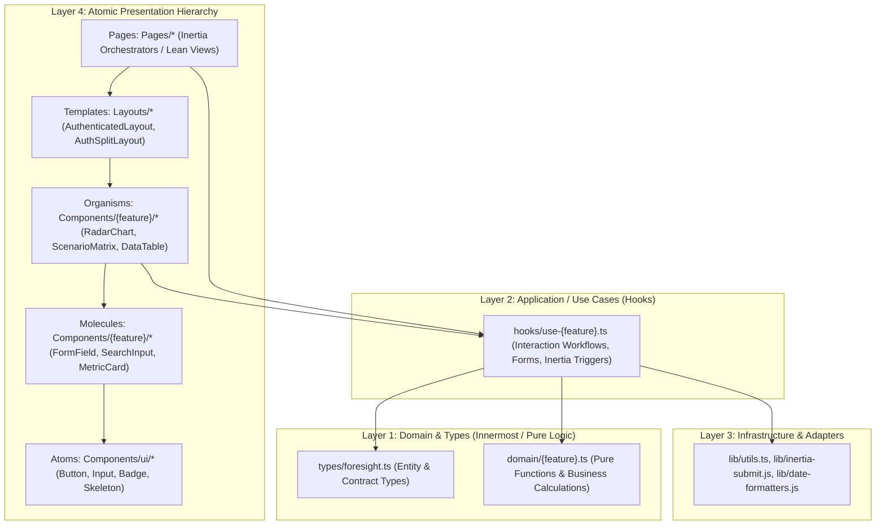

# Frontend Architecture Standards: Clean Architecture & Atomic Design System

## 1. Executive Summary

Foresight Radar adopts a unified frontend architecture combining **Clean Architecture** (separation of domain logic, application use cases, and presentation) with **Atomic Design** (hierarchical UI composition from atoms to pages).

This structure guarantees:
1. **Zero Domain Logic in Pages/Components:** UI components remain presentational and testable.
2. **High Reusability & Consistency:** UI primitives (shadcn/ui + Radix UI) act as atomic building blocks.
3. **Decoupled Business Logic:** Calculations (e.g. 2x2 matrix coordinates, causal loop polarities, priority scores) can be unit-tested without mounting React components or mocking the Inertia router.
4. **Predictable State Flow:** Inertia page props act as the single source of server truth; custom hooks manage UI interaction workflows.

---

## 2. Architectural Blueprint & Layer Mapping

---

## 3. Atomic Design Hierarchy Breakdown

### Level 1: Atoms (`resources/js/Components/ui/`)
- **Definition:** The indivisible base building blocks. Wrapped around Radix UI primitives and styled with Tailwind CSS v4.
- **Constraints:**
  - Zero business logic, zero state (except transient local visual state like focus/hover).
  - Must accept `className`, `children`, and standard HTML/Radix attributes.
  - Examples: `Button`, `Input`, `Badge`, `Checkbox`, `Switch`, `Skeleton`, `Label`, `Avatar`.

### Level 2: Molecules (`resources/js/Components/molecules/` or composite primitives)
- **Definition:** Simple combinations of 2 or more Atoms that serve a single focused function.
- **Constraints:**
  - Stateless or purely local visual toggles.
  - No direct calls to `router.post()` or Inertia page hooks; receive event callbacks via props.
  - Examples:
    - `FormField` (`Label` atom + `Input` atom + error text).
    - `ThemeToggle` (`Switch` atom + Sun/Moon icons).
    - `CitationBadge` (`Badge` atom + external link icon + dialog trigger).
    - `SearchInput` (`Input` atom + Lucide `Search` icon + clear button).

### Level 3: Organisms (`resources/js/Components/{Feature}/`)
- **Definition:** Complex, distinct UI sections composed of molecules, atoms, and other sub-components.
- **Constraints:**
  - Encapsulate a complete functional section of a page.
  - May subscribe to custom use-case hooks or receive domain data objects.
  - Examples:
    - `RadarVisualization` (`Components/Radar/RadarChart.jsx`): SVG coordinate plane, concentric horizon circles, quadrant markers, and tooltip cards.
    - `ScenarioMatrix` (`Components/Scenario/ScenarioMatrix.jsx`): 2x2 grid containing 4 quadrant cards, early indicators, and evidence dialog triggers.
    - `DataTable` (`Components/ui/data-table.jsx`): TanStack table with search filter molecule, pagination atom, and row action menus.

### Level 4: Templates / Layouts (`resources/js/Layouts/`)
- **Definition:** Page-level wireframes and shells that define structural layouts across the platform.
- **Constraints:**
  - Define navigation bars, sidebars, drawer menus, responsive viewports, and slots (`{children}`).
  - Do not handle feature-specific data; accept layout-level props (`user`, `breadcrumbs`, `title`).
  - Examples:
    - `AuthenticatedLayout.jsx`: Persistent responsive sidebar, top navbar, theme toggle, user profile menu, main content area.
    - `AuthSplitLayout.jsx`: 50/50 split authentication layout with strategic carousel on the left and form card on the right.

### Level 5: Pages (`resources/js/Pages/`)
- **Definition:** The Inertia Page Components invoked by Laravel controllers via `Inertia::render()`.
- **Constraints (The "Lean Page" Rule):**
  - **Maximum 100–150 lines of code.**
  - **No inline math or complex transformations:** Delegate to `domain/` functions.
  - **No raw HTTP/axios calls:** Delegate to Use-Case hooks or Inertia form helpers.
  - **Role:** Purely an **Orchestrator** that:
    1. Reads `page.props` from Laravel.
    2. Initializes the feature's Use-Case hook (`useScenarioMatrix`, `useRadarFilter`).
    3. Wraps the page in the appropriate `Layout`.
    4. Passes props and callbacks to child Organisms.

---

## 4. Clean Architecture Directory & File Placement Rules

| Layer | Directory Path | Allowed Dependencies | Prohibited Dependencies |
| :--- | :--- | :--- | :--- |
| **Domain Entities & Types** | `resources/js/types/` | Pure TypeScript | React, DOM, Inertia, Tailwind |
| **Domain Logic & Math** | `resources/js/domain/` | Pure JS/TS, `types/` | React Hooks, Inertia router, DOM |
| **Use Cases / Application Hooks** | `resources/js/hooks/` | Domain logic, Inertia router, React hooks, `lib/` | Raw JSX / HTML markup |
| **Infrastructure & Utilities** | `resources/js/lib/` | Pure JS/TS, external utility libraries (`date-fns`, `clsx`) | React components, domain entities |
| **Atomic UI Primitives** | `resources/js/Components/ui/` | React, Radix UI, `lib/utils` (`cn`), CVA | Inertia router, Domain entities |
| **Feature Organisms** | `resources/js/Components/{Feature}/` | Atoms, Molecules, `domain/`, `types/`, Use-Case hooks | Direct Laravel DB knowledge, Fat controller logic |
| **Layouts** | `resources/js/Layouts/` | Atoms, Navigation components, Header/Footer | Feature-specific business rules |
| **Inertia Pages** | `resources/js/Pages/` | Layouts, Organisms, Use-Case hooks, `types/` | Raw API fetching, deep JSX nesting > 150 lines |

---

## 5. Code Review Quality Gate (Strict Prohibitions)

When reviewing or writing code, reject the following patterns:

1. ❌ **Fat Page Anti-Pattern:** A file in `resources/js/Pages/` containing complex array filters, math calculations, coordinate mapping, and 300+ lines of JSX.
2. ❌ **Leaking Inertia Router into Atoms:** Passing `router` directly into a `Button` or `Badge`. Use standard event callbacks (`onClick`) or wrap with `<Link>`.
3. ❌ **Duplicate Form Validation:** Re-implementing validation rules already defined in Laravel `FormRequest` unless instant client-side feedback is specifically required via `useDialogForm` + Zod.
4. ❌ **Importing Ant Design:** Foresight Radar strictly uses Radix UI + `shadcn/ui` + Tailwind v4. Any import of `'antd'` is a critical violation.
5. ❌ **Direct DOM Manipulation:** Never use `document.getElementById` or `window.addEventListener` inside presentational atoms; utilize React refs and lifecycle hooks in custom hooks.

