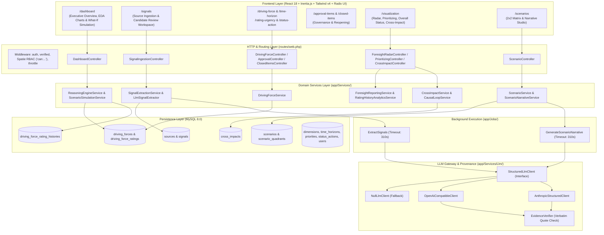
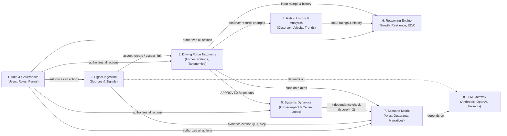
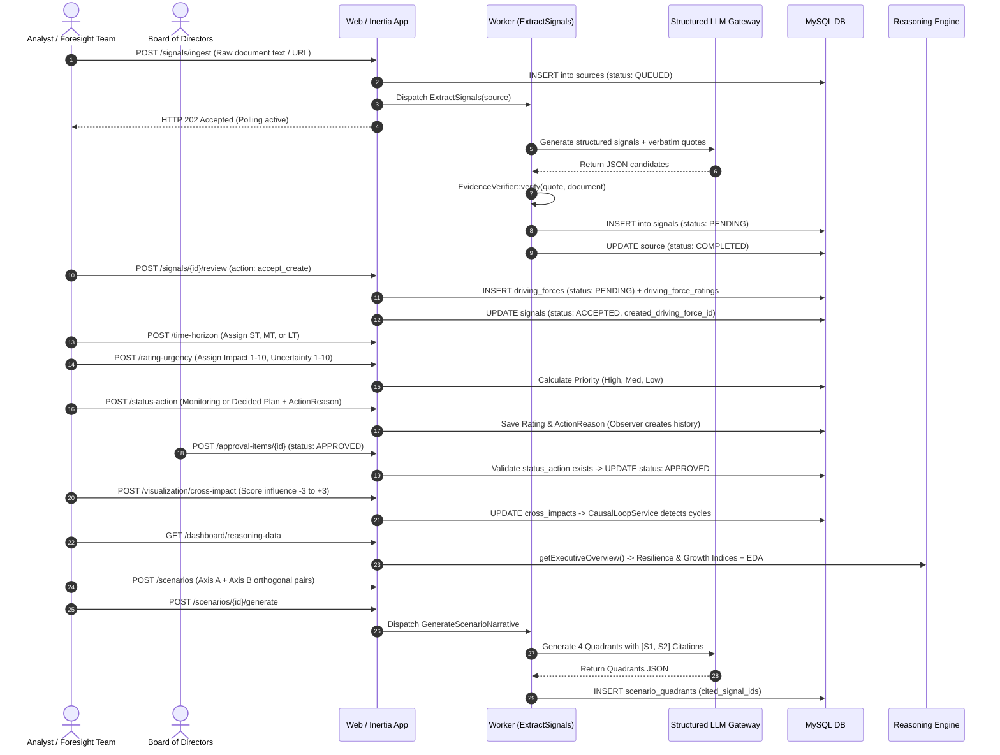
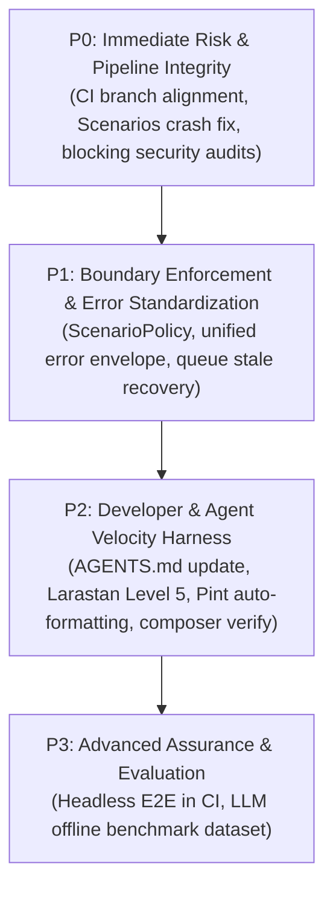
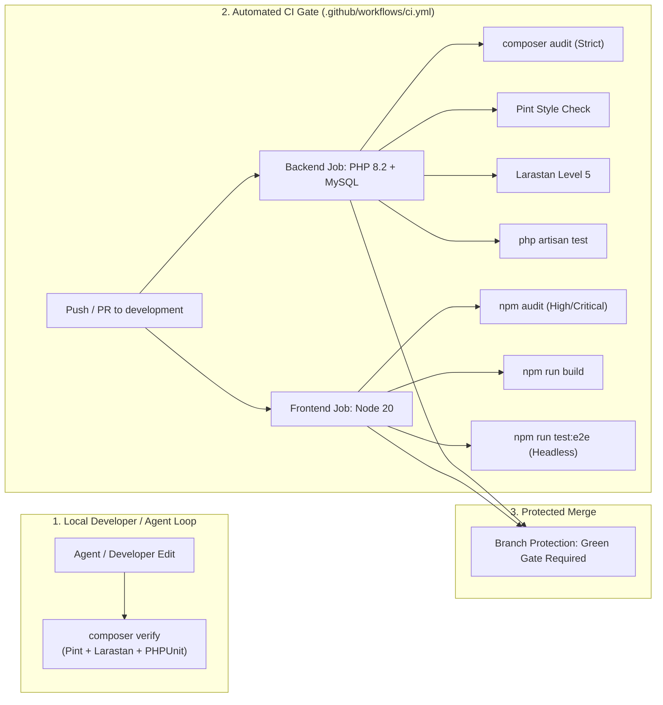

# Foresight Radar — Harness Engineering Baseline Audit

**Repository:** `https://github.com/roozylabs27/foresight-radar`  
**Branch Inspected:** `development` (Commit [`720db61`](file:///c:/laragon/www/foresight-radar))  
**Date of Audit:** October 21, 2026  
**Auditor:** Antigravity AI Pair Engineer  
**Scope:** Architecture, Domain Workflows, Security & Data Integrity, Reliability, Performance, Test Quality, and Agent Harness Infrastructure.

---

## 1. Executive Summary

Foresight Radar is a production-grade strategic foresight and executive intelligence platform built with **Laravel 10.48.17 (PHP 8.2)**, **Inertia.js**, and **React 18**. Over recent iterations, the system migrated its presentation layer from Ant Design v5 to **shadcn/ui + Radix UI + Tailwind CSS v4**, implemented an asynchronous structured LLM processing pipeline (supporting Anthropic Claude and OpenAI-compatible multi-providers with background queue workers), and established a rule-based executive reasoning engine with 2x2 scenario matrix simulation and systems-dynamics causal-loop detection.

### Engineering Maturity: Level 2+ (Emerging Disciplined)

| Dimension | Rating | Core Strength | Key Vulnerability / Bottleneck |
| :--- | :---: | :--- | :--- |
| **Backend Architecture** | **B+** | Clean domain services, typed Eloquent relations, atomic database transactions for critical state transitions. | Direct model instantiations inside controllers (`SignalIngestionController::review`); missing model policies for Scenarios & Signals. |
| **Data Integrity & Schema** | **B** | Enforced foreign keys, UUID indexes, state machine with strict transition guards (`DrivingForceStatus`). | Soft-delete reference asymmetry between `DrivingForce` and `Scenario`; unhandled nulls in UI. |
| **Reliability & LLM Gateway** | **A-** | Verbatim quote verification (`EvidenceVerifier`), dual-provider failover, deterministic offline heuristic fallbacks. | `Source` extraction lacks stale job recovery; missing pessimistic lock on concurrent narrative generation. |
| **Test Quality & Coverage** | **B+** | 208 passing PHPUnit tests (1,000 assertions); 13 comprehensive E2E specs; `FakeLlmClient` fixtures. | Zero static analysis (no PHPStan/Larastan); CI runs `coverage: none`; E2E not run in CI. |
| **CI/CD & Operational Harness**| **C+** | Docker Compose multi-container setup; isolated queue worker; MySQL service in CI. | **CI branch mismatch**: triggers on `[dev, develop]`, ignoring active branch `development`; audits non-blocking. |
| **Agent / Harness Readiness** | **C** | Addy Osmani skills structure in `.agents/skills/`. | **Stale instructions**: `AGENTS.md` mandates Ant Design v5 despite complete shadcn/Radix migration. |

---

## 2. Verified Repository Architecture Map



### Physical Directory Topology

```text
├── app/
│   ├── Enums/                 # DrivingForceStatus, LlmJobStatus, PriorityLevel, TimeHorizonType
│   ├── Http/
│   │   ├── Controllers/       # 15 Thin/Hybrid controllers (Inertia + JSON responses)
│   │   ├── Middleware/        # HandleInertiaRequests, SecurityHeaders
│   │   ├── Requests/          # 12 FormRequest validators with typed rules
│   │   └── Resources/         # Inertia/API JSON transformation resources
│   ├── Jobs/                  # ExtractSignals, GenerateScenarioNarrative (DB queue)
│   ├── Models/                # 15 Eloquent models with relations, casts, soft deletes
│   ├── Observers/             # DrivingForceRatingObserver (populates rating histories)
│   ├── Policies/              # DrivingForcePolicy, UserPolicy (Gap: missing Scenario/Signal policies)
│   ├── Services/              # 11 Domain services encapsulating business logic & math
│   │   ├── Extraction/        # LlmSignalExtractor
│   │   └── Llm/               # Anthropic, OpenAI-compatible, Null client, Prompt generators
│   └── Support/               # EvidenceVerifier, TableSort
├── database/
│   ├── data/                  # 12 JSON reference seed files (strictly zero Lorem Ipsum)
│   ├── migrations/            # 18 schema migrations with indexes & foreign keys
│   └── seeders/               # DatabaseSeeder, DefaultSystemSeeder, DrivingForceSeeder, UserSeeder
├── docker/                    # Nginx config, PHP 8.2 FPM configs
├── resources/js/
│   ├── Components/            # TanStack DataTable, Recharts EDA, AnalysisFilters, UI primitives
│   │   └── ui/                # shadcn/ui components (Radix UI wrappers)
│   ├── Layouts/               # AuthenticatedLayout, GuestLayout, AuthSplitLayout
│   └── Pages/                 # 14 Inertia Page workspaces
└── tests/
    ├── Feature/               # 48 feature tests (Auth, LLM, Performance, Reasoning, Reliability, Security)
    ├── Unit/                  # 6 unit tests (CausalLoop, EvidenceVerifier, PriorityCalculation, WordCount)
    └── e2e/                   # 13 E2E test specs (Playwright/@e2e-dev/web)
```

---

## 3. Module Dependency Map



### Module Boundary Coupling Analysis

1. **`Signals` → `DrivingForces` (Tight Coupling via Controller)**:
   - File: [`app/Http/Controllers/SignalIngestionController.php#L214-L257`](file:///c:/laragon/www/foresight-radar/app/Http/Controllers/SignalIngestionController.php#L214-L257)
   - When an analyst clicks `accept_create`, the controller directly creates the `DrivingForce` and `DrivingForceRating` models inline rather than delegating to `DrivingForceService`.
2. **`Scenarios` → `CrossImpact` (Soft Coupling via Domain Rule)**:
   - File: [`app/Services/ScenarioService.php#L53-L60`](file:///c:/laragon/www/foresight-radar/app/Services/ScenarioService.php#L53-L60)
   - Axes selection requires cross-impact influence $|score| < 2$ and distinct dimensions to enforce orthogonal scenario axes. Clean, domain-appropriate coupling.
3. **`Scenarios` → `Signals` (Evidence Provenance Coupling)**:
   - File: [`app/Services/ScenarioNarrativeService.php#L147-L155`](file:///c:/laragon/www/foresight-radar/app/Services/ScenarioNarrativeService.php#L147-L155)
   - A scenario narrative requires both axes to have `ACCEPTED` signals. If either axis lacks evidence, the LLM call is blocked (or generates a skeleton template).
4. **`DrivingForceRatingObserver` → `DrivingForceRatingHistory` (Event-driven Coupling)**:
   - File: [`app/Observers/DrivingForceRatingObserver.php#L22-L42`](file:///c:/laragon/www/foresight-radar/app/Observers/DrivingForceRatingObserver.php#L22-L42)
   - Rating changes trigger history entries automatically without controller overhead.

---

## 4. End-to-End Workflow and Gap Analysis

### Complete Lifecycle: Signal Ingestion to Executive Insight



### Verified Implementation Gaps & Disconnected Transitions

1. **Orphan Driving Force on Missing Horizon**:
   - *Flow*: `POST /signals/{id}/review` with `accept_create`.
   - *Evidence*: [`SignalIngestionController.php#L232-L241`](file:///c:/laragon/www/foresight-radar/app/Http/Controllers/SignalIngestionController.php#L232-L241). If `$signal->suggested_time_horizon_id` is null, `DrivingForceRating` is not created.
   - *Gap*: The driving force enters `PENDING` status, but without a rating record, it never appears in `/rating-urgency` or `/status-action`. It requires the analyst to know they must visit `/time-horizon` first.
2. **Soft-Delete Inconsistency Across Modules**:
   - *Flow*: Analyst deletes an approved driving force that is currently assigned as Axis A or B in a Scenario.
   - *Evidence*: `DrivingForce` uses `SoftDeletes` ([`app/Models/DrivingForce.php#L25`](file:///c:/laragon/www/foresight-radar/app/Models/DrivingForce.php#L25)). `Scenario` uses foreign key `cascadeOnDelete` ([`database/migrations/2026_10_16_000004_create_scenarios_tables.php#L30`](file:///c:/laragon/www/foresight-radar/database/migrations/2026_10_16_000004_create_scenarios_tables.php#L30)).
   - *Gap*: Soft deletion does not trigger MySQL cascade delete. The scenario still points to the soft-deleted force ID. In `ScenarioController::fetch()`, `$scenario->axis_a` resolves to `null`. In [`resources/js/Pages/Report/Scenarios.jsx#L430`](file:///c:/laragon/www/foresight-radar/resources/js/Pages/Report/Scenarios.jsx#L430), the UI attempts `scenario.axis_a.keyword`, throwing an uncaught JavaScript error and breaking the page.
3. **Queue Worker Stale Job Recovery Asymmetry**:
   - *Flow*: A background worker crashes or is OOM-killed while processing an extraction.
   - *Evidence*: `ScenarioNarrativeService::queue()` has a 360-second stale job check ([`app/Services/ScenarioNarrativeService.php#L47-L50`](file:///c:/laragon/www/foresight-radar/app/Services/ScenarioNarrativeService.php#L47-L50)).
   - *Gap*: `SignalExtractionService::ingest()` has NO stale check. If `ExtractSignals` dies, `Source::extraction_status` remains `PROCESSING` permanently, leaving the user interface showing an infinite spinner.

---

## 5. Security, Reliability, Performance, and Testing Findings

### Finding 1: Unrestricted Deletion of Scenarios Across Analysts
- **Severity**: High | **Confidence**: Verified (Tier 2)
- **Location**: [`app/Http/Controllers/ScenarioController.php#L103-L108`](file:///c:/laragon/www/foresight-radar/app/Http/Controllers/ScenarioController.php#L103-L108), [`routes/web.php#L74`](file:///c:/laragon/www/foresight-radar/routes/web.php#L74)
- **Evidence**: `ScenarioController::destroy()` performs `$scenario->delete()` guarded only by the route-level permission `can('manage-scenario')`. No model-level policy or creator verification exists.
- **Realistic Failure Scenario**: Analyst A creates a multi-quadrant scenario. Analyst B (also possessing `manage-scenario`) accidentally or intentionally issues `DELETE /scenarios/{id}`, permanently destroying Analyst A's work without audit logging or recovery.
- **Potential Impact**: Irreversible data loss of executive strategic scenarios; absence of role-based creator boundaries.
- **Recommended Remediation**: Create `ScenarioPolicy` checking `$user->id === $scenario->created_by || $user->hasRole('admin')`, and bind `$this->authorize('delete', $scenario)`.
- **Harness Enforcement**: Implement an automated authorization test in `tests/Feature/Security/ScenarioAuthorizationTest.php`.

---

### Finding 2: Client Crash When Scenario Axis Driving Force Is Soft-Deleted
- **Severity**: High | **Confidence**: Verified (Tier 2)
- **Location**: [`resources/js/Pages/Report/Scenarios.jsx#L427-L432`](file:///c:/laragon/www/foresight-radar/resources/js/Pages/Report/Scenarios.jsx#L427-L432)
- **Evidence**:
  ```jsx
  {scenario.axis_a.keyword}: {scenario.axis_a.low} ← → {scenario.axis_a.high}
  ```
  `scenario.axis_a` is rendered directly without optional chaining (`?.keyword`).
- **Realistic Failure Scenario**: An administrator deletes or soft-deletes a driving force that had previously been selected as an axis. When any analyst visits `/scenarios`, the entire Inertia component crashes with `TypeError: Cannot read properties of null (reading 'keyword')`.
- **Potential Impact**: Complete Denial of Service for the Scenarios workspace.
- **Recommended Remediation**: Add defensive null-handling (`scenario.axis_a?.keyword ?? "Faktor Dihapus"`) and enforce foreign-key or soft-delete guards preventing deletion of driving forces active in scenarios.
- **Harness Enforcement**: Add a Playwright E2E assertion in `tests/e2e/scenarios.e2e.ts` verifying rendering resilience when an axis force is soft-deleted.

---

### Finding 3: CI Quality Gate Bypassed on Main Development Branch
- **Severity**: High | **Confidence**: Verified (Tier 2)
- **Location**: [`.github/workflows/ci.yml#L4-L7`](file:///c:/laragon/www/foresight-radar/.github/workflows/ci.yml#L4-L7)
- **Evidence**:
  ```yaml
  on:
    push:
      branches: [main, master, dev, develop]
    pull_request:
      branches: [main, master, dev, develop]
  ```
- **Realistic Failure Scenario**: The team pushes commits or opens PRs against the primary working branch `development`. GitHub Actions does NOT trigger because `development` is missing from the branch filter. Broken builds or failing tests can be merged undetected.
- **Potential Impact**: Regression leakage into primary branches; false confidence in CI status.
- **Recommended Remediation**: Update `ci.yml` branch filter to include `development` and `feat/**`.
- **Harness Enforcement**: GitHub branch protection rule requiring `Backend Tests` and `Frontend Build` checks before merge.

---

### Finding 4: Security Audit Checks Are Non-Blocking in CI
- **Severity**: Medium | **Confidence**: Verified (Tier 2)
- **Location**: [`.github/workflows/ci.yml#L41-L43`](file:///c:/laragon/www/foresight-radar/.github/workflows/ci.yml#L41-L43), [`.github/workflows/ci.yml#L77-L79`](file:///c:/laragon/www/foresight-radar/.github/workflows/ci.yml#L77-L79)
- **Evidence**:
  ```yaml
  - name: Composer Security Audit
    run: composer audit
    continue-on-error: true

  - name: NPM Security Audit
    run: npm audit --audit-level=high
    continue-on-error: true
  ```
- **Realistic Failure Scenario**: A package with a critical CVE is introduced via Composer or NPM. CI continues and turns green due to `continue-on-error: true`.
- **Potential Impact**: Deployment of vulnerable third-party dependencies to production.
- **Recommended Remediation**: Remove `continue-on-error: true` or configure a strict audit policy file allowing only verified false positives.
- **Harness Enforcement**: CI gate halts job on high or critical vulnerability findings.

---

### Finding 5: Heterogeneous API Error Envelopes Across Endpoints
- **Severity**: Medium | **Confidence**: Verified (Tier 2)
- **Location**: [`app/Http/Controllers/Concerns/HandlesApiErrors.php#L21-L24`](file:///c:/laragon/www/foresight-radar/app/Http/Controllers/Concerns/HandlesApiErrors.php#L21-L24), [`app/Http/Controllers/RegisteredListController.php#L60-L63`](file:///c:/laragon/www/foresight-radar/app/Http/Controllers/RegisteredListController.php#L60-L63), [`app/Http/Controllers/ApprovalController.php#L62-L66`](file:///c:/laragon/www/foresight-radar/app/Http/Controllers/ApprovalController.php#L62-L66)
- **Evidence**:
  - `SignalIngestionController`: returns `{ "errors": "..." }`
  - `RegisteredListController`: returns `{ "message": "..." }`
  - `ApprovalController`: returns `{ "statusCode": 422, "errors": "...", "message": "..." }`
- **Realistic Failure Scenario**: A frontend toast handler expects `error.response.data.message`, but receives `{ errors: "..." }`. The user sees a blank error toast `"undefined"` instead of the actual error description.
- **Potential Impact**: Degraded UX; difficulty in programmatic error interception and automated API contract testing.
- **Recommended Remediation**: Unify `HandlesApiErrors` to always return standard RFC 7807 problem details or a consistent `{ message: string, errors?: Record<string, string[]> }` structure.
- **Harness Enforcement**: Automated contract test checking that all 5xx and 4xx responses adhere to the standard schema.

---

### Finding 6: Code Style Drift and Missing Static Analysis Enforcement
- **Severity**: Low | **Confidence**: Verified (Tier 2)
- **Location**: Root repository configuration; `./vendor/bin/pint --test`
- **Evidence**: Running `pint --test` reports:
  ```text
  FAIL: 222 files, 93 style issues
  ```
  Neither `pint --test` nor PHPStan/Larastan is integrated into CI or git pre-commit hooks.
- **Realistic Failure Scenario**: AI agents and developers generate contrasting formatting and unnoticed type mismatches, bloating git diffs and allowing silent type errors.
- **Potential Impact**: Accumulation of technical debt and unvalidated edge cases.
- **Recommended Remediation**: Add Pint formatting check and Larastan (Level 5) to `.github/workflows/ci.yml`.
- **Harness Enforcement**: `composer verify` script running Pint, PHPStan, and PHPUnit in sequence.

---

## 6. Current Harness Maturity Assessment

| Harness Dimension | Status | Verified Evidence |
| :--- | :---: | :--- |
| **1. Agent Instructions & Navigation** | **Partially Implemented** | `.agents/skills/` contains comprehensive Addy Osmani skills; however, `AGENTS.md` is stale with legacy Ant Design v5 guidance. |
| **2. Architecture & Domain Specs** | **Implemented & Verified** | Extensive markdown specifications exist in `docs/` (`REASONING_ENGINE.md`, `SIGNAL_TO_INSIGHT_SPEC.md`, `LLM_INTEGRATION.md`). Note: excluded from git via `.gitignore`. |
| **3. Standardized Commands** | **Implemented & Verified** | Dockerized environment (`docker compose exec app php artisan ...`), npm build scripts, Playwright E2E commands (`npm run test:e2e`). |
| **4. Deterministic Fixtures & Data** | **Implemented & Verified** | `FakeLlmClient` permits 100% deterministic offline LLM testing; JSON seeders (`action_reason.json`, `synthetic_user.json`) ensure synthetic data consistency. |
| **5. Multi-Layer Testing** | **Implemented & Verified** | **208 PHPUnit tests (1,000 assertions)** passing; **13 E2E test files** covering critical UI flows. |
| **6. Static Analysis & Linting** | **Missing** | No PHPStan / Larastan installed; no ESLint configured in `package.json`; Pint exists but fails 93 files and is not run in CI. |
| **7. Architecture Enforcement** | **Missing** | No automated layer boundary enforcement (e.g., Deptrac, ArchUnitPHP) preventing controller-to-model direct coupling. |
| **8. Security Quality Gates** | **Partially Implemented** | Docker non-root and rate limiting verified; however, `composer audit` and `npm audit` are non-blocking (`continue-on-error: true`). |
| **9. CI Quality Gates** | **Partially Implemented** | CI runs backend tests and frontend build; however, active branch `development` is omitted, and E2E tests are omitted from CI. |
| **10. LLM Evaluation & Regression** | **Partially Implemented** | Provenance tracked (`prompt_version`, `model`, `cited_signal_ids`); verbatim quote checking enforced; but no automated offline benchmark dataset measuring extraction precision/recall. |
| **11. Isolated Workspaces** | **Implemented & Verified** | Docker Compose provides full multi-container isolation (`laravel_app`, `laravel_queue`, `laravel_nginx`, `laravel_mysql`). |
| **12. Technical Debt Tracking** | **Partially Implemented** | Remediation roadmaps exist in `docs/roadmap/`; requires synchronization with codebase reality. |

---

## 7. Prioritized Remediation Backlog



| ID | Priority | Module | Task Description | Est. Effort |
| :--- | :---: | :--- | :--- | :---: |
| **REM-01** | **P0** | CI/CD | Add `development` and `feat/**` to `.github/workflows/ci.yml`. | 15 mins |
| **REM-02** | **P0** | Frontend | Add defensive null checks in `Scenarios.jsx` for soft-deleted driving forces. | 30 mins |
| **REM-03** | **P0** | CI/CD | Remove `continue-on-error: true` from `composer audit` and `npm audit`. | 15 mins |
| **REM-04** | **P1** | Security | Implement `ScenarioPolicy` and enforce creator/admin ownership checks. | 1 hour |
| **REM-05** | **P1** | Architecture | Standardize API error envelope across all controllers using `HandlesApiErrors`. | 2 hours |
| **REM-06** | **P1** | Reliability | Implement stale job recovery in `SignalExtractionService` for interrupted queues. | 1 hour |
| **REM-07** | **P2** | Agent Harness | Update `AGENTS.md` and `.agents/` to reflect shadcn/ui + Radix UI + Tailwind v4. | 1 hour |
| **REM-08** | **P2** | Quality Gate | Install Larastan at Level 5 and resolve style issues with `pint`. | 3 hours |
| **REM-09** | **P2** | Quality Gate | Add unified `composer verify` script (`pint --test && phpstan && php artisan test`). | 30 mins |
| **REM-10** | **P3** | Testing | Add headless E2E Playwright run to GitHub Actions CI workflow. | 2 hours |
| **REM-11** | **P3** | LLM Harness | Create offline benchmark dataset for LLM signal extraction scoring. | 4 hours |

---

## 8. Proposed Minimum Viable Harness Architecture

The Minimum Viable Harness (MVH) introduces **zero heavyweight infrastructure or external SaaS dependencies**. It leverages existing tools (Composer, Artisan, Docker, GitHub Actions, Playwright) to turn implicit agent guidelines into automated, self-verifying guardrails.



---

## 9. Suggested Documentation and Verification File Structure

To ensure that both human developers and autonomous AI agents have unambiguous, deterministic operating rules:

```text
├── AGENTS.md                          # Primary AI entry point (Purged of AntD; describes shadcn/Radix/Tailwind v4)
├── .github/
│   └── workflows/
│       └── ci.yml                     # Aligned branch triggers, blocking audits, Pint, Larastan, PHPUnit
├── phpstan.neon.dist                  # Larastan Level 5 configuration (baseline paths & types)
├── composer.json                      # Added "verify" script: pint --test && phpstan && php artisan test
├── .agents/
│   ├── ARCHITECTURE.md                # Tracked copy of core architecture & module boundaries
│   ├── CONTRACTS.md                   # Unified API request/response schema specifications
│   └── references/
│       ├── definition-of-done.md      # Updated DoD including Larastan & E2E passes
│       └── prompt-standards.md        # Verbatim quote & structured JSON guidelines
```

---

## 10. Phased Implementation Plan with Acceptance Criteria

### Phase 1: Pipeline & Security Hardening (P0 — Days 1–2)
1. **CI Branch Alignment & Strict Audits**:
   - *Target*: `.github/workflows/ci.yml`
   - *Acceptance Criteria*: Pushes to `development` trigger CI; composer and npm security audits block the pipeline on vulnerabilities.
2. **Defensive UI Axis Rendering**:
   - *Target*: `resources/js/Pages/Report/Scenarios.jsx`
   - *Acceptance Criteria*: Soft-deleting a driving force leaves the Scenarios table and detail view operational without uncaught JavaScript exceptions.

### Phase 2: Architecture & Contract Consistency (P1 — Days 3–4)
1. **Scenario Authorization Policy**:
   - *Target*: `app/Policies/ScenarioPolicy.php`, `ScenarioController.php`
   - *Acceptance Criteria*: Non-admin users cannot delete scenarios created by other analysts (`403 Forbidden`).
2. **API Error Envelope Standardization**:
   - *Target*: `app/Http/Controllers/Concerns/HandlesApiErrors.php`
   - *Acceptance Criteria*: All JSON error responses share a standard schema; `InformationDisclosureTest` validates consistency across all modules.
3. **Queue Interruption Stale Recovery**:
   - *Target*: `app/Services/SignalExtractionService.php`
   - *Acceptance Criteria*: Sources stuck in `PROCESSING` for > 360 seconds can be retried or reset.

### Phase 3: Agent Harness & Static Analysis (P2 — Days 5–6)
1. **Agent Context Modernization**:
   - *Target*: `AGENTS.md`
   - *Acceptance Criteria*: All Ant Design references removed; accurate shadcn/ui and Radix guidelines provided for future agent sessions.
2. **Larastan & Pint Integration**:
   - *Target*: `composer.json`, `phpstan.neon.dist`
   - *Acceptance Criteria*: `composer verify` runs Pint, Larastan Level 5, and PHPUnit cleanly with zero errors.

### Phase 4: Headless E2E Verification in CI (P3 — Days 7–8)
1. **CI E2E Pipeline**:
   - *Target*: `.github/workflows/ci.yml`
   - *Acceptance Criteria*: Playwright/@e2e-dev/web runs smoke and critical lifecycle tests in headless Chromium as a required CI stage.

