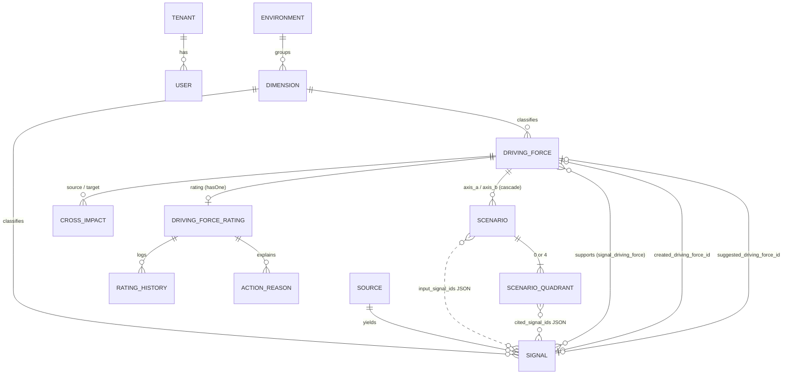
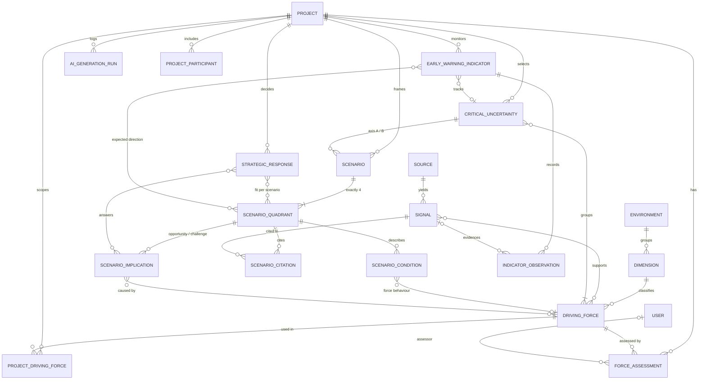

# Scenario Planning Data Model Gap Analysis

**Date:** 2026-10-30
**Scope:** Can the schema represent the nine-step method? Proposals only; **no migrations are created in this phase**.
**Evidence base:** `database/migrations/*`, `app/Models/*`, `database/data/*.json`. Gap IDs refer to `docs/audit/SCENARIO_PLANNING_FEATURE_AUDIT.md` §6.

---

## 1. Existing Relevant Entities

| Table | Key columns | Tenant | Notes |
|---|---|---|---|
| `environments` | `name` (Macro, Mezzo) | Global | Seeded from `database/data/environment.json` |
| `dimensions` | `environment_id`, `name` | Global | 8 rows; see taxonomy gap G03 |
| `sources` | `title`, `url`, `publisher`, `published_at`, `raw_content`, `content_hash`, `extraction_meta`, `extraction_status/error` | Yes | Raw evidence |
| `signals` | `source_id`, `dimension_id`, `title`, `summary`, `significance`, `evidence_quote`, `quote_verified`, `preliminary_impact/uncertainty`, `confidence_score/rationale`, `is_ai_generated`, `review_status`, `reviewed_by/at`, `rejection_reason`, `created_driving_force_id`, `suggested_driving_force_id`, `extraction_provider/model`, `prompt_version` | Yes | Strong provenance |
| `signal_driving_force` | `signal_id`, `driving_force_id`, `notes` | (via parents) | M:N evidence link, unique pair |
| `driving_forces` | `dimension_id`, `keyword`, `description`, `pic`, `status`, `remark`, `approved_at`, `closed_at`, `created_by/updated_by`, soft delete | Yes | Tenant-wide library |
| `driving_force_ratings` | `driving_force_id`, `time_horizon_id`, `status_action_id`, `priority_id`, `impact_analysis`, `uncertainty_analysis`, soft delete | Yes | One per force in practice (`hasOne`, `updateOrCreate`); no DB unique constraint |
| `driving_force_rating_histories` | snapshot of rating fields, `event`, `changed_by`, `changed_at` | Yes | Append-only, observer-written |
| `action_reasons` | `driving_force_rating_id`, `status_action_id`, `date`, `reason` | — | Monitoring / Decided Plan log |
| `time_horizons`, `priorities`, `status_actions` | lookups | Global | |
| `cross_impacts` | `source_driving_force_id`, `target_driving_force_id`, `score` −3..+3, `note` | Yes | Unique pair |
| `scenarios` | `name`, `focal_question`, `axis_a_force_id`, `axis_b_force_id`, four pole labels, `status` DRAFT/FINAL, `provider`, `model`, `prompt_version`, `input_signal_ids` (JSON), `generated_at`, `generation_status/error/notice` | Yes | 2×2 header |
| `scenario_quadrants` | `scenario_id`, `position` HH/HL/LH/LL, `title`, `narrative`, `implications`, `early_indicators` (JSON), `cited_signal_ids` (JSON), `is_ai_generated`, `provider`, `edited_by/at` | Yes | Unique (scenario, position) |
| `tenants`, `users`, `tenant_invitations`, roles/permissions | | | Collaboration base |
| `user_llm_settings`, `tenant_llm_settings` | encrypted keys, provider, model | Yes | Tenant setting appears unused (G24, Needs Verification) |

## 2. Current Relationships (ERD)

Dotted lines are JSON arrays, not foreign keys.

## 3. Coverage Against the Audit Checklist

| Concept | Representation today | Status | Gap |
|---|---|---|---|
| Scenario planning project | — | Missing | G01 |
| Focal issue | `scenarios.focal_question` (optional, per matrix) | Partial | G01 |
| Signals | `signals` | Implemented | — |
| Evidence and sources | `sources`, `evidence_quote`, `quote_verified` | Implemented | — |
| Driving forces | `driving_forces` | Implemented (tenant-wide) | G02 |
| Macro / mezzo classification | `environments` → `dimensions` | Partial (8 of 11 categories) | G03 |
| Uncertainty / impact assessments | `driving_force_ratings` | Partial (one shared value, no rationale) | G07, G08 |
| Expert assessments | — | Missing | G07 |
| Critical uncertainties | implicit: two axis FKs | Missing | G09 |
| Scenario dimensions | axis FK + force keyword | Partial | G09 |
| Scenario poles | four label columns | Implemented | — |
| Scenario frameworks | `scenarios` | Partial (no approval, quadrants created late) | G11 |
| Scenario quadrants | `scenario_quadrants` | Implemented | — |
| Scenario descriptions / conditions | — | Missing | G12 |
| Scenario narratives | `scenario_quadrants.narrative` | Implemented | G13, G14 |
| Challenges | inside `implications` text | Partial | G15 |
| Opportunities | inside `implications` text | Partial | G15 |
| Strategic responses | — | Missing | G17 |
| Early warning indicators | `early_indicators` JSON strings | Partial | G18 |
| Monitoring observations | — | Missing | G19 |
| AI generation metadata | columns on `signals`, `sources.extraction_meta`, `scenarios` | Partial (per table, inconsistent) | — |
| Human reviews and approvals | `signals.review_status`, `driving_forces.status/approved_at`, `scenario_quadrants.edited_*` | Partial | G11, G14, G17 |

## 4. Structural Problems Found

| # | Problem | Evidence | Consequence |
|---|---|---|---|
| D1 | **No aggregate root.** Nothing groups the artefacts of one exercise | No project table | Two exercises share one score per force; scenarios cannot be traced to the force list they were based on |
| D2 | **Wrong cardinality for assessments.** One rating per force, tenant-wide | `DrivingForce::rating()` hasOne; `TimeHorizonController::create` `updateOrCreate` | Impact/uncertainty depend on the focal issue but cannot differ per exercise; no per-expert values |
| D3 | **Wrong cardinality for axes.** An axis is one force | `scenarios.axis_a_force_id` | Cannot model "Government Regulation" = Politic + Legislative |
| D4 | **Evidence references in JSON.** | `scenarios.input_signal_ids`, `scenario_quadrants.cited_signal_ids` | No referential integrity; deleted signals become "Sinyal sudah dihapus"; cannot query "which scenarios cite this signal" |
| D5 | **Unstructured downstream content.** Implications and indicators are text / JSON strings | `scenario_quadrants.implications`, `early_indicators` | Steps 7 and 9 cannot link to forces, carry priorities, thresholds or observations |
| D6 | **Cascade on hard delete.** | `axis_*_force_id ... cascadeOnDelete()` | A force hard delete silently removes approved scenarios |
| D7 | **Two meanings of "action".** Force-level `status_actions` vs scenario-level strategic response | `status_action.json`, `action_reasons` | Risk of reusing Monitoring / Decided Plan as Step 8 |
| D8 | **No staleness tracking.** | — | Downstream artefacts stay "current" after upstream edits |
| D9 | **Provenance columns vary by table.** | `extraction_provider` vs `provider` vs `is_ai_generated` | Each new entity would invent its own; hard to report "what is still unreviewed AI output" |
| D10 | **Missing DB constraint for one rating per force.** | No unique index on `driving_force_ratings.driving_force_id` | Concurrent `updateOrCreate` could create duplicates (Needs Verification) |

## 5. Proposed Schema Improvements

Principles: extend, do not replace; keep `driving_forces` as the tenant's shared **library** and add exercise-scoped link tables; every new table uses `uuid`, `tenant_id` + `BelongsToTenant`, timestamps; foreign keys inside an exercise use `restrictOnDelete` for approved artefacts.

### 5.1 Exercise (P0 — G01, G02)

**`scenario_planning_projects`** — `name`, `focal_question` (required), `purpose` (required), `target_year` (required), `geography`, `industry`, `owner_unit`, `owner_user_id`, `background`, `objectives`, `status` (draft / active / monitoring / archived), `confirmed_by`, `confirmed_at`, `created_by`, soft delete.

**`project_driving_forces`** — `project_id`, `driving_force_id`, `influence_note`, `inclusion_status` (proposed / included / excluded), `is_predetermined` (bool), `added_by`. Unique (project, force).

### 5.2 Taxonomy (P0 — G03)

Data change, not schema: add dimensions *Political*, *Social*, *Legislative* (macro) and *New Entrant* (mezzo); relabel *Economy → Economic*, *Customer → Consumer*, *Supplier → Supply Chain*. Existing *Regulation* forces need a reviewed re-classification into Political or Legislative; keep the *Regulation* row until reassigned. Add optional `code` and `sort_order` to `dimensions` so the UI and prompts do not depend on names (the same name-matching issue is documented for `priorities` in `PriorityLevel`).

### 5.3 Assessments (P1 rationale, P2 multi-assessor — G07, G08)

**`force_assessments`** — `project_id`, `driving_force_id`, `assessor_id` (nullable for AI), `kind` (individual / consensus / ai_suggestion), `impact` 1–10, `uncertainty` 1–10, `impact_rationale`, `uncertainty_rationale`, `review_status`, `generation_run_id`. Unique (project, force, assessor, kind). The consensus row is what the matrix plots.

P1 can ship with only `kind = consensus` (one row per project + force, with rationale); P2 adds individual rows and spread display. `driving_force_ratings` stays for the radar / issue-management features.

### 5.4 Critical uncertainties (P0 — G09)

**`critical_uncertainties`** — `project_id`, `name`, `description`, `low_pole_label`, `high_pole_label`, `selection_rationale` (required), `axis` (A / B / null while proposed), `status` (proposed / approved / retired), `approved_by`, `approved_at`, `origin`, `generation_run_id`.

**`critical_uncertainty_forces`** — `critical_uncertainty_id`, `driving_force_id`. At least one row.

Business rule: at most two `approved` rows with `axis` set per project.

### 5.5 Framework and scenarios (P0 — G11; P1 — G12, G14, G16)

**`scenarios`** (extend): `project_id` (nullable for legacy rows), `axis_a_uncertainty_id`, `axis_b_uncertainty_id` (restrict on delete), `framework_status` (draft / approved), `approved_by`, `approved_at`, `stale_since`, `stale_reason`. Make `axis_*_force_id` nullable and change to `nullOnDelete` (D6). Keep pole label columns as a snapshot taken on approval.

**`scenario_quadrants`** (extend): `summary` (one-line headline), `review_status` (draft / reviewed / approved), `reviewed_by`, `reviewed_at`, `stale_since`. Rows created when the framework is saved, not when narrative is generated.

**`scenario_conditions`** (new) — `scenario_quadrant_id`, `kind` (pole_expression / force_behaviour / assumption), `text`, `axis` (A / B / null), `driving_force_id` (nullable), `sort_order`, `origin`, `review_status`.

**`scenario_citations`** (new, replaces JSON over time) — `scenario_quadrant_id`, `signal_id`, `ref` (S1…), `statement_kind` (fact / analysis / assumption / interpretation, nullable until P2). Keep `cited_signal_ids` populated during transition.

### 5.6 Challenges & opportunities (P1 — G15)

**`scenario_implications`** — `scenario_quadrant_id`, `type` (opportunity / challenge), `title`, `description`, `impact_level` (low / medium / high), `priority`, `origin`, `review_status`, `generation_run_id`.
**`implication_links`** — `scenario_implication_id`, `linkable_type` (driving_force / scenario_condition), `linkable_id`.

### 5.7 Strategic responses (P1 — G17)

**`strategic_responses`** — `project_id`, `title`, `description`, `rationale`, `initiatives` (text), `priority`, `owner_id`, `depends_on` (text, P2 may link conditions), `status` (proposed / approved / rejected), `approved_by`, `approved_at`, `origin`, `generation_run_id`.
**`response_implications`** — `strategic_response_id`, `scenario_implication_id`.
**`response_scenarios`** — `strategic_response_id`, `scenario_quadrant_id`, `fit` (applies / partial / not_applicable). Robustness is derived (count of `applies`), not stored.

### 5.8 Early warning (P1 — G18; P2 — G19)

**`early_warning_indicators`** — `project_id`, `name`, `description`, `critical_uncertainty_id` (nullable), `driving_force_id` (nullable), `metric`, `unit`, `baseline_value`, `baseline_date`, `frequency` (monthly / quarterly / ad hoc), `owner_id`, `source_type` (manual / signal_feed / external), `threshold_rule`, `status`, `origin`, `review_status`.
**`indicator_scenarios`** — `indicator_id`, `scenario_quadrant_id`, `expected_direction` (rising / falling / stable / qualitative), `note`.
**`indicator_observations`** (P2) — `indicator_id`, `observed_at`, `value_numeric`, `value_text`, `signal_id` (nullable), `recorded_by`, `note`, `crossed_threshold` (bool).

### 5.9 Provenance, review, collaboration

**`ai_generation_runs`** (P1) — `project_id`, `purpose`, `provider`, `model`, `prompt_version`, `input_refs` (JSON), `status`, `error`, `usage` (JSON), `created_by`. New artefacts reference it via `generation_run_id`; existing scenario columns remain.

Common columns for new artefacts: `origin` (human / ai / template), `review_status` (proposed / accepted / rejected, or draft / reviewed / approved for documents).

**`project_participants`** (P2) — `project_id`, `user_id`, `role` (coordinator / contributor / expert / viewer), `division`.
**`comments`** (P2) — polymorphic `commentable`, `body`, `author_id`, `resolved_at`.
**`activity_log`** (P2) — consider `spatie/laravel-activitylog` only if the team accepts the dependency; otherwise a small `decision_events` table (subject, event, actor, payload).

## 6. Target ERD

## 7. Data Integrity Considerations

1. **Tenant consistency.** Every link table must reject cross-tenant pairs (e.g. a project of tenant A referencing a force of tenant B). Use `TenantRule::exists` in requests and test it as `TenantAwareExistsRulesTest` does.
2. **Exactly-two axes.** Enforce in the service with a row lock on the project (same `lockForUpdate` pattern as `ScenarioNarrativeService::queue`).
3. **Exactly-four quadrants.** Create them in one transaction with the scenario; keep the existing unique (scenario, position).
4. **Approved artefacts are restrict-on-delete.** Retire instead of delete (`status = retired`).
5. **Snapshots on approval.** When a framework is approved, copy pole labels and uncertainty names onto the scenario so later edits to the uncertainty do not rewrite history; flag the scenario stale instead.
6. **Legacy data.** Backfill one "Legacy exercise" per tenant; attach existing scenarios and their axis forces; copy each force's current rating into a `consensus` assessment. Leave `driving_force_ratings` untouched for radar features.
7. **Rating uniqueness.** Add a unique index on `driving_force_ratings.driving_force_id` (after checking for duplicates) or document why it is absent (D10).

## 8. Provenance and Auditability Requirements

| Requirement | How |
|---|---|
| Every AI artefact names provider, model, prompt version, inputs | `ai_generation_runs` + `generation_run_id` |
| AI output is distinguishable from approved decisions | `origin` + `review_status`; UI badge reused from `QuadrantCard` |
| Each decision records who and when | `approved_by/at`, `confirmed_by/at`, `reviewed_by/at` |
| Evidence is traceable from scenario statement to source quote | `scenario_citations` → `signals.evidence_quote` (`quote_verified`) → `sources` |
| Score changes are auditable | `force_assessments` rows + history (reuse observer pattern) |
| Upstream edits are visible downstream | `stale_since` / `stale_reason` set by model events on assessments, uncertainties, framework, conditions |
