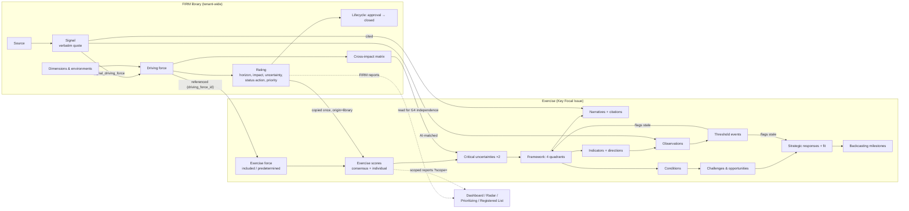
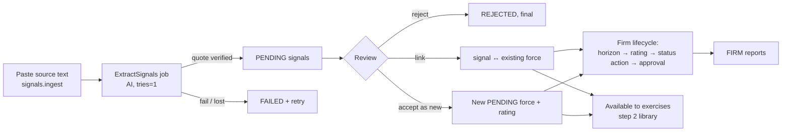
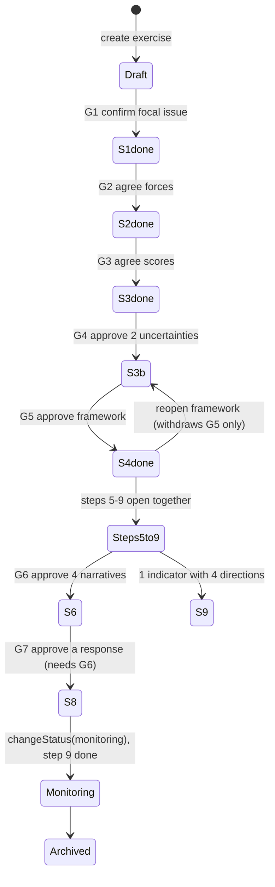
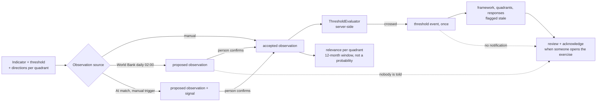
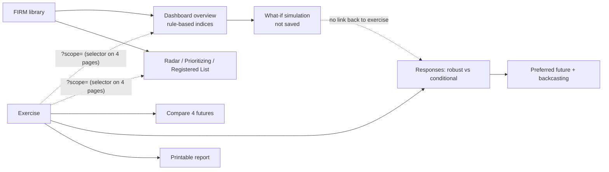

# Product Workflow & Traceability — Foresight Radar

Audit of 2026-11-13, `main` `46e22d4`. Verification codes:
- **S:** source;
- **T:** existing tests;
- **B:** browser, from earlier sessions: production E2E 2026-11-12, restored-copy sweep 2026-11-13;
- **N:** not verified.

Finding IDs (PI-xx) are explained in [product-feature-integrity-report.md](product-feature-integrity-report.md).

## 1. Domain and scope relationship (FIRM vs Key Focal Issue)

Shared by reference: signals, force identity, cross-impact matrix, dimensions. Copied once: impact and uncertainty. Never flows back: exercise scores. Not propagated: firm edits, status changes and soft deletes of a force (PI-06).

## 2. Workflow A — Environmental intelligence

| Stage | Code | State change | Tests | Verified | Gaps |
|---|---|---|---|---|---|
| Ingest | `SignalExtractionService::ingest` :115 | source QUEUED | SignalIngestionTest | S, T | URL not fetched; duplicate text not detected (content_hash unused) |
| Extract | `ExtractSignals`, `LlmSignalExtractor`, `::store` :263 | PROCESSING → COMPLETED/FAILED; signals PENDING | LlmSignalExtractionTest, Recovery | S, T, B (failure path on production) | live AI output N |
| Review | `SignalIngestionController::review` :318 | ACCEPTED/REJECTED; pivot; new force | SignalIngestionTest | S, T | irreversible; no reopen or unlink |
| Lifecycle | 6 controllers (TimeHorizon … ClosedItems) | rating, priority, status | ForesightLifecycleTest et al. | S, T, e2e specs | no approver/closer, no transition history |
| Library → exercise | `ProjectDrivingForceService::add` / `library()` | exercise link + copied consensus | ProjectDrivingForceTest | S, T, B | offers forces in any status (PI-06) |

**Failure and recovery:** a failed extraction is marked FAILED with a reason and can be retried (B on production, AI-05/06). **Manual workaround:** correcting a wrong review means deleting the signal and re-ingesting.

## 3. Workflow B — Complete scenario planning

| Step | Input from previous step (stored link) | Output consumed by | Gate (server) | Propagation on upstream change | Tests | Verified | Broken or weak transition |
|---|---|---|---|---|---|---|---|
| 1 Focal issue | — | every step; narrative prompt (via a framework copy) | G1 | focal edit withdraws G1–G5 and flags the framework | ProjectTest | S, T, B | lifecycle bypass through PUT (PI-01); framework copy of the question not re-synced |
| 2 Forces | library forces (`driving_force_id`) | step 3 | G2 (≥1 included) | inclusion change withdraws G2–G5 | ProjectDrivingForceTest | S, T, B | any-status library; firm changes not propagated |
| 3 Scores | exercise forces | CU candidates | G3 (every included force has a consensus) | score change withdraws G3–G5 | ProjectAssessmentTest | S, T, B | library copies satisfy G3 (PI-02) |
| 3b CU | scored forces | framework axes | G4 (≤2, independence acknowledgement) | withdraw → G5 withdrawn, flags 7–9 | CriticalUncertaintyTest | S, T, B | no low-score warning; empty matrix = independent |
| 4 Framework | approved CUs | steps 5–9 | G5 | reopen flags downstream | ScenarioFrameworkTest | S, T, B | default names accepted |
| 5 Conditions | quadrants | narrative prompt, implications, responses | none ("done" = ≥2 per quadrant) | edit flags the narrative and responses | ScenarioConditionTest | S, T, B | not required before narratives; linked implications not flagged |
| 6 Narratives | conditions + cited signals | step 7 seed text, step 9 hints, report | G6 (4 approved) | regeneration flags implications | ScenarioNarrativeReviewTest | S, T, B | statement trace lost on edit; approval ignores stale; survives G5 withdrawal (PI-03, PI-05) |
| 7 Implications | quadrant (+ optional force/condition) | responses | none (opportunity + challenge per quadrant) | edit flags responses | ScenarioImplicationTest | S, T, B | no link to narrative statements |
| 8 Responses | implications, conditions (optional) | backcasting, report | G7 (rationale, fit ×4, G6) | flagged by implications, conditions, thresholds | StrategicResponseTest | S, T, B | approval survives withdrawal; no execution fields (PI-03, PI-11) |
| 9 Indicators | CU/force (optional FK) | observations, relevance, lifecycle | none (1 indicator with 4 directions) | — | EarlyWarningIndicatorTest | S, T, B | weak completion; relevance counts non-discriminating indicators (PI-09) |
| Report | approved artefacts | executives | draft until G1–G7 | — | ScenarioReportTest | S, T, B | no stale state or relevance |

**End-to-end evidence:**
- `ForesightExerciseJourneyTest` (T);
- production E2E steps 1→9 with narratives written by hand (B, 2026-11-12);
- restored production copy, 37/37 exercise pages 200 (B, 2026-11-13).

**Manual workaround:** without AI, narratives must be written by hand. The template skeleton cannot be approved unedited, which is correct.

## 4. Workflow C — Continuous monitoring

| Transition | Code | Verified | Gap |
|---|---|---|---|
| Configure indicator | `EarlyWarningIndicatorService` :31-186 | S, T, B | owner and frequency not enforced |
| Fetch external | `ExternalIndicatorService::due/fetch`, schedule 02:00 | S, T | stays proposed; no "would cross" signal (PI-04) |
| AI match | `SignalMatchService` | S, T | manual trigger; `observed_at` = match date |
| Threshold | `IndicatorThresholdService::evaluate` :38-82 | S, T, B (E2E-15) | one rule per indicator; event has no acknowledgement |
| Relevance | `relevance()` :211-283 | S, T | counts proposed and non-discriminating indicators (PI-09) |
| Review trigger | `StalenessService` | S, T, B | visible only inside the exercise; one acknowledgement clears everything |
| Notify a person | — | — | **Missing** (PI-04) |
| Overdue observation | — | — | **Missing** |

**Verdict:** a well-guarded register with semi-automatic inputs. It is not yet a loop, because the last hop (telling an owner) does not exist.

## 5. Workflow D — Strategic decision support

| Transition | Verified | Gap |
|---|---|---|
| Scope selector → scoped datasets | S, T (ReportScopeTest) | not on Cross-Impact or Knowledge Graph; scoped report mixes firm horizon and status; period = rating `created_at` (PI-07) |
| Exercise → its scoped reports | S | **missing link** |
| What-if → exercise | S, T | disconnected; nothing saved |
| Compare | S, T, B | no relevance or monitoring shown |
| Responses → execution | S, T | no due date, KPI, execution status or review (PI-11) |
| Report | S, T, B | print-only; no stale state or relevance |

## 6. Workflow E — Multi-tenant collaboration

```mermaid
flowchart LR
  E0[Organisation created<br/>seeder only] --> E1[Admin invites<br/>admin or bod]
  E1 --> E2[Signed link → accept<br/>user created, role synced]
  E2 --> E3[Members: role change,<br/>last-admin guard, removal]
  E3 --> E4[Exercise participants<br/>coordinator/contributor/expert/viewer]
  E4 --> E5[Individual scores, comments]
  E5 --> E6[Gates approved by creator/owner/admin]
  E6 --> E7[Decision log]
```

| Transition | Code | Tests | Verified | Gap |
|---|---|---|---|---|
| Create organisation | `UserSeeder.php:41` only | — | — | **Missing** (PI-16) |
| Invite / accept | TenantMemberController:115, TenantInvitationService | TenantInvitationLifecycle (16) | S, T | 2 roles only; an existing account cannot join a second organisation (by design) |
| Members and roles | `updateRole`, `removeMember` | TenantMemberAuthorization, RoleEscalation | S, T | — |
| Operator workspace | OperatorWorkspaceController | OperatorWorkspace (7) | S, T | — |
| Participants | ProjectParticipantController | ProjectParticipantTest (4) | S, T | roles carry no distinct rights (PI-12) |
| Scoring and comments | ProjectAssessmentService, CommentController | ProjectAssessmentTest, comment test | S, T | spread not recorded at G3; comments hard-deleted; no notifications |
| Approval | ScenarioPlanningProjectPolicy:15-20 | step tests | S, T, B | single approver; BOD cannot approve; no rationale |
| Isolation | BelongsToTenant, TenantRule, RunInTenantContext | TenantIsolation*, Security/* | S, T, B (local) | production cross-org N (one organisation) |

## 7. Evidence-to-decision chain

| Hop | Stored | Visible to the user | Navigable | Evidence |
|---|---|---|---|---|
| Source → Signal | yes (`signals.source_id`, verbatim quote) | yes (Signals; quote in the narrative evidence) | external URL only | migration 2026_10_09_000003 |
| Signal → Driving force | yes (`signal_driving_force`) | count only inside the exercise | no | ProjectDrivingForceService:149 |
| Firm force → Exercise force | yes (`driving_force_id`) | yes | no link to the library item | — |
| Exercise force → Critical uncertainty | yes (`critical_uncertainty_forces`) | yes (keywords, rationale) | no | CriticalUncertaintyService:136 |
| Critical uncertainty → Framework axis | yes (`axis_a/b_uncertainty_id`) | yes | no | ScenarioFrameworkService:144-151 |
| Quadrant → Narrative statements and citations | yes, **until the first edit** | S-labels and statement kinds | no link to the signal | ScenarioNarrativeService:215-218 |
| Narrative → Challenge / opportunity | **no** (quadrant only) | narrative text shown alongside | no | ScenarioImplicationService:205-218 |
| Implication → Response | yes, optional | text on the response card | no | StrategicResponseService:224-233 |
| Response → Decision | partial: gate, action, subject **text**, actor; no artefact id, no rationale | Decision log | no | GateDecisionObserver |
| Response → Indicator | **no direct link** (only via a backcasting milestone) | — | no | early_warning_indicators FKs |
| Indicator → Observation → Signal | yes | observations and events | no signal link | EarlyWarningIndicatorService:160-178 |

**Broken links:** narrative → implication; response → indicator; decision → artefact and rationale.

**Stored but not navigable:** every hop. All links are step-level.

**Reconstructed by hand:**
- which statement an implication answers;
- which signals support a response;
- which indicator watches which response;
- why a gate was passed (rationale exists only for G4 and G7).

**Supporting vs contradicting evidence:** this distinction is made only in scenario relevance (step 9). Narratives and responses carry supporting citations only.
