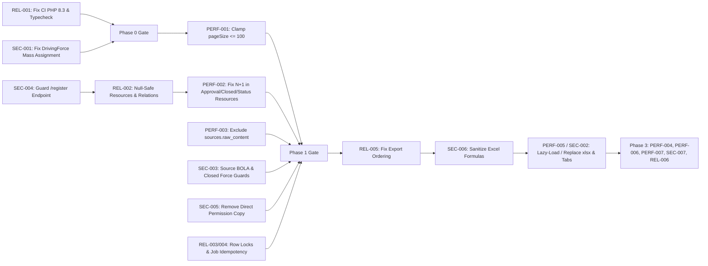

# Foresight Radar — Phased Remediation Plan (`AUDIT_REMEDIATION_PLAN.md`)

**Audit Date:** 2026-10-23  
**Repository:** `https://github.com/roozylabs27/foresight-radar`  
**Audited Branch / Commit:** `development` (`83f532a`)

---

## 1. Remediation Strategy & Guiding Principles

To remediate all 20 confirmed findings without introducing regressions, work is organized into **4 incremental, independently verifiable phases** ordered by risk reduction and dependency order:

- **Phase 0 — Immediate Containment & CI/CD Alignment (P0 Blockers):** Fix broken GitHub Actions CI (`REL-001`), close the mass-assignment approval bypass (`SEC-001`), lock down public self-registration (`SEC-004`), and eliminate HTTP 500 null-dereference crashes (`REL-002`).
- **Phase 1 — High-Impact Database Performance & Concurrency Hardening (P1):** Clamp unbounded `pageSize` across all 9 paginated endpoints (`PERF-001`), eliminate the 50+ query N+1 waterfalls in `ApprovalItemsResource`, `ClosedItemsResource`, and `StatusActionResource` (`PERF-002`), strip `sources.raw_content` from list/radar queries (`PERF-003`), and add row locking / atomic upserts (`REL-003`, `REL-004`, `SEC-003`, `SEC-005`).
- **Phase 2 — Frontend Bundle Optimization, Supply-Chain Cleanup & Export Integrity (P2):** Fix `RegisteredListController::export_data` dimension ordering (`REL-005`), sanitize spreadsheet formula characters (`SEC-006`), lazy-load or replace `xlsx` (`PERF-005`, `SEC-002`), and lazy-load non-default Dashboard tabs.
- **Phase 3 — Search Indexing, Query Deduplication & Architectural Polish (P3):** Deduplicate `ReasoningEngineService` queries (`PERF-004`), add MySQL `FULLTEXT` search indexes (`PERF-006`), cache static lookup tables (`PERF-007`), apply global authenticated rate limiting and lean `auth.user` serialization (`SEC-007`), and unify the API error envelope (`REL-006`).

---

## 2. Phase-by-Phase Execution Plan

### Phase 0: Immediate Security Containment, Crash Prevention & CI Alignment
**Target Effort:** `S` (~2–3 hours) | **Findings Addressed:** `REL-001`, `SEC-001`, `SEC-004`, `REL-002`

| Step | Finding ID | Action Items | Verification & Required Tests |
|---|---|---|---|
| **0.1** | `REL-001` | Update `.github/workflows/ci.yml` lines 34 & 114 from `php-version: '8.2'` to `'8.3'`, add `development` to trigger branches, and add `npm run typecheck` to `frontend-quality` and `./verify.sh`. | Run `./verify.sh --quick` and validate workflow YAML. |
| **0.2** | `SEC-001` | In `DrivingForceController::create()` and `update()`, replace `$request->all()` with `$request->validated()`, force `'status' => DrivingForceStatus::PENDING->value`, `'created_by' => auth()->id()`, and `$driving_force->updated_by = auth()->id()`. Remove `status`, `approved_at`, `closed_at`, `created_by`, `updated_by` from `DrivingForce::$fillable`. | Add `DrivingForceSecurityTest` asserting injected `status: "APPROVED"` on create is ignored and `updated_by` on update cannot be spoofed. |
| **0.3** | `SEC-004` | Set `'allow_registration' => env('AUTH_ALLOW_REGISTRATION', false)` in `config/auth.php`, enforce `abort_unless(config('auth.allow_registration'), 403)` in `RegisteredUserController`, and add `throttle:6,1` to `/register`. | Update `RegistrationTest` to test both disabled (default `403`) and explicitly enabled registration states. |
| **0.4** | `REL-002` | Add `->withTrashed()` to `DrivingForce::pic_user()`, `created_by_user()`, `updated_by_user()`; make `UserResource`, `ApprovalItemsResource`, `ClosedItemsResource`, `StatusActionResource`, and `OverallStatusResource` null-safe (`?->`); replace `roles->pluck('name')[0]` in `UserController` with `$user->hasRole(...)`. | Add regression tests for soft-deleted PIC user on `/approval-items/fetch-data` and roleless user on `/user-management/fetch-data`. |

**Phase 0 Rollback Plan:** Revert single atomic commit; zero database schema changes required.

---

### Phase 1: High-Impact Performance, RBAC Integrity & Concurrency Hardening
**Target Effort:** `M` (~3–4 hours) | **Findings Addressed:** `PERF-001`, `PERF-002`, `PERF-003`, `SEC-003`, `SEC-005`, `REL-003`, `REL-004`

| Step | Finding ID | Action Items | Verification & Required Tests |
|---|---|---|---|
| **1.1** | `PERF-001` | Clamp `pageSize` to `min(100, max(1, (int) $pageSize))` in `DrivingForceService::resolvePageSize()`, `RegisteredListController::registered_list()`, `SignalIngestionController::fetch_signals()`, and `User::filter()`. | Feature test asserting `?pageSize=50000` returns `meta.per_page === 100` across all paginated endpoints. |
| **1.2** | `PERF-002` | Eager-load `dimension`, `pic_user`, `rating.time_horizon`, `rating.priority`, `rating.status_action`, and `rating.action_reasons.status_action` in `DrivingForceService` (`statusAction`, `approvalItems`, `closedItems`) and remove direct `StatusAction::where(...)` calls inside `ApprovalItemsResource`, `ClosedItemsResource`, and `StatusActionResource`. | Query-count assertion test (`DB::enableQueryLog()`) verifying `<= 10` queries for 15 rows on `/approval-items/fetch-data`, `/closed-items/fetch-data`, and `/status-action/fetch-data`. |
| **1.3** | `PERF-003` | Constrain eager-loaded `source` columns to `source:id,uuid,title,url,publisher,published_at` in `SignalIngestionController::fetch_signals()`, `DrivingForceService::filter()`, and `ForesightReportingService`. | Feature test asserting `raw_content` is not serialized in `/signals/fetch` JSON payloads. |
| **1.4** | `SEC-003` | Enforce creator/admin ownership check in `SignalIngestionController::extraction()` and block rating/horizon/status mutations on `CLOSED` driving forces in `TimeHorizonController`, `RatingUrgencyController`, and `StatusActionController`. | Feature tests asserting `403` on cross-user source extraction polling and `409`/`422` when mutating a `CLOSED` driving force. |
| **1.5** | `SEC-005` | Remove `$user->syncPermissions($get_role->permissions)` in `UserController::create()` and `update()` (and clear stale direct permissions via `$user->syncPermissions([])`) so permissions are inherited cleanly from Spatie roles. | Feature test verifying role permission changes take immediate effect on users. |
| **1.6** | `REL-003`, `REL-004` | Move `review_status !== 'PENDING'` check inside `DB::transaction()` with `lockForUpdate()` in `SignalIngestionController::review()`; wrap `CrossImpactService::score()` in `DB::transaction()` / `updateOrCreate()`; implement `ShouldBeUnique` on `ExtractSignals` and remove duplicate `$this->failed($e)` call in `handle()`. | Concurrency/idempotency unit and feature tests for signal review, cross-impact scoring, and `ExtractSignals` failure handling. |

**Phase 1 Rollback Plan:** Revert atomic commits; zero destructive schema migrations.

---

### Phase 2: Export Correctness, Supply-Chain Cleanup & Frontend Code Splitting
**Target Effort:** `M` (~3–4 hours) | **Findings Addressed:** `REL-005`, `SEC-006`, `PERF-005`, `SEC-002`

| Step | Finding ID | Action Items | Verification & Required Tests |
|---|---|---|---|
| **2.1** | `REL-005` | Replace `$query->lazy(100)` with `$query->limit(2000)->get()` (or `$query->cursor()`) in `RegisteredListController::export_data()` so `ORDER BY Dimension.name` is preserved and exceptions are caught before streaming starts. | Feature test asserting exported items are ordered by `dimension` name. |
| **2.2** | `SEC-006` | Add a spreadsheet cell sanitizer in `OverallStatus.jsx` (or server-side exporter) that prefixes strings starting with `=`, `+`, `-`, `@`, `\t`, `\r` with `'`. | Unit test verifying formula strings like `=CMD|' /C calc'!A0` are prefixed with `'`. |
| **2.3** | `PERF-005`, `SEC-002` | Dynamically import spreadsheet generation on click (or replace `xlsx` with a maintained alternative / server-side export), lazy-load inactive tabs (`ScenarioSimulation`, `PrioritizingChart`, `Radar`, `OverallStatus`) in `Dashboard.jsx` using `React.lazy` + `<Suspense>`, and harden `email` validation rules with `'not_regex:/[\r\n]/'`. | Run `npm run build` (verify `OverallStatus` initial chunk drops by `>250 kB`) and `npm run test:e2e:smoke`. |

**Phase 2 Rollback Plan:** Revert frontend/export commit and rebuild assets with `npm run build`.

---

### Phase 3: Query Deduplication, Fulltext Search Indexing & API Standardization
**Target Effort:** `M` (~3–4 hours) | **Findings Addressed:** `PERF-004`, `PERF-006`, `PERF-007`, `SEC-007`, `REL-006`

| Step | Finding ID | Action Items | Verification & Required Tests |
|---|---|---|---|
| **3.1** | `PERF-004` | Reuse loaded `$dimensions` and `$ratings` in `ReasoningEngineService::getExecutiveOverview()` and `RatingHistoryAnalyticsService` instead of re-querying `dimensions` 3x and `driving_force_ratings` 4x. | Query-count test on `ReasoningEngineService::getExecutiveOverview()`. |
| **3.2** | `PERF-007` | Cache static reference tables (`Dimension`, `TimeHorizon`, `Priority`, `StatusAction`) via `Cache::remember('lookup.*', 3600, ...)`. | Unit/Feature test verifying lookup responses. |
| **3.3** | `PERF-006` | Add an additive migration creating MySQL `FULLTEXT` indexes on `driving_forces(keyword, description)` and `signals(title, summary, evidence_quote)` with driver check (`Schema::getConnection()->getDriverName() === 'mysql'`). | Migration up/down test and search filter tests. |
| **3.4** | `SEC-007`, `REL-006` | Add baseline `throttle:120,1` to authenticated routes in `routes/web.php`, restrict `HandleInertiaRequests` `auth.user` to `only(['id', 'uuid', 'name', 'email'])`, and standardize all 8 legacy controllers onto `errorJsonResponse()` (returning both `message` and `errors` keys for backward compatibility). | Full PHPUnit (`composer verify`) + Playwright smoke (`npm run test:e2e:smoke`). |

**Phase 3 Rollback Plan:** Run `php artisan migrate:rollback --step=1` if fulltext index migration needs reversal, and revert commit.

---

## 3. Dependency Graph Between Remediations

