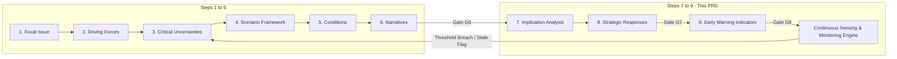
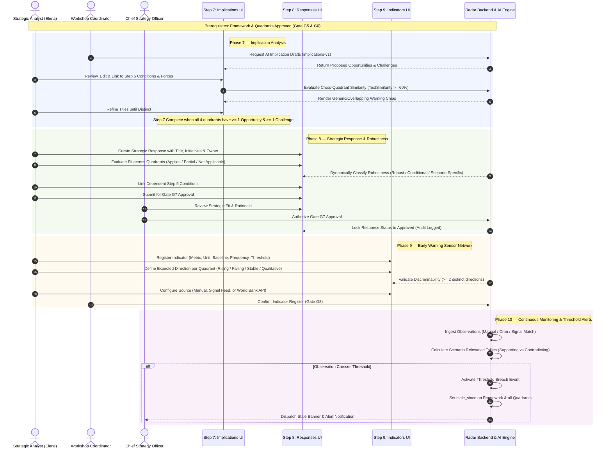
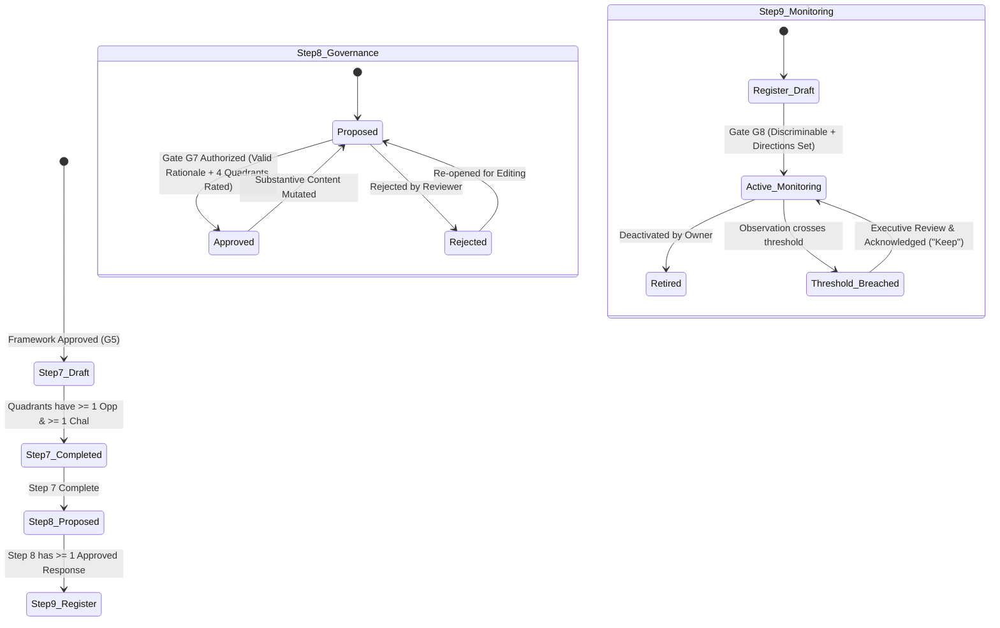
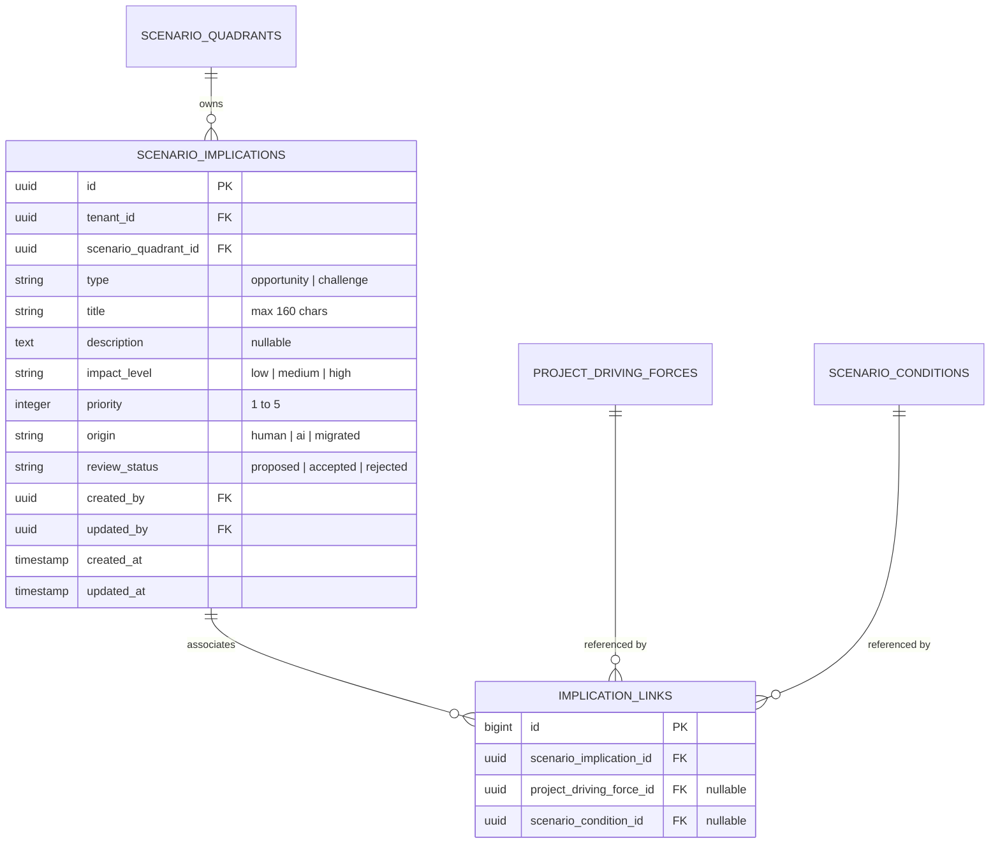
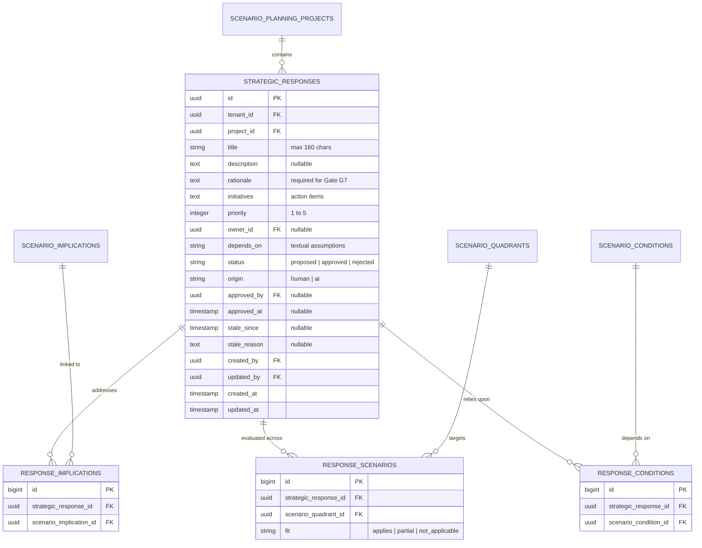
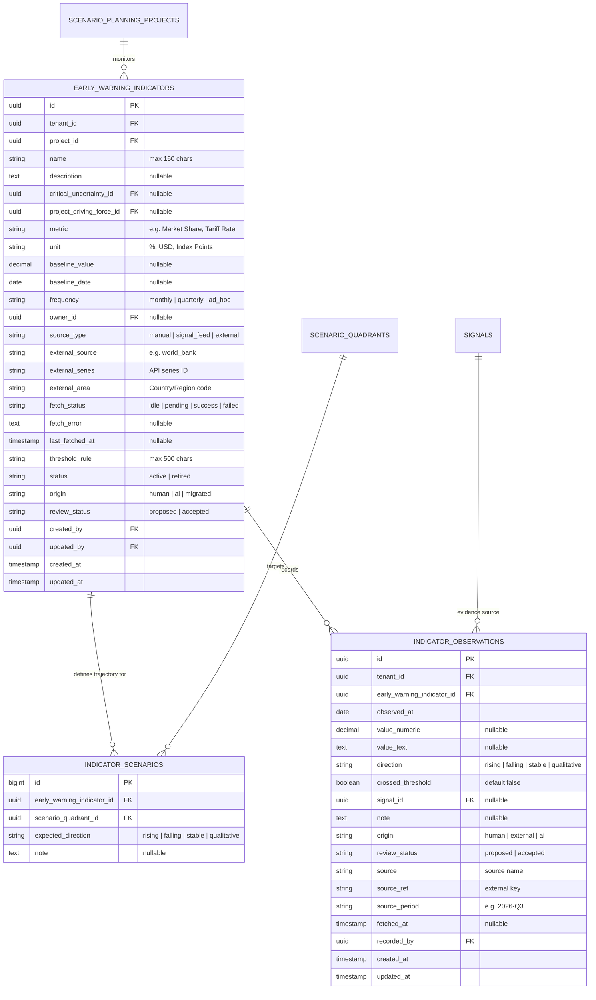
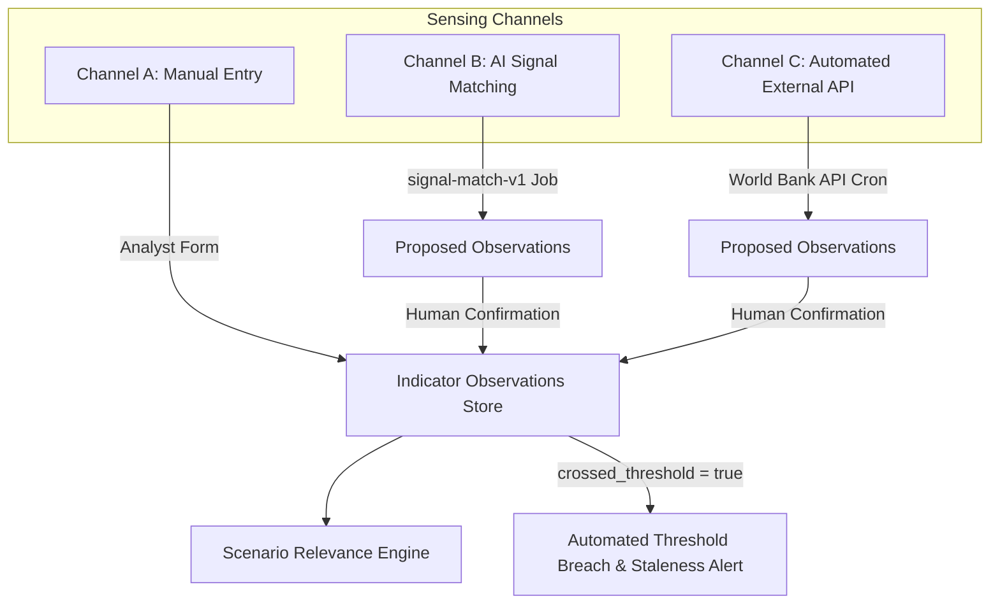

# Product Requirements Document (PRD)
# Foresight Radar Scenario Planning Phases: Steps 7 through 9
## Implication Analysis, Strategic Response, and Early Warning Indicator Tracking

- **Document Version:** 1.0.0
- **Target Platform:** Foresight Radar (Laravel 11 / React 19 / Inertia.js 2)
- **Author:** Elena (Chief Product Officer / Strategic Product Architect)
- **Executive Reviewer:** Roozy (CEO, RoozyLabs)
- **Methodological Reference:** *Scenario Planning Methodology — Part of Era Jaya* (Deck Slides 2, 15–26)
- **Date:** November 2026
- **Status:** Approved for Implementation / Canonical Product Specification

---

## 1. Executive Summary & Strategic Context

### 1.1 Executive Overview
Modern enterprise strategy fails when organizations treat the future as a singular, linear extrapolation of today's market conditions. **Foresight Radar** delivers an AI-native strategic foresight and control plane platform that enables organizations to systematically discover weak signals, cluster driving forces, construct rigorous $2 \times 2$ inductive scenario frameworks, and translate plausibly divergent futures into actionable resilience.

While Steps 1 through 6 construct and narrate plausible macro-environmental operating futures (from Key Focal Issues to Rich Narrative Imagination), **Steps 7 through 9 represent the operational and strategic realization phases**:
1. **Step 7 (Implication Analysis):** Extracts quadrant-specific Challenges and Opportunities directly linked to driving forces and scenario conditions.
2. **Step 8 (Strategic Response & Option Robustness Mapping):** Develops strategic initiatives, evaluates their fit across all four quadrants, classifies their strategic robustness, and governs executive commitment through Gate G7.
3. **Step 9 (Early Warning Indicator Tracking Engine):** Establishes a forward-looking sensor network of quantitative and qualitative leading indicators, tracks multi-channel observations (manual, signal matching, and automated external API feeds), computes scenario directional relevance tallies, and activates automated threshold breach triggers.



### 1.2 Problem Statement
Prior to the implementation of Steps 7–9, scenario planning workflows suffered from critical systemic shortcomings:
1. **Disjointed Implication Tracking:** Scenarios concluded with free-text qualitative paragraphs. Organizations lacked structured, prioritized challenges and opportunities explicitly traceable to causal driving forces and scenario conditions.
2. **Absence of Cross-Scenario Option Mapping:** Strategic initiatives were drafted in isolation without evaluating whether an initiative was universally "robust" (viable across multiple distinct futures) or highly vulnerable ("scenario-specific").
3. **Static, Non-Operationalized Artifacts:** Scenario exercises became "shelfware"—static presentation decks devoid of ongoing sensor telemetry. Strategy teams lacked an automated early-warning telemetry engine capable of tracking whether real-world shifts are reinforcing or invalidating specific future quadrants.

### 1.3 Strategic Business Value
- **Decision Agility:** Reduces organizational response time to macro-environmental shifts by pre-authoring validated strategic responses before trigger conditions materialize.
- **Capital Allocation Efficiency:** Prioritizes investments in "robust" options that yield positive returns across $\ge 3$ quadrants while establishing contingent hedging options for divergent futures.
- **Continuous Macro-Sensing:** Integrates automated external data streams (e.g., World Bank API, proprietary signal feeds) with real-time threshold detection, transforming annual planning into an active organizational radar.

---

## 2. Detailed User Personas & Journey Workflows

### 2.1 Target User Personas

| Persona | Role & Organizational Context | Primary Responsibilities in Steps 7–9 | Core UI/UX Pain Points & Needs |
| :--- | :--- | :--- | :--- |
| **Chief Strategy Officer (CSO) / Strategic Director** | Executive sponsor; accountable to the Board of Directors for 5–10 year strategic resilience. | • Reviews option robustness across quadrants.<br>• Authorizes formal commitment at **Gate G7**.<br>• Monitors executive radar for threshold alerts. | Needs concise, high-signal robustness summaries without cognitive clutter. Requires explicit audit trails and rationale logs. |
| **Scenario Planning Coordinator / Lead Futurist** | Facilitator of cross-functional foresight workshops; manages project workflow and gate progression. | • Orchestrates implication extraction workshops.<br>• Triggers AI suggestions and moderates consensus.<br>• Oversees indicator register completeness. | Needs clear workflow progression cues (stepper), distinctness warnings for generic outputs, and bulk review controls. |
| **Senior Strategic / Business Analyst (e.g. Elena)** | Domain expert; conducts primary research, synthesizes forces, and builds data models. | • Authors detailed challenges, opportunities, and initiative plans.<br>• Maps causal links to Step 5 conditions and forces.<br>• Configures baseline metrics and threshold rules. | Needs rapid inline editing, keyboard accessibility, clear condition pickers, and live character/word counters. |
| **Operational Domain Owner / Sensing Specialist** | Functional department lead (e.g., Supply Chain, Regulatory Affairs, Technology). | • Owns assigned indicators.<br>• Inputs monthly/quarterly observations.<br>• Confirms automated external data imports and signal matches. | Needs streamlined observation forms, clear visual cues for threshold breaches, and source-provenance verification. |

### 2.2 End-to-End User Journey Workflow



### 2.3 Gate Governance & State Machine

The platform enforces strict state transition gates to maintain methodology integrity:



---

## 3. Functional Specifications: Step 7 — Implication Analysis

### 3.1 Objectives & Scope
Step 7 decomposes the high-level scenario narratives into concrete business implications. Each quadrant of the $2 \times 2$ framework is analyzed across two distinct dimensions:
- **Opportunities:** Favorable developments, unmet customer needs, or competitive openings created by that specific future state.
- **Challenges:** Strategic threats, cost pressures, operational hurdles, or regulatory constraints that emerge under that future state.

### 3.2 Data Architecture & Schema
The relational structure ties implications directly to framework quadrants and provides granular traceability back to project forces and conditions.



### 3.3 Core Business Logic & Validation Constraints
1. **Framework Gate Prerequisite:** Step 7 operations require an approved scenario framework (`scenarios.framework_status = 'approved'`).
2. **Field Validations:**
   - `type`: Required enum `['opportunity', 'challenge']`.
   - `title`: Required string, trimmed, $1 \le \text{length} \le 160$ characters.
   - `impact_level`: Required enum `['low', 'medium', 'high']`.
   - `priority`: Required integer between 1 (lowest) and 5 (highest).
   - `description`: Optional text.
3. **Relational Scope Enforcement:**
   - Any linked `project_driving_force_id` must belong to the active project and be marked `inclusion_status = 'included'`.
   - Any linked `scenario_condition_id` must belong to the **exact same quadrant** as the implication item. Cross-quadrant condition linking is strictly forbidden.
4. **Step 7 Completion Rule:** Step 7 is marked **Completed** if and only if **every one of the four quadrants** possesses $\ge 1$ accepted opportunity and $\ge 1$ accepted challenge.
5. **Legacy Migration Support:**
   - Existing free-text `implications` from legacy narrative records are migrated as `origin = 'migrated'` and `review_status = 'proposed'`.
   - Editing and assigning a type (`opportunity` or `challenge`) automatically transitions the status to `accepted`.

### 3.4 Semantic Distinctness & Anti-Generic Guardrail
A common failure mode in foresight exercises is writing generic platitudes (e.g., *"Need for operational agility"*) that apply identically to all futures, destroying the discriminative utility of scenario planning.
- **Cross-Quadrant Similarity Engine:** Uses `TextSimilarity::words` tokenization (removing stop-words and normalizing whitespace and punctuation).
- **Collision Detection:**
  $$\text{Overlap Ratio}(A, B) = \frac{|\text{Tokens}(A) \cap \text{Tokens}(B)|}{\min(|\text{Tokens}(A)|, |\text{Tokens}(B)|)}$$
- If $\text{Overlap Ratio} \ge 0.60$ between titles in different quadrants, or if identical titles appear in all 4 quadrants, the system flags the items as `generic = true` and displays an amber warning badge (`Mirip dengan [Kuadran X]`).
- The warning does not hard-block submission, but provides immediate visual feedback to analysts to sharpen quadrant-specific implications.

### 3.5 AI Suggestion Engine (`implications-v1`)
- **Prompt Contract:** Invokes `ScenarioImplicationPrompt` (Schema version `implications-v1`) via `AiGenerationRecorder`.
- **Context Payload:** Provides Focal Question, Target Horizon, Quadrant Title & Summary, Narrative text, and the quadrant's accepted Step 5 Conditions.
- **Constraints:** Schema enforces structured JSON output. The LLM must explicitly cite condition label IDs provided in the context. Hallucinated condition labels are purged during backend ingestion validation.
- **Provenance:** Generated items are tagged `origin = 'ai'` and `review_status = 'proposed'`. They do not satisfy Step 7 completion criteria until explicitly accepted by a human analyst.

---

## 4. Functional Specifications: Step 8 — Strategic Response & Robustness Mapping

### 4.1 Objectives & Scope
Step 8 translates foresight into strategic decision-making. Analysts author enterprise responses and evaluate their viability across all four futures, enabling executive leadership to distinguish between:
- **No-Brainer / Robust Initiatives:** Highly effective across almost all scenarios.
- **Contingent / Scenario-Specific Options:** Essential under specific conditions but potentially wasteful or hazardous in others.

### 4.2 Data Architecture & Schema



### 4.3 Robustness Classification Engine
For each strategic response, analysts assign a `fit` rating for each of the four framework quadrants:
- `applies` (Full strategic fit / essential capability)
- `partial` (Moderate fit / requires customization)
- `not_applicable` (Irrelevant or counter-productive)

The system automatically computes the response's strategic archetype:
$$\text{Applies Count} = \sum_{q \in \text{Quadrants}} \mathbb{I}(\text{fit}(q) == \text{'applies'})$$

| Classification | Condition | Strategic Meaning & Action Guidance |
| :--- | :--- | :--- |
| **Robust (`robust`)** | $\text{Applies Count} \ge 3$ (`ROBUST_FROM = 3`) | **Core Strategy:** Low-regret investments. Fund immediately regardless of which future unfolds. |
| **Conditional (`conditional`)** | $\text{Applies Count} = 2$, or mixed `partial` ratings | **Hedge / Option:** Requires structured monitoring. Prepare operational contingencies. |
| **Scenario-Specific (`scenario_specific`)** | $\text{Applies Count} = 1$ | **Wildcard Bet:** Deep specialization. Execute only if early warning indicators confirm this specific trajectory. |
| **Unrated (`null`)** | Quadrant fit count $< 4$ | Assessment incomplete. Cannot be approved. |

### 4.4 Gate G7 Executive Approval State Machine
- **Approval Constraints:**
  1. `rationale` must be non-blank.
  2. All 4 framework quadrants must have an assigned fit rating (`response_scenarios` count $= 4$).
  3. Action must be authorized by an Executive/Coordinator (`ScenarioPlanningProjectPolicy`).
- **Mutability Lock & Auto-Reversion:**
  - Any subsequent edit to `title`, `description`, `initiatives`, `fit`, or `conditions` immediately reverts `status` to `'proposed'`, clearing `approved_by` and `approved_at`.
  - This ensures that substantive changes cannot bypass executive scrutiny.

### 4.5 Assumption Dependency Tracking & Dynamic Staleness
Strategic responses frequently depend on specific assumptions (e.g., *"Assuming battery density improves by 40%"*).
- Responses can formally link to Step 5 conditions via `response_conditions`.
- If an upstream condition is edited (text, axis, force link) or deleted:
  1. The platform triggers `StalenessService`.
  2. The response is flagged with `stale_since = now()` and `stale_reason = "Kondisi '[Condition Text]' yang menjadi rujukan telah diubah/dihapus."`
  3. The response card displays an amber Stale banner.
  4. Analysts must either review and update the response or explicitly click **"Keep" (Pertahankan)** to acknowledge and clear the flag.

---

## 5. Functional Specifications: Step 9 — Early Warning Indicator Tracking Engine

### 5.1 Objectives & Scope
Step 9 equips the enterprise with a forward-looking intelligence sensor grid. Rather than waiting for disruption to occur, the organization monitors leading indicators that signal which scenario quadrant is actively emerging in the real world.

### 5.2 Data Architecture & Schema



### 5.3 Discriminability Engine
An indicator is methodologically useless if it is expected to rise in all four scenarios (it fails to differentiate between futures).
- **Validation Algorithm (`discriminates`):**
  $$\text{Distinct Directions} = |\{ \text{expected\_direction}(q) \mid q \in \text{Quadrants} \}|$$
  $$\text{Is Discriminable} \iff \text{Distinct Directions} \ge 2$$
- If an indicator has the same expected direction in all four quadrants, the system marks `discriminates = false` and renders a prominent warning:
  > **Peringatan Diskriminasi:** Indikator ini memiliki arah yang sama di semua kuadran sehingga tidak dapat membedakan masa depan.

### 5.4 Multi-Channel Observation Ingestion
The tracking engine ingests observations through three complementary channels:



1. **Channel A: Manual Field Logging**
   - Analysts record quantitative values or qualitative status updates.
   - User explicitly logs whether the observed trend is `rising`, `falling`, or `stable` relative to baseline.
2. **Channel B: AI Signal Feed Matching (`signal-match-v1`)**
   - As new environmental signals are ingested into Foresight Radar, background job `MatchSignalsToIndicators` evaluates semantic relevance against registered indicators.
   - Matched signals are staged as `review_status = 'proposed'`.
   - Analysts confirm or dismiss proposals. Only accepted observations contribute to relevance tallies.
3. **Channel C: Automated External Connectors (`IndicatorSource`)**
   - **World Bank API Connector (`WorldBankSource`):** Directly queries the World Bank Indicators API v2 (`api.worldbank.org/v2/country/{area}/indicator/{series}`).
   - **Ingestion Pipeline:** Scheduled cron command `php artisan indicators:fetch-external` runs daily at 02:00.
   - Fetches latest period data with automated retry on transient $502/503$ gateways.
   - Compares latest period against predecessor to automatically compute `direction` (`rising`, `falling`, `stable`).
   - Observations land as `origin = 'external'` and `review_status = 'proposed'`, requiring human sign-off before entering formal tallies.

### 5.5 Scenario Directional Relevance Tally Engine
The engine computes which scenario quadrant is actively materializing based on empirical observations:
- **Tally Algorithm:**
  For each quadrant $q \in \text{Quadrants}$:
  $$\text{Supporting}(q) = \sum_{o \in \text{Observations}} \mathbb{I}(\text{direction}(o) == \text{expected\_direction}(q, o.\text{indicator}))$$
  $$\text{Contradicting}(q) = \sum_{o \in \text{Observations}} \mathbb{I}(\text{direction}(o) \ne \text{expected\_direction}(q, o.\text{indicator}))$$
  $$\text{Net Support}(q) = \text{Supporting}(q) - \text{Contradicting}(q)$$
- **Leading Scenario Determination:**
  - $\text{Leading} = q^*$ if $\text{Net Support}(q^*) == \max_{q}(\text{Net Support}(q))$ AND $\text{Net Support}(q^*) > 0$ AND the maximum is strictly unique.
  - If tallies tie or net scores are non-positive, `leading = null` (inconclusive trajectory).
- Rendered on the **Relevance Dashboard Panel** with visual progress bars indicating supporting vs. opposing data points.

### 5.6 Automated Threshold Breach & Stale Invalidation
When an observation is flagged with `crossed_threshold = true`:
1. The platform executes `StalenessService::flagFrameworkAndQuadrants`.
2. Sets `stale_since = now()` on the parent scenario framework and all four quadrants with reason:
   `"Indikator '[Indicator Name]' melewati ambang batas pada [Date]."`
3. Triggers immediate email/system alerts to the Project Owner and Coordinator.
4. Marks Step 9 and Project Overview with a high-priority warning banner requiring strategic re-assessment.

---

## 6. User Interface & UX Interaction Specifications (React 19 / Inertia.js 2)

### 6.1 Architectural Standards & Design System
- **Frameworks:** React 19, Inertia.js 2, Vite, Tailwind CSS with semantic tokens (`--card`, `--primary`, `--muted`, `--destructive`, `--warning`).
- **Component Primitives:** Radix UI / shadcn accessible primitives (`Dialog`, `DropdownMenu`, `Tabs`, `Badge`, `Card`, `Tooltip`).
- **Icons:** Lucide React icons. **Strict Guardrail:** No generic Sparkles icons (per repository UI standard). Use domain-specific icons (`Crosshair`, `ShieldAlert`, `TrendingUp`, `ExternalLink`, `Activity`).
- **Layout Organization:** Each step page is kept lean ($< 150$ lines), delegating complex organisms to `resources/js/Components/ScenarioPlanning/`.

### 6.2 Screen Specification: Step 7 — `Implications.jsx`
- **Page Route:** `GET /scenario-planning/{project}/implications`
- **Header Slot:** Renders `ExerciseStepper` showing 9-step progress and active status.
- **Main View Layout:** 4-quadrant grid (2 columns $\times$ 2 rows) matching the framework geometry (HH, HL, LH, LL).
- **Quadrant Container (`QuadrantImplications.jsx`):**
  - Displays Quadrant Title, Pole definitions, and one-line Summary.
  - Opportunity and Challenge items grouped into collapsible sections.
  - Item Card shows Type Icon (Green `TrendingUp` for Opportunity, Amber `AlertTriangle` for Challenge), Title, Impact Level badge (`High`, `Medium`, `Low`), and linked condition pills.
  - If `generic = true`, renders an amber chip: `[!] Mirip dengan [Kuadran Y]`.
  - Action buttons: "Tambah Implikasi", "Saran AI" (triggers `implications-v1`).
- **Dialog (`ImplicationDialog.jsx`):**
  - Form fields: Type (Radio Group), Title (Input with character counter $0/160$), Description (Textarea), Impact Level (Select), Priority (1–5 Star/Number picker).
  - Multi-select picker for Step 5 Conditions (filtered strictly to conditions of the active quadrant).
  - Multi-select picker for Project Driving Forces.

### 6.3 Screen Specification: Step 8 — `Responses.jsx`
- **Page Route:** `GET /scenario-planning/{project}/responses`
- **Header Slot:** `ExerciseStepper` + Next Action prompt.
- **Top Summary Metric Bar:**
  - Total Responses count.
  - Robust Responses badge ($\ge 3$ quadrants).
  - Conditional Responses badge ($2$ quadrants).
  - Scenario-Specific Responses badge ($1$ quadrant).
  - Unapproved Proposals counter.
- **Filter & Search Bar:** Filter by Status (`Semua`, `Proposed`, `Approved`, `Rejected`), Robustness, and text search.
- **Response Card (`ResponseCard.jsx`):**
  - Header: Title, Robustness Badge (`Kuat / Robust`, `Kondisional`, `Khusus Skenario`), Status Pill (`Diusulkan`, `Disetujui`, `Ditolak`).
  - Stale Banner: Rendered if `stale_since` is non-null with explanation and "Pertahankan" (Keep) button.
  - Matrix Grid: Mini $2 \times 2$ matrix displaying fit badge per quadrant:
    - Green dot: `Cocok (Applies)`
    - Amber dot: `Sebagian (Partial)`
    - Gray dot: `Tidak Cocok (N/A)`
  - Initiatives preview and linked implications counter.
  - Footer: Assigned Owner, Open Comments drawer toggle, Gate G7 Approve/Reject buttons (for authorized managers).
- **Dialog (`ResponseDialog.jsx`):**
  - Title, Description, Rationale (mandatory for approval), Initiatives list.
  - 4-Quadrant Fit selector: 4 radio/toggle rows corresponding to each quadrant position.
  - Condition dependency multi-select.

### 6.4 Screen Specification: Step 9 — `Indicators.jsx`
- **Page Route:** `GET /scenario-planning/{project}/indicators`
- **Top Layout:** Split view:
  - Left / Top: **Relevance Dashboard (`RelevancePanel.jsx`)** displaying empirical sensor readings. Shows which scenario has the highest net support, total observations logged, and bar graphs for all 4 quadrants.
  - Right / Top: Register Summary, AI Suggestion Controls (`IndicatorAiControls.jsx`), and "Tambah Indikator" button.
- **Indicator Card (`IndicatorCard.jsx`):**
  - Name, Metric, Unit, Baseline (e.g., `Baseline: 14.2% (Okt 2026)`), Frequency pill, Source pill (`Manual`, `Signal Feed`, `World Bank API`).
  - Discriminability Alert: Amber warning if directions are uniform.
  - Expected Directions Strip: Shows 4 pills with icons representing expected trajectories in each quadrant ($\uparrow$ Rising, $\downarrow$ Falling, $\rightarrow$ Stable, $\sim$ Qualitative).
  - Threshold Rule block: Quotes rule (e.g., *"Jika penetrasi > 25% sebelum 2028"*).
  - Observations Expansion Panel (`IndicatorObservations.jsx`):
    - Table of last 5 observations.
    - Values, observation date, direction icon, and threshold crossed alert badge.
    - Button: "Catat Observasi" (opens `ObservationDialog.jsx`).
    - For external indicators: "Ambil Data Sekarang" manual trigger (`ExternalFetchControl.jsx`).

---

## 7. Non-Functional Requirements & Security Specifications

### 7.1 Multi-Tenant Data Isolation
- **Rule:** Every table (`scenario_implications`, `strategic_responses`, `early_warning_indicators`, etc.) includes `tenant_id`.
- **Enforcement:** Eloquent models utilize the `BelongsToTenant` trait. All query scopes and foreign key updates are locked to the authenticated user's tenant. Cross-tenant reads or writes return HTTP 403/404 immediately.

### 7.2 Provenance & Audit Trails
- **Provenance Constants:** All created records populate `origin` (`human`, `ai`, `template`, `migrated`) and `review_status` (`proposed`, `accepted`, `rejected`).
- **AI Run Logging:** Every call to LLM prompts (`implications-v1`, `response-v1`, `indicators-v1`) logs full prompt tokens, model identity, provider, execution duration, and raw completion into `ai_generation_runs`.
- **Decision Log:** Every gate action (G7, G8) records a permanent row in `project_decisions` logging the user ID, timestamp, decision type, and justification rationale.

### 7.3 Performance & Reliability SLAs
- **Page Render SLA:** Server-side Inertia response generation $< 250\text{ ms}$ for projects with up to 100 implications and 50 indicators.
- **Asynchronous Execution:** All LLM generations and external World Bank API synchronization jobs implement `ShouldQueue` and `ShouldBeUnique`. Long-running tasks never block HTTP web requests.
- **External API Resilience:** The World Bank connector enforces a $10\text{-second}$ timeout, automatic single transient retry, and graceful error logging to `fetch_error` without failing platform background workers.

---

## 8. Comprehensive Acceptance Criteria & BDD Test Scenarios

### 8.1 Gherkin Test Scenarios

```gherkin
Feature: Foresight Radar Steps 7-9 Strategic Realization

  Background:
    Given an authenticated user "Elena" with role "coordinator"
    And an active project "Mobility 2035" with an approved framework (Gate G5 passed)
    And four framework quadrants exist: "FAVOUR", "DICHOTOMY", "CHALLENGING", "STAGNATION"

  # =========================================================================
  # STEP 7: IMPLICATION ANALYSIS
  # =========================================================================
  Scenario: Successfully authoring an implication linked to a valid quadrant condition
    Given quadrant "FAVOUR" has an accepted condition "Insentif Pajak EV Diberlakukan"
    When Elena creates an implication for "FAVOUR" with:
      | type         | opportunity                                 |
      | title        | Lonjakan Permintaan Armada Niaga Ramah Ling |
      | impact_level | high                                        |
      | priority     | 4                                           |
      | condition    | Insentif Pajak EV Diberlakukan              |
    Then the implication is saved with status "accepted" and origin "human"
    And the implication is linked to condition "Insentif Pajak EV Diberlakukan"

  Scenario: Rejecting condition links from a different quadrant
    Given quadrant "CHALLENGING" has an accepted condition "Krisis Pasokan Baterai"
    When Elena attempts to create an implication for "FAVOUR" linked to "Krisis Pasokan Baterai"
    Then the request is rejected with a validation error "Kondisi tidak sesuai dengan kuadran yang dipilih"

  Scenario: Flagging generic implications appearing across multiple quadrants
    Given an implication with title "Kebutuhan Efisiensi Biaya Operasional" exists in "FAVOUR"
    When Elena creates an implication with title "Kebutuhan Efisiensi Biaya Operasional" in "CHALLENGING"
    Then both implications are flagged with generic warning "Mirip dengan kuadran lain"

  # =========================================================================
  # STEP 8: STRATEGIC RESPONSE & ROBUSTNESS MAPPING
  # =========================================================================
  Scenario: Correctly deriving robustness based on multi-quadrant fit
    When Elena creates a strategic response "Kembangkan Ekosistem Swap Baterai Modular":
      | quadrant    | fit            |
      | FAVOUR      | applies        |
      | DICHOTOMY   | applies        |
      | STAGNATION  | applies        |
      | CHALLENGING | not_applicable |
    Then the response robustness classification is "robust"
    And the response status is "proposed"

  Scenario: Enforcing Gate G7 approval constraints
    Given a strategic response "Luncurkan Portofolio xEV Murah" with status "proposed"
    And only 2 out of 4 quadrants have been rated for fit
    When Elena attempts to approve the response for Gate G7
    Then the approval is rejected with error "Nilai kecocokan respons di keempat kuadran sebelum menyetujuinya"

  Scenario: Substantive edit auto-reverts approved response to proposed
    Given a strategic response "Ekspansi SPKLU Mandiri" is "approved" with Gate G7 recorded
    When Elena updates the title to "Ekspansi SPKLU dan Ultra-Fast Charging"
    Then the response status is automatically reverted to "proposed"
    And the approved_by and approved_at fields are cleared

  Scenario: Upstream condition mutation triggers response staleness
    Given an approved strategic response depends on condition "Subsidi Listrik Hijau"
    When the coordinator updates the text of condition "Subsidi Listrik Hijau"
    Then the strategic response is marked with "stale_since"
    And the response displays a stale alert "Kondisi yang menjadi rujukan telah diubah"

  # =========================================================================
  # STEP 9: EARLY WARNING INDICATOR TRACKING ENGINE
  # =========================================================================
  Scenario: Rejecting non-discriminating indicators
    When Elena attempts to register an indicator "Inflasi Global" with directions:
      | quadrant    | expected_direction |
      | FAVOUR      | rising             |
      | DICHOTOMY   | rising             |
      | CHALLENGING | rising             |
      | STAGNATION  | rising             |
    Then the indicator is flagged as "discriminates = false"
    And a warning banner is displayed "Indikator tidak membedakan masa depan"

  Scenario: Computing empirical scenario relevance tallies from observations
    Given an active indicator "Tingkat Adopsi EV" with expected directions:
      | quadrant    | expected_direction |
      | FAVOUR      | rising             |
      | DICHOTOMY   | rising             |
      | CHALLENGING | falling            |
      | STAGNATION  | falling            |
    When an accepted observation is logged with direction "rising"
    Then the relevance tally for "FAVOUR" is incremented by 1 supporting
    And the relevance tally for "DICHOTOMY" is incremented by 1 supporting
    And the relevance tally for "CHALLENGING" is incremented by 1 contradicting
    And the relevance tally for "STAGNATION" is incremented by 1 contradicting
    And the leading scenario is evaluated as "FAVOUR / DICHOTOMY tie (no unique leader)"

  Scenario: Threshold breach triggers automated framework staleness alert
    Given an active indicator "Tarif Bea Masuk EV CBU" with threshold "Tarif > 40%"
    When an observation is logged with value "45%" and "crossed_threshold = true"
    Then the observation is saved with threshold breach recorded
    And the scenario framework is flagged with "stale_since"
    And all four quadrants display the stale banner citing the indicator breach
```

### 8.2 Automated Test Coverage Matrix

| Test Suite / File | Test Method & Assertion Scope | Roadmap Ref |
| :--- | :--- | :--- |
| `ScenarioImplicationTest.php` | • `test_create_implication_with_quadrant_condition_link`<br>• `test_cross_quadrant_condition_link_rejected`<br>• `test_generic_title_flagged_across_quadrants`<br>• `test_step7_completion_requires_opportunity_and_challenge_in_all_quadrants` | R1.7, R2.6 |
| `StrategicResponseTest.php` | • `test_create_strategic_response_with_four_quadrant_fits`<br>• `test_robustness_calculation_robust_conditional_specific`<br>• `test_gate_g7_requires_rationale_and_complete_fits`<br>• `test_substantive_mutation_resets_status_to_proposed`<br>• `test_condition_change_triggers_response_staleness` | R1.8, R2.9 |
| `EarlyWarningIndicatorTest.php` | • `test_indicator_discriminates_validation`<br>• `test_relevance_tally_supporting_and_contradicting`<br>• `test_unique_leading_scenario_calculation`<br>• `test_threshold_breach_flags_framework_stale` | R1.9, R2.3 |
| `ExternalIndicatorSourceTest.php` | • `test_world_bank_connector_successful_ingestion`<br>• `test_transient_gateway_retry_and_error_handling`<br>• `test_cron_fetch_creates_proposed_observations` | R3.6 |

---

## 9. Definition of Done (DoD)

A release or PR for Steps 7–9 is complete and production-ready when:
1. **Contract Synchronization:** All DB schemas, Eloquent models, FormRequests, Inertia props, and React components strictly mirror the specifications in this PRD.
2. **Quality Verification:**
   - 100% pass rate across `ScenarioImplicationTest`, `StrategicResponseTest`, `EarlyWarningIndicatorTest`, and `ExternalIndicatorSourceTest`.
   - Zero Larastan / PHPStan Level 5 errors.
   - Code style verified via Laravel Pint (`pnpm pint` / `./vendor/bin/pint`).
   - Frontend passes `pnpm run build` with zero TypeScript or JSX bundling errors.
3. **Design System & UX Integrity:**
   - Zero raw hex codes or unauthorized style bracket values in React components (compliant with `DESIGN.md`).
   - Zero Sparkles icons utilized in user interfaces.
4. **Documentation & Traceability:**
   - Architecture documents and roadmap files (`SCENARIO_PLANNING_DEVELOPMENT_ROADMAP.md`, `PROGRESS.md`, `feature_list.json`) updated to reflect release state.
