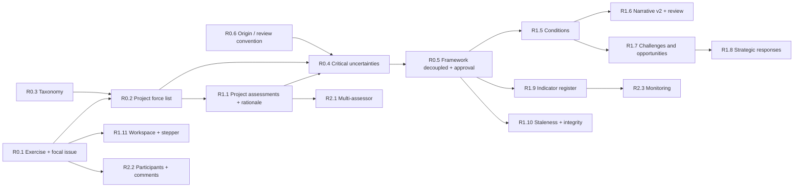

# Scenario Planning Development Roadmap

**Date:** 2026-10-30
**Basis:** gaps G01–G26 (`docs/audit/SCENARIO_PLANNING_FEATURE_AUDIT.md`), matrix rows (`docs/audit/SCENARIO_PLANNING_FEATURE_MATRIX.md`), schema proposals (`docs/audit/SCENARIO_PLANNING_DATA_MODEL_GAP.md`, "DM §"), features (`SCENARIO_PLANNING_FEATURE_SPECIFICATION.md`).

**Complexity scale** (relative, from code inspection; no calendar estimates):
S = one migration or a seed change plus a controller/form tweak · M = new table(s), service, a page or panel, tests · L = several tables, workflow rules, multiple screens, migration of legacy data · XL = cross-cutting change or external integration.

**Definition of Done for every item:** AGENTS.md §7 (Pint, Larastan L5, PHPUnit, `npm run build`, `npm audit`), feature tests including tenant isolation for every new table, Chrome DevTools MCP verification for UI, `PROGRESS.md` / `feature_list.json` updated.

---

## Dependency Overview

Note: R1.1 (project-scoped consensus scores) is listed under P1 because rationale is P1, but its schema part (exercise-scoped scores) is a prerequisite for R0.4 and should ship with P0.

---

## P0 — Essential Methodological Alignment

| ID | Feature | Problem solved | Current status | Required changes | Depends on | Acceptance criteria | Cx |
|---|---|---|---|---|---|---|---|
| R0.1 | Scenario planning exercise with focal issue | No container for the nine steps; focal issue optional per matrix (G01; matrix 1.1, 1.2, 1.3, 1.6) | **Done 2026-10-31** | `scenario_planning_projects` (focal question, purpose, target year, optional scope/owner/background/objectives, status, G1 confirmation, soft delete); `ScenarioPlanningProjectPolicy` (creator, owner, admin roles); `ScenarioPlanningProjectService` (re-confirmation when the focal issue changes, nine-step status); `/scenario-planning` list + workspace with step list; sidebar item. Deviations: no fake "legacy" project per tenant (it would need an invented focal question); `scenarios.project_id` moved to R0.5, where the framework becomes project-scoped | — | `ProjectTest` (9); browser: create with validation, confirm opens steps 2–9 | L |
| R0.2 | Project-scoped driving force list | Forces are tenant-wide and hidden by the current-month filter (G02; 2.10) | **Done 2026-10-31** | `project_driving_forces` (inclusion status, influence note, predetermined flag, added by; unique per project); step 2 page `/scenario-planning/{project}/driving-forces` with library picker (any month, own tenant, not deleted), edit dialog, category coverage; gate G2 (`forces_confirmed_by/at`, needs G1 and one included force) opens steps 3–9; changing inclusion or withdrawing G1 withdraws G2 | R0.1, R0.3 | `ProjectDrivingForceTest` (10); browser: add 3 forces with search, edit note, agree list, steps 3–9 open | M |
| R0.3 | Eleven-category taxonomy | Social, New Entrant missing; Political + Legislative merged as Regulation (G03; 2.3) | **Done 2026-10-30** | `App\Support\DimensionTaxonomy` (codes, order, legacy names); migration `2026_10_30_000002` adds `dimensions.code` / `sort_order` and renames rows in place (Economy→Economic, Regulation→Legislative pending client Q5, Customer→Consumer, Supplier→Supply Chain), adds Political, Social, New Entrant; seeder uses the same class; `driving_force.json` seeds by code; `Dimension::ordered()` for all lists and the extraction prompt; keyword rules, 11-sector radar, knowledge-graph colours and copy updated | — | `DimensionTaxonomyTest` (6); dev DB migrated (8 rows renamed in place, 3 added, forces kept); radar and Driving Force list checked in the browser | S |
| R0.4 | Critical uncertainties: group, name, poles, rationale, approve two | Axes are single forces; selection is invisible and unjustified (G09; 3.7, 3.8, 3.9, 3.12, 4.1, 4.2, 4.3) | **Done 2026-10-31** (default answers to client questions 3–5) | `critical_uncertainties` + `critical_uncertainty_forces` (members are exercise forces); propose after G3 (name, 1..n included non-predetermined forces, two different poles, required reason); approve exactly two as axis A/B with a project row lock; strongly linked axes (|cross-impact| ≥ 2) need an acknowledgement; approved ones are locked until withdrawn; G1/G2/G3 withdrawal withdraws G4; pair suggestions (strength, mutual influence); page `/scenario-planning/{project}/uncertainties`; step 3 done and steps 4–9 open at G4. Scenario axes referencing uncertainties moved to R0.5 | R0.2, project scores from R1.1, R0.6 | `CriticalUncertaintyTest` (11); browser: propose (grouped forces), validation, approve A, approve B with acknowledgement, steps 1–3 done | L |
| R0.5 | Framework decoupled from narrative, with approval | Quadrants exist only after generation; FINAL not reachable in UI; no approval (G11; 4.4, 4.6, 4.10) | **Done 2026-10-31** | Framework per exercise (`scenarios.project_id` unique, `axis_*_uncertainty_id` restrict, `framework_status`, `approved_by/at`; force FKs nullable + `nullOnDelete`); saving creates four quadrants "{pole A} · {pole B}" without narrative; `scenario_quadrants.summary`, narrative nullable; poles editable while draft (default names follow); unique quadrant names; approve (G5) locks poles and names, reopen; G4 withdrawal withdraws G5 and a replacement axis moves a draft framework; step 4 done and steps 5–9 open at G5; `ScenarioNarrativeService::generate` fills rows in place and keeps approved names; generation of a framework waits for G5; evidence from all member forces; force hard delete refused while in an approved framework; page `/scenario-planning/{project}/framework`. Also fixed: nested route throttles shared the group counter (generate was throttled after 10 ordinary requests) | R0.4 | `ScenarioFrameworkTest` (12); all existing scenario tests pass; browser: create, duplicate-name error kept in dialog, rename + summary, approve, steps 1–4 done, framework on `/scenarios` | M |
| R0.6 | Origin and review-status convention | AI proposals and decisions are mixed outside signals/quadrants (X.3) | **Done 2026-11-02** | `App\Support\Provenance` (human / ai / template / library / migrated) and `domain/provenance.js` (origins + review states); `origin` added to `project_driving_forces` (library) and `scenario_quadrants` (human / ai / template, backfilled); tables with their own decision column (CU and response `status`, `inclusion_status`, `framework_status`) use it as the review state; shared `Components/ProvenanceBadge.jsx` replaces the badges in QuadrantCard, implication items, indicator cards, response cards and uncertainty cards; services use the constants; documented in `docs/architecture/origin-review-convention.md` | — | Origin assertions in `ProjectDrivingForceTest`, `ScenarioFrameworkTest`, `Llm/ScenarioTest`; browser: provider badge on AI quadrants, review badge, response "Usulan" | S |

## P1 — Core Scenario Planning Completeness

| ID | Feature | Problem solved | Current status | Required changes | Depends on | Acceptance criteria | Cx |
|---|---|---|---|---|---|---|---|
| R1.1 | Project consensus assessments with rationale; matrix per project | One shared score per force; no rationale; matrix not exercise-aware; predetermined elements unlabeled (G02, G08; 3.4, 3.5, 3.6) | **Done 2026-10-31** | `force_assessments` (consensus row per exercise force; `kind`/`assessor_id` ready for R2.1; `origin` human/library/ai; rationale per score); organization rating copied on add and backfilled for existing links, marked for review; step 3 page `/scenario-planning/{project}/assessment` with numbered uncertainty × impact matrix (threshold 6, candidate and predetermined zones); gate G3 (`scores_confirmed_by/at`) needs every included force scored and opens steps 4–9; changing a score, withdrawing G2 or G1 withdraws G3. Spec step 3 AC 5 (stale framework) needs critical uncertainties: moved to R0.4/R1.10 | R0.2 | `ProjectAssessmentTest` (10); browser: matrix classes and score dialog | M |
| R1.2 | Force description and influence | 20-word description; no influence on focal issue (G04; 2.4, 2.5) | **Done 2026-11-02** | Force description limit 120 words on create and update (`DrivingForceRequest::DESCRIPTION_WORDS`, was 20 / 30), keyword stays ≤4 words; the force form checks both on the client and shows a live word count; the per-exercise influence note already landed in R0.2 | R0.2 | `DrivingForceTest::test_a_description_of_up_to_120_words_is_accepted_on_create_and_update` (100 and 120 words saved, 121 refused, 5-word keyword refused) | S |
| R1.3 | Signals aggregate into forces; merge forces | One signal → one force shortcut; no de-duplication (G05; 2.7, 2.8) | **Done 2026-11-02** | Signal review: "Link to DF" is the primary action; "create force" requires a force-level name (≤4 words) and description, refuses the signal title cut to four words unless `confirm_signal_title`, can attach other accepted signals, and no longer copies the signal title/summary into the force. Merge (`POST /driving-force/{force}/merge`, `edit-driving-force`): `DrivingForceMergeService` moves signal links, `created_driving_force_id`, cross-impacts (survivor's pair wins, self-loops dropped), legacy scenario axes (flagged stale), exercise links (taken over when the survivor is not in the exercise, otherwise CU memberships, conditions, implication links and indicators move to the survivor's link and the survivor's scores win); exercises whose axis used the duplicate are flagged stale; tombstone `merged_into_id/merged_by/merged_at` + soft delete; "Gabungkan ke…" row action with a searchable target on the Driving Force page | R0.2 | `ForceAggregationTest` (5) incl. spec step 2 AC 3 and 5; existing signal tests updated for the required force name; browser: merge dialog (validation, target list, cancelled), review form fields and validation | M |
| R1.4 | Inclusion independent of Status of Action | Approval requires Monitoring/Decided Plan before a force can be an axis (G06; 2.11) | **Done 2026-10-31** | Exercise inclusion and critical uncertainty membership use the exercise list, never `driving_forces.status` / Status of Action | R0.2 | A force with no Status of Action can be included and grouped into a CU | S |
| R1.5 | Scenario conditions and predetermined elements | No step 5 (G12; 5.1–5.4, 5.7) | **Done 2026-10-31** (manual; AI drafts stay P2) | `scenario_conditions` (kind pole_expression / force_behaviour / assumption, text ≤500, axis, `project_driving_force_id`, `sort_order`, `origin`, `review_status`); add / edit / delete / move up-down per quadrant after G5; a pole expression needs its axis, a force behaviour an included non-axis force; conditions identical in all four quadrants are flagged as possible predetermined elements; predetermined forces shown on every quadrant; step 5 done at ≥2 accepted conditions per quadrant; page `/scenario-planning/{project}/conditions`. The narrative prompt does not use conditions yet (R1.6) | R0.5 | `ScenarioConditionTest` (7); browser: validation in dialog, assumption and pole conditions, reorder, quadrant count | M |
| R1.6 | Narrative prompt v2 and review states | Narrative skips conditions; evidence only from axis forces; no approval (G13, G14; 6.2, 6.3, 6.6) | **Done 2026-10-31** | Prompt `scenario-v2`: today and target year with the path between them, predetermined elements, accepted conditions per quadrant (narrative must reflect them); evidence adds signals of forces named by force-behaviour conditions (label "C"); `scenario_quadrants.review_status` draft / reviewed / approved with `reviewed_by/at` (G6); every generation resets to draft; reviewed or approved quadrants need the overwrite confirmation; editing an approved narrative returns it to draft; an unedited template cannot be approved; names of an approved framework stay locked in the quadrant edit too; step 6 done when all four quadrants are approved; unreviewed AI narratives counted on the exercise overview | R1.5 | `ScenarioNarrativeReviewTest` (6); `Llm/ScenarioTest` and `ScenarioHarnessTest` pass (version assertion moved to v2); browser: review badge and actions, reset to draft, step list | M |
| R1.7 | Challenges and opportunities | One free-text implications field (G15; 7.1–7.6) | **Done 2026-10-31** (manual; AI drafts stay P2) | `scenario_implications` (type opportunity / challenge, title ≤160, description, impact_level, priority 1–5, origin, review_status) and `implication_links` (one nullable FK each to exercise force or condition instead of a polymorphic pair); add / edit / delete per quadrant after G5; links to included exercise forces and to conditions of the same quadrant; titles present in all four quadrants flagged as generic; existing narrative `implications` text imported once as an untyped proposal (typing it accepts it) and still shown with "copy to new item"; step 7 done at ≥1 opportunity and ≥1 challenge per quadrant; page `/scenario-planning/{project}/implications`. Also fixed: the shared-text check on the conditions page crashed when a quadrant had no conditions | R0.5 (R1.5 for links) | `ScenarioImplicationTest` (6) incl. the deck FAVOUR example (1 opportunity, 2 challenges); browser: validation in dialog, item with linked condition | M |
| R1.8 | Strategic responses with scenario fit and robustness | Step 8 absent (G17; 8.1–8.7, 8.10) | **Done 2026-11-01** (manual; AI suggestions stay P2) | `strategic_responses` (title, description, rationale, initiatives, priority 1–5, owner, depends_on, status proposed / approved / rejected, approver, origin), `response_implications`, `response_scenarios` (fit applies / partial / not_applicable per quadrant); entered once per exercise after G5; links to step 7 items of the framework; robustness derived (≥3 applies robust, 1 scenario-specific, else conditional); list ranked by applies then priority, filter by status; approval G7 needs a rationale and a fit for all four quadrants; any edit returns a response to proposed; reject; step 8 done with an approved response; page `/scenario-planning/{project}/responses`. G7 uses the exercise policy (creator, owner, admin) rather than only the response owner. Separate from force-level Status of Action | R1.7 | `StrategicResponseTest` (7) incl. deck slide 24 response applying to two quadrants; browser: create with partial fit, approval refused with both reasons | L |
| R1.9 | Early warning indicator register | Indicators are strings (G18; 9.1–9.7, 9.12) | **Done 2026-11-01** (register only; observations stay P2) | `early_warning_indicators` (name, description, link to an exercise critical uncertainty and/or exercise force, metric, unit, baseline value/date, frequency monthly / quarterly / ad hoc, owner, source_type manual / signal_feed / external, threshold rule ≤500, status active / retired, origin, review_status) and `indicator_scenarios` (expected direction rising / falling / stable / qualitative + note per quadrant); after G5; an indicator with one direction everywhere is flagged as not discriminating; narrative `early_indicators` strings imported once per exercise as proposals (deduplicated; saving accepts) and still listed with "make indicator"; step 9 done with an accepted active indicator rated in all four quadrants; page `/scenario-planning/{project}/indicators` | R0.5 | `EarlyWarningIndicatorTest` (7) incl. the deck slide 25 indicator; browser: indicator with four directions saved, source shown | M |
| R1.10 | Staleness flags and referential integrity | Upstream changes invisible; hard delete cascades scenarios (G16; 4.9, X.2) | **Done 2026-11-01** | `stale_since` / `stale_reason` on scenarios and quadrants, `stale_acknowledged_by/at` on scenarios; `StalenessService` flags (reasons accumulate, nothing deleted or regenerated) on: a score change of a force in an axis uncertainty, a focal issue / purpose / target year change, a replaced axis, pole changes after narratives, condition changes after a narrative (that quadrant only), a cited signal rejected or deleted (`Signal` model events, legacy scenarios too); "Keep" (`scenario-planning.stale.acknowledge`) records who/when and clears; a regenerated or edited narrative clears its quadrant; banner on the overview and steps 4, 5, 7, "Perlu ditinjau" badge on narrative cards. Rule 3 (superseded axis) is covered by the axis approval shown on the framework; rule 5 (hard delete blocked) landed in R0.5 | R0.5 | `StalenessTest` (7) covering workflow §6 rules 1, 2, 4; browser: banner with reason and affected quadrant, keep clears it | M |
| R1.11 | Project workspace, stepper, regrouped navigation | Flat legacy sidebar; no sense of progress (G20; X.1) | **Done 2026-11-02** | Sidebar grouped into Scenario Planning (exercises, Scenarios) / Library (Signals, Driving Force) / Analysis (Prioritizing, Registered List, Radar, Cross-Impact, Knowledge Graph) / Governance (Time Horizon, Rating, Status of Action, Approval, Closed), Dashboard and Settings standalone, no route or permission changed; `ExerciseStepper` under the header of all eight step pages (status per step, current step, locked steps not linked, link back to the overview) through a new `subheader` slot in `AuthenticatedLayout`; overview card with the next action in plain words (`nextAction`) and the last gate with approver and date (`lastGate`, G1–G7); existing stale banner and unreviewed-narrative count stay on the overview. Step 6 still opens `/scenarios` | R0.1 (fills in as other items land) | `WorkspaceTest` (3) incl. a sidebar contract that every original route remains; browser: grouped sidebar, overview card, stepper on step 4 | M |
| R1.12 | `ai_generation_runs` provenance | Provenance columns differ per table (DM D9) | **Done 2026-11-02** | `ai_generation_runs` (purpose, provider, model, prompt version, input refs, status completed / failed / rejected, error, usage, duration, user, exercise); `AiGenerationRecorder` called on every AI call — signal extraction (input: source) and scenario narratives (input: scenario + evidence signal ids; exercise id for frameworks); `generation_run_id` on `signals`, `scenarios` and `scenario_quadrants` set only for AI output (keyword-rule signals and template narratives link none). The per-table provider columns stay for display. No UI yet; the table serves audits and later reports | R0.6 | `LlmSignalExtractionTest` (+3) and `Llm/ScenarioTest` (+2): completed run linked from signals / scenario / quadrants, failed and rejected calls recorded without links, no run without AI | S |
| R1.13 | Focal issue context fields and G1 confirmation | Scope, owner, background, objectives, confirmation absent (1.4, 1.5, 1.8) | **Done 2026-10-31** (with R0.1) | Optional fields and G1 confirmation shipped with R0.1; changing question, purpose or target year withdraws the confirmation | R0.1 | Spec Step 1 AC 3 | S |
| R1.14 | Document relevance filter for signal extraction | An unrelated document (recipe, personal email, spam) still yields signals (AI guardrail, requested 2026-10-30) | **Done 2026-10-30** | `extract-v2` with top-level `is_relevant` / `relevance_reason`; explicit `false` drops all returned signals (`discarded_irrelevant`), source COMPLETED with a notice; warning toast in Signals UI and global notification. Decision: keyword (no-AI) path unchanged, analysts filter in review | — | `LlmSignalExtractionTest` (4 new: irrelevant, irrelevant-with-signals, relevant unchanged, schema/prompt), benchmark and existing extraction tests pass | S |

## P2 — Advanced Analytical and Collaborative Capabilities

| ID | Feature | Problem solved | Current status | Required changes | Depends on | Acceptance criteria | Cx |
|---|---|---|---|---|---|---|---|
| R2.1 | Multi-assessor scoring and consensus | Slide 14 consensus cannot be captured (G07; 3.3) | **Done 2026-11-07** | `force_assessments` `kind = individual` rows (one per assessor and force), entered by anyone who can open the exercise (`view-scenario`, until R2.2 narrows it to participants); never plotted, never part of G3 or staleness. Step 3 shows count, min / max / median per axis, the assessors, and "discuss" when max − min ≥ 4 (`WIDE_SPREAD`). The coordinator still sets the consensus row; its dialog shows the spread and "Pakai median". Own score can be withdrawn | R1.1, R2.2 | Two participants score the same force; spread visible; consensus row distinct | L |
| R2.2 | Participants, comments, decision log | No collaboration beyond PIC and approver (G21; 2.12, X.4, X.5) | **Done 2026-11-08** | Three slices: `project_participants` (coordinator / contributor / expert / viewer; a listed exercise takes input only from contributing roles and the coordinator); `project_decisions` written by `GateDecisionObserver` for every G1–G7 approval, rejection and withdrawal, listed on the overview; polymorphic `comments` on forces, critical uncertainties, quadrants and responses (side-sheet thread, resolve / reopen and delete by author or coordinator, open counts on step 2, 3b, 5 and 8) | R0.1 | Participants with roles; comments on forces, CUs, quadrants, responses; gate history listed | L |
| R2.3 | Monitoring: observations, signal matching, relevance view, review trigger | No monitoring loop (G19; 9.8–9.11) | **Done 2026-11-08** (AI match proposals moved to R2.6) | Three slices: `indicator_observations` (date, value / text, direction, threshold flag, accepted signal, note; recorded and confirmed by whoever may give input); step 9 "Skenario yang menguat" counts matching and opposing directional observations per quadrant with a unique leader; an observation that crosses the threshold flags the framework and all quadrants stale (R1.10) with the indicator and date as reason, shown in the overview banner until kept | R1.9, R1.10 | Spec Step 9 AC 3; dashboard shows observation counts per quadrant direction | L |
| R2.4 | AI assists for steps 2–3 | No AI for force clustering or score suggestions (G22; 2.9, 3.11) | **Done 2026-11-08** | Two queued AI assists recorded in `ai_generation_runs`: `assessment-v1` score suggestions per included force (`ai_suggestion` rows citing only the force's own signals; accept copies into the consensus under the normal G3 / staleness rules, reject discards) and `force-cluster-v1` candidate forces from accepted signals no exercise force rests on (`force_candidates`; refs, 1–4 word keyword, ≤120-word description and category validated; accept creates a PENDING library force, links its signals and adds it to the exercise; reject keeps it out) | R1.1, R1.3, R1.12 | Proposals cite only offered signal refs; nothing applied without acceptance | M |
| R2.5 | AI assists for steps 4–5 | No pole/name suggestions; no distinctness check (G22; 4.7, 4.8, 5.5) | **Done 2026-11-09** | Three slices: `conditions-v1` queued AI condition drafts (proposed conditions, accepted or discarded one by one, counted only when accepted); rule-based distinctness check (≥60% word overlap between conditions of different quadrants, listed on step 5 and marked "Mirip"); `framework-v1` queued AI pole labels and quadrant names for a draft framework (stored on the framework, applied through the normal pole update and renaming, or discarded) | R0.5, R1.5, R1.12 | Suggestions shown as proposals; distinctness warnings list overlapping conditions | M |
| R2.6 | AI assists for steps 7–9 | No AI for implications, responses, standalone indicators (G22; 7.7, 8.9) | **Done 2026-11-09** | Four queued AI assists, all proposals reviewed by a person and recorded in `ai_generation_runs`: `implications-v1` (opportunities / challenges per quadrant citing its conditions), `response-v1` (responses citing implications with fit per quadrant, approved through G7), `indicators-v1` (indicators that move differently in at least two futures), `signal-match-v1` (new accepted signals matched to indicators as observations awaiting confirmation; unconfirmed ones do not count for relevance). Generic items are flagged by rule (shared `TextSimilarity`) | R1.7, R1.8, R1.9, R1.12 | Each output references condition / implication labels; generic items flagged | M |
| R2.7 | Statement typing and citation rows | Fact / assumption / AI interpretation not distinguished (6.7) | **Done 2026-11-09** | Prompt `scenario-v3` returns `statements[]` with `kind` (fact / analysis / assumption / interpretation) and `refs`; a fact without a valid label becomes interpretation; `narrative_statements` per quadrant; `scenario_citations` rows (backfilled from `cited_signal_ids`); inline markers with a legend on `/scenarios`; "Dikutip di skenario" on the signal detail (`signals.citations`); editing a narrative drops the kinds but keeps the citations | R1.6 | Each narrative sentence shows its kind; citations queryable by signal | M |
| R2.8 | Scenario comparison and consistency review | Cannot compare four futures side by side (G23; 5.5 grid, 5.6, X.6) | **Done 2026-11-09** | Read-only comparison page `scenario-planning.compare` (`ScenarioComparisonService`): one column per quadrant with poles, summary, narrative review state, accepted conditions, accepted opportunities and challenges, fit of each response that is not rejected, and direction of each active accepted indicator. Consistency review per quadrant (`ScenarioConsistencyService`): rule checks (too few accepted conditions, an axis without a pole condition, drafts awaiting review, conditions alike another quadrant) and a coordinator sign-off (consistent / issues; a note is required for issues or when checks warn); changing an accepted condition clears the sign-off and asks for a new review | R1.5, R1.7, R1.8, R1.9 | Four-column view of summary, conditions, implications, responses, indicators | M |
| R2.9 | Response assumption dependencies | Responses cannot state the conditions they rely on (8.8) | **Done 2026-11-03** | Pivot `response_conditions` (response ↔ step 5 condition of the same framework); `stale_since` / `stale_reason` on `strategic_responses`. Editing (kind, text, axis, force) or deleting a relied-on condition flags each response with the reason; status is kept; "Keep" (`responses.keep`) or editing the response clears it. Dialog picks conditions per quadrant; card lists them and shows the warning. `depends_on` stays as free text for other assumptions | R1.8 | A response lists its dependent conditions; changing one flags the response | S |
| R2.10 | Prompt compliance regression suite | No single check proves the guardrails still hold after a prompt or model change (requested 2026-10-30; relates to R2.7, R3.2) | **Done 2026-10-30** | Fixtures `tests/Fixtures/llm-compliance/fixtures.json`; offline `PromptComplianceTest` (11 guardrail cases + 2 command tests); live `php artisan llm:compliance` gated by `LLM_COMPLIANCE_LIVE=true`, read-only, outside PHPUnit/CI, `--provider/--model/--base-url/--api-key-env` to compare a candidate model; rule documented in `docs/product/LLM_INTEGRATION.md` | — | All 13 compliance tests pass; command refuses without the flag and makes no calls | M |

## P3 — Enhancements and Future Opportunities

| ID | Feature | Problem solved | Current status | Required changes | Depends on | Acceptance criteria | Cx |
|---|---|---|---|---|---|---|---|
| R3.1 | AI focal issue refinement | Weakly framed questions (1.7) | **Done 2026-11-09** | Prompt `focal-issue-v1` as a queued job (`SuggestFocalIssue`, same pattern as R2.4–R2.6, chosen over the sync call): a critique of the focal question (yes/no, no horizon, too broad or narrow, assumes the answer, unclear scope) and two or three alternative questions with a rationale. Nothing is written to the exercise: "Gunakan" opens the edit dialog with the chosen question; saving goes through the normal update (reconfirmation after G1) and drops the suggestion | R0.1 | Suggestion never overwrites without user action | S |
| R3.2 | LLM resolution checks | Tenant LLM settings appear unused; evidence precondition checks the default client (G24; 6.9, X.7) | **Done 2026-10-30** (with TENANT-008) | Resolver order user key → organization key → platform default, all quota-wrapped; `ScenarioNarrativeService::assertGeneratable()` takes the client the generation uses (`clientFor($userId)`); admin UI on Settings → Organization | — | `TenantLlmQuotaTest` (resolver order, quota); `ScenarioTest::test_evidence_rules_follow_the_client_the_generation_uses` (fails on the old check), `::test_queued_generation_uses_the_organization_key_and_counts_usage`; `LlmSignalExtractionTest::test_queued_extraction_uses_the_organization_key` | S |
| R3.3 | `auth()` helper cleanup in `ScenarioController` | AGENTS.md §10 violation (G25) | **Done 2026-11-02** | `ScenarioController` was already clean (R0.5); the remaining five calls in `CrossImpactController`, `DrivingForceController`, `UserController` (`Auth::id()` / `Auth::user()`) and `UserRequest` (`$this->user()`) replaced; `tests/Unit/AuthHelperPolicyTest` fails on any new `auth()` call in app, routes, database or tests | — | `AuthHelperPolicyTest` (failed on the unfixed `CrossImpactController:46`, passes after) | S |
| R3.4 | Mark outdated product docs as superseded | `DOMAIN_GAPS.md`, `FORESIGHT_DOMAIN_MODEL.md`, `SIGNAL_TO_INSIGHT_SPEC.md` describe an older state (G26) | **Done 2026-11-03** | Dated "Superseded (2026-11-03)" note at the top of `DOMAIN_GAPS.md`, `FORESIGHT_DOMAIN_MODEL.md` and `SIGNAL_TO_INSIGHT_SPEC.md`: what has changed since 2026-10-09 (Signal, Source, Scenario and the exercise entities now exist; Ant Design replaced) and which current documents to use instead; content kept for history | — | Each old doc has a dated header note | S |
| R3.5 | Export of an approved exercise | Results live only in the app | **Done 2026-11-09** | Printable report page `scenario-planning/{project}/report` (`ScenarioReportService`, `ScenarioReportController`, `Report.jsx`) following deck slides 15–25; the browser's "Save as PDF" gives the file, so no new dependency. Available at any time and marked as a draft until G1–G7 have all passed. It holds gate status, all nine steps and the decision log, with agreed content only: confirmed forces, approved uncertainties, accepted conditions and implications, approved narratives with their evidence, responses that are not rejected and active accepted indicators | P1 complete | Export contains all nine steps of one project | M |
| R3.6 | External data sources for indicators | Some indicators need market / regulatory data feeds | **Done 2026-11-10** | Connector interface `IndicatorSource` with the first connector `WorldBankSource` (World Bank Indicators API v2: public, no key, fixed host; series code and area validated before they reach the URL; it asks for `per_page` rows only, since the API answers 502/503 to `mrv` above 3, and retries a transient failure once). An external indicator names its provider, series and area. A coordinator fetches with "Ambil data" (queued `FetchIndicatorSource`), and `indicators:fetch-external` runs daily at 02:00 for every active, accepted external indicator. Each new period becomes one observation with origin `external` and review status `proposed`, carrying source, series reference, period and fetch time; it counts only after a person confirms it. The direction compares with the previous period; a failed fetch is shown on the indicator | R2.3 | One external feed writes observations with provenance | XL |

## P4 — Beyond the Nine Steps (deck slides 2 and 26)

Added 2026-11-10 after the alignment audit against `docs/Scenario Planning Methodology - Part of Era Jaya.pptx`: all nine steps are covered; these two items come from the deck's overview and closing slides.

| ID | Feature | Problem solved | Current status | Required changes | Depends on | Acceptance criteria | Cx |
|---|---|---|---|---|---|---|---|
| R4.1 | Preferred future and backcasting | The deck ends with a preferred future and early action plans planned back from it (slides 2, 26); the app stopped at four scenarios and indicators | **Done 2026-11-10** | Project columns `preferred_quadrant_id`, `preferred_rationale`, `preferred_by`, `preferred_at`; table `backcasting_milestones` (year, title, description, status planned / in_progress / done, owner, optional step 8 response that is not rejected and step 9 indicator of the same exercise); `BackcastingService`, `BackcastingController`, page `scenario-planning/{project}/backcasting`. Only after G5; milestones only with a preferred future, between the current year and the target year, listed from the target year back to now. Choosing or clearing the preferred future is logged as decision `PF` ("Masa depan pilihan"); clearing keeps the milestones. The report gains a "Masa depan pilihan & backcasting" section | R0.5, R1.8, R1.9 | A coordinator picks one quadrant with a rationale and plans dated milestones back to now; the report shows the path | M |
| R4.2 | Signal horizon and wild card | Slide 26 separates signals that are likely (current trend), could happen (current knowledge) or might happen (weak signal / future knowledge), plus wild cards; signals carry no such class | **Done 2026-11-10**; AI proposal 2026-11-11 | Signal columns `horizon` (likely / could / might), `wild_card`, `classified_by`, `classified_at`; `POST signals/{signal}/classify` (permission `review-signal`), set by the reviewer from the "Klasifikasi" dialog of any signal that is not rejected; badges and a "Horizon" filter (likely, could, might, wild card, unclassified) in the signal list; step 9 (`EarlyWarningIndicatorService::sensing`) lists accepted weak signals and wild cards in a panel apart from the indicators. Extraction prompt `extract-v3` asks the model for `signal_class` (likely / could / might) and `wild_card` per signal; unknown classes and non-boolean flags are dropped, keyword rules propose nothing. The proposal is stored with `classified_by` empty and shown as "Usulan AI" in the list, the dialog and step 9 until a reviewer saves the class | R2.6 | A reviewer classifies a signal; step 9 shows weak signals and wild cards apart | M |

---

## Consistency Check with the Matrix

| Matrix priority | Rows | Roadmap items |
|---|---|---|
| P0 | 1.1, 1.2, 1.3, 1.6 (purpose), 2.3, 2.10, 3.7, 3.8, 3.9, 3.12, 4.1, 4.2, 4.3, 4.4, 4.6, 4.10, X.3 | R0.1–R0.6 |
| P1 | 1.4, 1.5, 1.6 (background, objectives), 1.8, 2.4, 2.5, 2.7, 2.8, 2.11, 3.4, 3.5, 3.6, 4.9, 5.1–5.4, 5.7, 6.2, 6.3, 6.6, 7.1–7.6, 8.1–8.7, 8.10, 9.1–9.7, 9.12, X.1, X.2 | R1.1–R1.13 |
| P2 | 2.9, 2.12, 3.3, 3.11, 4.7, 4.8, 5.5, 5.6, 6.7, 7.7, 8.8, 8.9, 9.8–9.11, X.4, X.5, X.6 | R2.1–R2.9 |
| P3 | 1.7, 6.9, X.7 | R3.1–R3.2 (R3.3–R3.6 are outside the matrix) |

## Recommended First Slice

R0.3 (taxonomy, S) can ship alone. Then R0.1 → R0.2 → (R1.1 schema) → R0.4 → R0.5 as one vertical slice: create an exercise for the deck's example, include the 11 forces, score them, approve "Government Regulation" and "Technology Development", and save the FAVOUR / DICHOTOMY / CHALLENGING / STAGNATION framework. The existing narrative generator then works on top of it unchanged.
