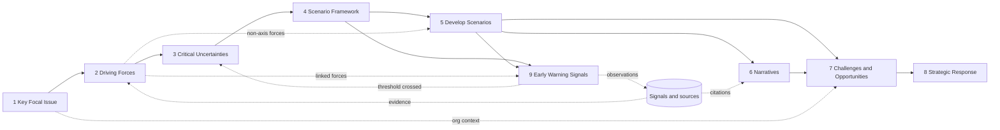

# Scenario Planning Methodology — Analysis

**Date:** 2026-10-30
**Source of truth:** `docs/Scenario Planning Methodology - Part of Era Jaya.pptx` (26 slides; summarized by Jaka Purwanto, 2023–2024, based on Lindgren & Bandhold 2003, Schoemaker 1995, Woody Wade 2020, Rohrbeck 2012/2021, Ruff 2014)
**Purpose:** Restate the deck's nine-step method as product requirements for Foresight Radar. This document describes the method only; the implementation status is in `docs/audit/SCENARIO_PLANNING_FEATURE_AUDIT.md`.

Related documents:

- `docs/audit/SCENARIO_PLANNING_FEATURE_AUDIT.md` — what exists today
- `docs/audit/SCENARIO_PLANNING_FEATURE_MATRIX.md` — capability-by-capability status
- `docs/audit/SCENARIO_PLANNING_DATA_MODEL_GAP.md` — schema gaps
- `docs/product/SCENARIO_PLANNING_TARGET_WORKFLOW.md` — target journey
- `docs/product/SCENARIO_PLANNING_FEATURE_SPECIFICATION.md` — target features
- `docs/product/SCENARIO_PLANNING_DEVELOPMENT_ROADMAP.md` — priorities

---

## 1. Summary of the Deck

### 1.1 Why scenario planning (slides 1–11)

- Scenario planning explores **plausible futures and their development paths** over a medium-to-long horizon. It does not try to find the "right" future; it prepares the organization to succeed across several (slide 11).
- Linear planning (extrapolating last year, or extrapolating with a best/worst tolerance band) works for roughly a one-year horizon. When many change drivers act in parallel (new regulation, technology, geopolitics, competitors, social change, consumer behaviour, macroeconomics, environment), the range of possible futures widens and extrapolation stops working (slides 6–10).
- Leaders need "sensing the future": identify key driving forces, explore multiple plausible futures, and detect early warning signals (slide 2).
- Worked references: Bandung Scenarios 2030, Sketsa Energi Indonesia 2030, and Jakarta Metropolitan urban mobility 2030 (Sunitiyoso et al., 2023), which shows four named scenarios each with a headline and illustration (slides 3–5).

### 1.2 The nine steps (slide 13)

1. Key Focal Issue
2. Driving Forces
3. Critical Uncertainties
4. Scenario Framework
5. Develop Scenarios
6. Narratives Imagination
7. Challenges & Opportunities
8. Strategic Response ("Strategic Respond" on the slide)
9. Early Warning Signal

### 1.3 Collaboration principle (slide 14)

Consensus on driving forces and their priority level comes from a **cross-functional, collaborative meeting**: several divisions (A–E), external or internal experts, and a coordinating division that runs the session. The assessment covers the macro and mezzo environment. The deck names this "one of the key success factors" for a robust scenario set.

### 1.4 Worked example (slides 15–25)

Indonesia four-wheeler electrification in 2030, carried through all nine steps. It is used throughout this document as the reference case.

### 1.5 Sensing (slide 26)

Monitoring potential signals of change shows which scenario is becoming the new trend. Signals depend on context (regulation, customer or social behaviour, technology, industry). Using scenarios plus early warning signals, organizations can act before trends fully materialize. The slide distinguishes current trends ("likely"), current knowledge ("could"), and future knowledge ("might"), and wild cards / weak signals ("hilal", early detection).

---

## 2. The Nine Steps

Each step lists: intent, required capabilities, inputs, outputs, methodological rules, AI opportunities, and human validation. "Must" marks what the deck requires; "should" marks what a usable product needs to support the step well.

### Step 1 — Key Focal Issue (slide 15)

**Intent.** State the strategic question the exercise explores, and why.

**Deck example.** Key focal issue: *"How Indonesia vehicle (four wheeler) electrification look like in 2030?"* Purpose: *"Based on this scenario planning, CP function develops strategic proposal toward ID electrification 2030 scenario."*

**Required capabilities.**

| Capability | Level | Note |
|---|---|---|
| Focal question (one sentence) | Must | The anchor for every later step |
| Purpose / intended use of the result | Must | The deck pairs the question with a purpose |
| Planning horizon (target year) | Must | Embedded in the question ("in 2030"); needs to be explicit so the horizon can drive prompts and indicators |
| Scope: geography and industry | Should | "Indonesia", "four wheeler" |
| Owner / organizational context (function, business unit) | Should | "CP function" |
| Background and rationale | Should | Short text |
| Participants | Should | Needed for slide 14 collaboration |

**Inputs.** Organizational context, sponsor intent.
**Outputs.** A defined scenario planning exercise that all later artefacts belong to.
**Rules.** One exercise has one focal issue. Changing the focal issue after scenarios exist changes the meaning of everything downstream.
**AI opportunity.** Sharpen a draft question (make it open, time-bound, scoped), propose a purpose statement. Optional.
**Human validation.** The sponsor confirms the question and purpose.

### Step 2 — Driving Forces (slides 16–17)

**Intent.** Identify the forces that will shape the focal issue, across two environmental levels.

**Taxonomy (slides 16–17).**

| Level | Categories in the deck |
|---|---|
| Macro environment | Political, Economic, Social, Technology, Ecology (Environmental), Legislative (Regulation) |
| Mezzo / industry environment | Consumer (Customers), Supply Chain / Suppliers, Competitors (Existing competitors), New Entrant, Product Substitute |

Slide 16 groups 30+ observed movements under these headings (e.g. *strong government push on energy security*, *EV incentives and tax structures are evolving*, *increasing TKDN requirements*, *regulatory complexity across central and local government (Opsen)*, *pressure on middle-class purchasing power*, *value-based switching*, *cost pressure due to declining volumes*, *aggressive price repositioning*, *rapid market entry of Chinese OEMs*, *growth of car-sharing platforms*). Slide 17 condenses these into **11 driving forces, one per category**, each with a short description, e.g. *Politic — willing to control electrification*; *Technology — mega trend of Connected, Autonomous, Sharing, Electrification*; *Entrance — low entry barrier, many new comers*; *Substitute — demand of car sharing increase*.

**Methodological reading.** Slide 16 lists **observations of movement** (signals). Slide 17 lists **driving forces**, each an aggregation of several observations. A signal is evidence; a driving force is the broader force. Several signals support one force; one signal may support more than one force.

**Required capabilities.**

| Capability | Level |
|---|---|
| Create a driving force with name and description | Must |
| Classify level (macro / mezzo) and category from the 11 above | Must |
| Link supporting signals / evidence to a force (many-to-many) | Must |
| Describe the force's influence on the focal issue | Should |
| Review, edit, merge duplicates, retire forces | Should |
| Collaborative assessment and expert validation (slide 14) | Must |
| Scope forces to the exercise's focal issue | Must (a force is "driving" relative to a focal issue) |

**Inputs.** Focal issue; signals and sources; expert knowledge.
**Outputs.** A validated, categorized list of driving forces for the exercise (the deck's example has 11).
**Rules.** Do not turn every signal into a force. Every category should be considered, though not every category needs a force. The list should be short enough to assess in a workshop.
**AI opportunity.** Extract signals from documents; propose a category; cluster related signals into candidate forces; flag duplicates.
**Human validation.** The cross-functional group agrees the list (slide 14).

### Step 3 — Critical Uncertainties (slides 18–19)

**Intent.** Score each driving force on **uncertainty (1–10)** and **impact (1–10)**, plot them, and pick the **two most critical** items.

**Deck example.** Slide 18 adds uncertainty and impact columns (1–10) to the 11-force table. Slide 19 plots forces by number on an uncertainty (x) × impact (y) Low/High matrix: forces 9 and 7/10, 8/11, 3, 5, 1, 2, 4, 6 appear. It then names **Key driver #1: Government Regulation** and **Key driver #2: Technology**.

**Methodological reading.** "Government Regulation" is not one of the 11 rows; it combines *Politic (1)* and *Legislative (6)*. A critical uncertainty can therefore be a **named cluster of one or more driving forces**, chosen by judgement, not the two highest scores. The deck shows the selection as a decision.

**Required capabilities.**

| Capability | Level |
|---|---|
| Score uncertainty 1–10 and impact 1–10 per force | Must |
| Record rationale for each score | Should |
| Capture several participants' scores and reach consensus | Must (slide 14) |
| Uncertainty × impact matrix visualization | Must |
| Highlight the high-impact / high-uncertainty region | Must |
| Select exactly two critical uncertainties | Must |
| A critical uncertainty may group several forces and have its own name | Must (deck example) |
| Record why those two were selected | Should |
| Check the two are independent enough to form axes | Should |
| Review AI-suggested scores before they count | Must if AI is used |

**Inputs.** Validated driving forces.
**Outputs.** Two named, approved critical uncertainties with rationale.
**Rules.** High impact + high uncertainty are candidates. High impact + low uncertainty are **predetermined elements**: they belong in every scenario, not on an axis. The final two are a human decision.
**AI opportunity.** Suggest scores with rationale citing linked signals; suggest candidate pairs; check independence using cross-impact data.
**Human validation.** The group approves both critical uncertainties and the reason.

### Step 4 — Scenario Framework (slide 20)

**Intent.** Turn the two critical uncertainties into axes with two opposing poles each, producing a 2×2 matrix of four quadrants, then name them.

**Deck example.** Axis 1 *Government Regulation*: Favorable ↔ Unfavorable. Axis 2 *Technology Development*: Fast ↔ Slow. Quadrants are later named (slide 21):

| Scenario | Technology Development | Government Regulation |
|---|---|---|
| FAVOUR | Fast | Favorable |
| DICHOTOMY | Fast | Unfavorable |
| CHALLENGING | Slow | Unfavorable |
| STAGNATION | Slow | Favorable |

**Required capabilities.**

| Capability | Level |
|---|---|
| Use the two selected critical uncertainties as axes | Must |
| Name each axis (dimension) | Must ("Technology Development" names the uncertainty, not a force keyword) |
| Define two opposing, plausible poles per axis | Must |
| Generate four quadrants from the pole combinations | Must |
| Name each quadrant | Must ("And Naming", slide 20) |
| Short description and assumptions per quadrant | Should |
| Validate the poles are opposite ends of one uncertainty and both plausible | Should |
| Keep the link from axes back to critical uncertainties and forces | Must |

**Inputs.** Two critical uncertainties.
**Outputs.** An approved 2×2 framework with four named quadrants.
**Rules.** Axes come from the critical uncertainties, never from the macro/mezzo categories. Poles describe end states of the uncertainty, not good/bad outcomes for the company.
**AI opportunity.** Suggest pole labels; suggest quadrant names; check that poles are mutually exclusive.
**Human validation.** Approve the framework before developing scenarios.

### Step 5 — Develop Scenarios (slide 21)

**Intent.** Describe the conditions that hold in each quadrant.

**Deck example.** Each quadrant gets three descriptive conditions, e.g. FAVOUR: *regulation favours all electrification technologies*; *positive trend of new technology adoption*; *ecosystem developed for all technologies (HEV, BEV, FCEV)*. DICHOTOMY: *regulation favours only BEV*; *technology adoption follows global movement*; *ecosystem grows slowly for certain technologies*.

**Required capabilities.**

| Capability | Level |
|---|---|
| A list of conditions per scenario | Must |
| State how each axis pole shows up concretely | Must |
| State how the other (non-axis) driving forces behave in the scenario | Should |
| Assumptions and predetermined elements common to all scenarios | Should |
| Compare the four scenarios side by side | Should |
| Check the scenarios are meaningfully different and internally consistent | Should |
| Edit AI-drafted conditions | Must if AI is used |

**Inputs.** Framework; driving forces; predetermined elements.
**Outputs.** Four scenario descriptions, each a short list of conditions.
**Rules.** Conditions come before the narrative. Four scenarios should not be the same future with different names.
**AI opportunity.** Draft conditions per quadrant from poles plus the other forces; flag near-duplicate conditions across quadrants.
**Human validation.** The team accepts the conditions.

### Step 6 — Narratives Imagination (slide 22)

**Intent.** Write a story of each future: how the world looks in the target year and how it got there.

**Deck example.** *"Scenario 1 – FAVOUR (Fast Technology × Favourable Regulation): By 2030, Indonesia thrives as a regional EV hub…"* Four paragraphs of ~50–60 words, each opening with the scenario name and its pole combination.

**Required capabilities.**

| Capability | Level |
|---|---|
| A narrative per scenario | Must |
| Grounded in the scenario's conditions | Must |
| Sequence of developments toward the target year | Should |
| Reference supporting signals | Should |
| Distinguish observed fact, evidence-supported analysis, assumption, plausible development, AI interpretation | Must if AI writes it |
| Edit and validate narratives | Must |

**Inputs.** Scenario conditions; evidence; driving forces.
**Outputs.** Four validated narratives.
**Rules.** No invented facts, statistics or sources. Speculation is marked as such.
**AI opportunity.** Draft narratives with citations to signals.
**Human validation.** Review and approve each narrative.

### Step 7 — Challenges & Opportunities (slide 23)

**Intent.** For each scenario, what opportunities and challenges it creates for the organization.

**Deck example.** FAVOUR — opportunity: *introduce all xEV (HEV, PHEV, BEV, FCEV) to maximize market penetration and CO₂ reduction*; challenges: *intense competition because all players want the incentive*; *big effort needed to attract customers*. CHALLENGING — opportunity: *flexy-fuel vehicles with less cost burden*; challenge: *E85/E100 fuel readiness nationwide*.

**Required capabilities.**

| Capability | Level |
|---|---|
| List opportunities per scenario | Must |
| List challenges per scenario | Must |
| Describe impact on the organization | Should |
| Link to the driving forces / conditions that cause them | Should |
| Prioritize | Should |

**Inputs.** Scenario conditions and narrative; organizational context (Step 1).
**Outputs.** Opportunities and challenges per scenario.
**Rules.** Items must follow from that scenario's conditions. An item that fits all four scenarios is either a predetermined element or too generic.
**AI opportunity.** Draft scenario-specific items; flag items repeated across all scenarios.
**Human validation.** Review and prioritize.

### Step 8 — Strategic Response (slide 24)

**Intent.** Decide what the organization will do in each scenario, in answer to its opportunities and challenges.

**Deck example.** FAVOUR — *engage authority to assure product incentive; secure USP for each xEV model; systematic and continuous advocacy to external stakeholders*. STAGNATION — *collaborate with third parties to develop product and accelerate ecosystem*. The response *"Secure USP for each xEV model"* appears under two scenarios.

**Required capabilities.**

| Capability | Level |
|---|---|
| Create responses per scenario | Must |
| Link each response to the opportunities / challenges it answers | Should |
| Rationale | Should |
| Priority, actions / initiatives, owner | Should |
| Mark which scenarios a response applies to (one response, several scenarios) | Should (deck shows a shared response) |
| Identify responses useful in all or most scenarios ("no-regret" / robust) | Should |
| Record assumptions a response depends on | Should |
| Approval state separate from AI suggestions | Must |

**Inputs.** Opportunities and challenges.
**Outputs.** Approved strategic responses with scenario coverage.
**Rules.** AI recommendations are proposals until approved by an accountable person.
**AI opportunity.** Suggest responses; suggest which scenarios a response also serves.
**Human validation.** Approval by the owner (in the deck example, the CP function).

### Step 9 — Early Warning Signal (slides 25–26)

**Intent.** Name the indicators that show which scenario is unfolding, then monitor them.

**Deck example.** FAVOUR indicators: *regulation issuance of incentive for all xEV models; xEV technology adoption grows steadily; customer acceptance for various xEV technologies; good progress of xEV ecosystem development*. Each scenario's four indicators mirror the four themes (regulation incentives, adoption growth, customer acceptance, ecosystem progress) with the direction that fits the scenario.

**Methodological reading.** The same indicator (e.g. *xEV adoption growth*) distinguishes scenarios by its **direction or threshold**: "grows steadily" points to FAVOUR/DICHOTOMY, "goes slowly" to STAGNATION/CHALLENGING. Indicators are therefore best modelled once, with a per-scenario expected direction.

**Required capabilities.**

| Capability | Level |
|---|---|
| Indicators per scenario | Must |
| Link indicators to driving forces / axes | Should |
| What to monitor, in words | Must |
| Measurable metric where possible, unit, baseline, threshold | Should |
| Monitoring frequency and owner | Should |
| Observations over time (manual entry first) | Should |
| Link new signals to indicators | Should |
| Show which scenario is gaining relevance | Should |
| Trigger a review of the exercise when a threshold is crossed | Should |

**Inputs.** Scenarios; axes; driving forces.
**Outputs.** An indicator set and a monitoring record.
**Rules.** Not every indicator can be automated; manual observation must be supported. An indicator should discriminate between scenarios.
**AI opportunity.** Suggest indicators; match newly ingested signals to indicators.
**Human validation.** Confirm indicators and thresholds; confirm observations.

---

## 3. Inputs, Outputs and Dependencies

| Step | Primary input | Primary output | Hard dependency |
|---|---|---|---|
| 1 | Org context | Exercise + focal issue + horizon | — |
| 2 | Focal issue, signals | Driving forces (categorized, evidenced) | 1 |
| 3 | Driving forces | Scores; two critical uncertainties | 2 |
| 4 | Two critical uncertainties | 2×2 framework, four named quadrants | 3 |
| 5 | Framework, other forces | Conditions per scenario | 4 |
| 6 | Conditions, evidence | Narrative per scenario | 5 |
| 7 | Conditions, narrative, org context | Opportunities and challenges per scenario | 5 (6 recommended) |
| 8 | Opportunities, challenges | Strategic responses with scenario coverage | 7 |
| 9 | Scenarios, axes, forces | Indicators, observations | 4 (5 recommended) |

---

## 4. Methodological Rules (product invariants)

1. **One exercise, one focal issue.** Every driving force assessment, framework, scenario, response and indicator belongs to an exercise.
2. **Signals are evidence, not forces.** Forces aggregate signals; links are many-to-many.
3. **Two levels, eleven categories.** Macro: Political, Economic, Social, Technology, Ecology, Legislative. Mezzo: Consumer, Supply Chain, Competitor, New Entrant, Substitute.
4. **Scores are 1–10 on two axes.** Uncertainty and impact are assessed per force, per exercise.
5. **Exactly two critical uncertainties**, chosen by people, each possibly grouping several forces, with a recorded reason.
6. **Axes are critical uncertainties, never categories.**
7. **Each axis has two opposing, plausible poles**; four quadrants result, each with a name.
8. **Conditions precede narrative.** Narratives elaborate conditions; they do not introduce new axes.
9. **Four scenarios must differ** in substance, not only in name.
10. **Implications are scenario-specific.** Generic items are flagged.
11. **Responses are linked to scenarios**, and a response may serve several.
12. **Indicators discriminate between scenarios** by direction or threshold.
13. **AI output is a proposal** until a person accepts it. Provenance (AI, template, human, edited) stays visible.
14. **Consensus is collaborative** (slide 14): several participants contribute; the record shows who decided what.
15. **Monitoring loops back.** New evidence may change scores, which may call the framework into question.

---

## 5. AI-Assisted Opportunities (summary)

| Step | AI assist | Human role |
|---|---|---|
| 1 | Refine the focal question and purpose | Confirm |
| 2 | Extract signals; propose category; cluster signals into candidate forces; detect duplicates | Accept, merge, edit |
| 3 | Suggest scores with rationale; suggest candidate axis pairs; independence check | Score, decide the two |
| 4 | Suggest poles and quadrant names | Approve framework |
| 5 | Draft conditions; distinctness check | Edit, accept |
| 6 | Draft cited narratives | Edit, approve |
| 7 | Draft scenario-specific opportunities / challenges | Prioritize, approve |
| 8 | Suggest responses and their cross-scenario coverage | Approve |
| 9 | Suggest indicators; match new signals to indicators | Confirm thresholds and observations |

AI is optional at every step: each artefact must be creatable and editable by hand.

## 6. Human Validation Points (decision gates)

| Gate | Decision | Who (per slide 14) |
|---|---|---|
| G1 | Focal issue and purpose confirmed | Sponsor / coordinating division |
| G2 | Driving force list agreed | Cross-functional group |
| G3 | Scores agreed (consensus) | Cross-functional group + experts |
| G4 | Two critical uncertainties approved with reason | Coordinating division |
| G5 | Framework (axes, poles, names) approved | Coordinating division |
| G6 | Scenarios and narratives approved | Coordinating division |
| G7 | Strategic responses approved | Accountable owner |
| G8 | Indicator thresholds confirmed; review triggered when crossed | Monitoring owner |
