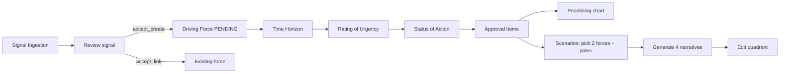
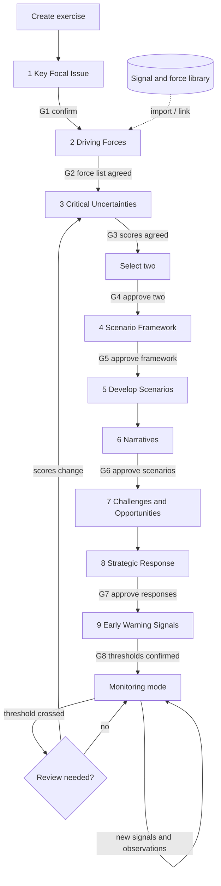
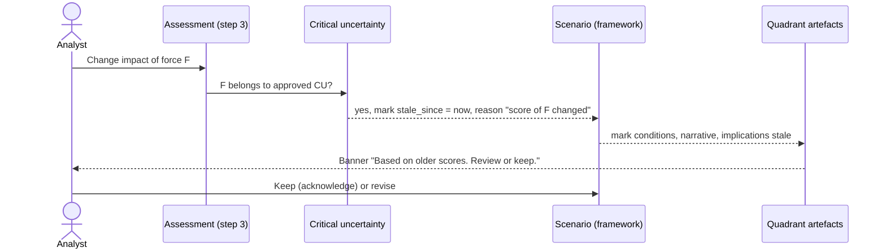
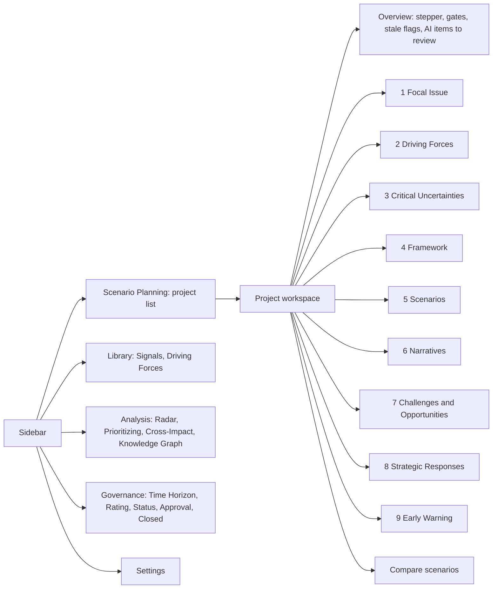

# Scenario Planning Target Workflow

**Date:** 2026-10-30
**Inputs:** `docs/product/SCENARIO_PLANNING_METHODOLOGY.md` (method), `docs/audit/SCENARIO_PLANNING_FEATURE_AUDIT.md` (current state).
**Scope:** The end-to-end journey a business user should follow, with transitions, gates, AI assists and change handling. Feature-level detail is in `SCENARIO_PLANNING_FEATURE_SPECIFICATION.md`.

---

## 1. Design Principles

1. **One exercise = one workspace.** All nine steps happen inside a scenario planning project. The existing tenant-wide modules (signal library, driving force library, radar, cross-impact) remain available and feed the exercise.
2. **The nine steps are the navigation.** Users always see which step they are on, what is done, and what is next.
3. **Gates are explicit.** Seven human decisions (G1–G7, plus G8 for monitoring) move the exercise forward. AI never passes a gate.
4. **Steps stay reachable.** Users can go back to any completed step. Editing upstream flags downstream work as possibly outdated; it never deletes it.
5. **AI is optional.** Every artefact can be created by hand; AI drafts carry an "AI proposal" badge until reviewed.

## 2. Current vs Target Journey

### 2.1 Today

Issues observed in code: no exercise context; each list defaults to the current month; approval requires an operational Status of Action; the two axes are chosen inside the scenario form with no record of the decision; quadrants are created only by narrative generation; steps 1, 5, 8 have no screen; 7 and 9 are a text field and a string list.

### 2.2 Target

## 3. Step Transitions

| From → To | Entry condition (validation) | Data carried | Back-navigation | Upstream-change effect |
|---|---|---|---|---|
| Create → 1 | User has `manage-scenario` (or a new `manage-project`) | — | — | — |
| 1 → 2 | Focal question, purpose, target year filled; **G1** confirmed | Focal issue, horizon, scope (used in prompts) | Editable; edits after G1 flag all steps stale | Changing focal question or target year flags 2–9 |
| 2 → 3 | ≥1 force included; every included force has category and description; **G2** recorded | Included forces + linked signals | Add / exclude forces any time | Excluding a force used in a critical uncertainty flags 3–9 |
| 3 → 3b | Every included force has a consensus impact and uncertainty score (rationale recommended); **G3** | Scores, rationale, matrix | Re-score any time | Score change on a force inside an approved uncertainty flags 4–9 |
| 3b → 4 | Exactly two critical uncertainties, each with ≥1 force and a selection rationale; independence warning acknowledged; **G4** | Names, linked forces, rationale | Retire / replace an uncertainty (requires new framework) | Replacing an uncertainty marks the framework superseded |
| 4 → 5 | Both axes have two poles; four quadrants exist and are named; **G5** | Axes, poles, quadrant names / summaries | Rename quadrants any time; changing poles re-opens G5 | Pole change flags 5–9 for that scenario |
| 5 → 6 | Each quadrant has ≥2 conditions | Conditions, predetermined elements | Edit freely | Condition edit flags that quadrant's narrative, implications |
| 6 → 7 | Each quadrant has a narrative; **G6** (all four reviewed) | Narratives with citations | Regenerate (edited text protected by confirmation, as today) | Narrative edit does not flag downstream |
| 7 → 8 | Each quadrant has ≥1 opportunity and ≥1 challenge | Implications with links | Edit freely | Deleting an implication unlinks responses (warn) |
| 8 → 9 | ≥1 approved response; every response has a scenario-fit row for all four quadrants; **G7** | Responses, fit, robustness | Edit; approval resets on substantive edit | — |
| 9 → Monitoring | Each quadrant has ≥2 indicators with expected direction; owner and frequency set; **G8** | Indicators, thresholds | Edit | — |
| Monitoring → 3 | A threshold crossed or a reviewer opens a review | Observations, new signals | — | Opening a review creates a new assessment round; prior decisions stay as history |

Steps 7 and 9 can start once the framework is approved (G5); the table shows the recommended order.

## 4. Human Decision Points

| Gate | Decision | Recorded as | Default approver |
|---|---|---|---|
| G1 | Focal issue, purpose, horizon confirmed | `confirmed_by/at` on project | Project owner / coordinator |
| G2 | Driving force list agreed | `inclusion_status = included` on project forces + gate event | Coordinator after group session |
| G3 | Consensus scores agreed | consensus assessments `review_status = accepted` | Coordinator |
| G4 | Two critical uncertainties approved, with reason | `critical_uncertainties.status = approved` | Coordinator |
| G5 | Framework approved | `scenarios.framework_status = approved` | Coordinator |
| G6 | Scenarios and narratives approved | quadrant `review_status = approved` (×4) | Coordinator |
| G7 | Strategic responses approved | `strategic_responses.status = approved` | Accountable owner per response |
| G8 | Indicators and thresholds confirmed | indicator `review_status = accepted` | Monitoring owner |

P0/P1 ship gates as single-approver actions using existing permissions; P2 adds participants and consensus (slide 14).

## 5. AI-Assisted Actions in the Journey

| Step | Action (button) | Runs as | Output state |
|---|---|---|---|
| 1 | "Sharpen focal question" | sync, short | Suggestion in form; user accepts text |
| 2 | Existing: ingest source → extract signals | `ExtractSignals` job | PENDING signals |
| 2 | "Suggest forces from accepted signals" | job | Proposed project forces (`origin = ai`) |
| 3 | "Suggest scores" | job | `ai_suggestion` assessments with rationale citing signals |
| 3b | Existing: suggested axis pairs (extend to uncertainties) | sync | Candidate pairs |
| 4 | "Suggest poles and names" | sync | Proposed labels |
| 5 | "Draft conditions" | job | Proposed conditions |
| 6 | Existing: "Generate narratives" (prompt v2 adds conditions) | `GenerateScenarioNarrative` | Draft narratives |
| 7 | "Draft opportunities and challenges" | job | Proposed implications |
| 8 | "Suggest responses" | job | Proposed responses + suggested fit |
| 9 | "Suggest indicators"; later "Match new signals to indicators" | job | Proposed indicators; proposed observation links |

All jobs follow the existing contract: `ShouldBeUnique`, `tries = 1`, status column, polling, template or empty fallback, structured schema, server-side validation of references.

## 6. Handling Upstream Changes

Rules:

1. Staleness is a flag with a reason; nothing is deleted or regenerated automatically.
2. "Keep" records an acknowledgement (who, when) and clears the flag.
3. A framework approved on uncertainty X stays linked to X even if X is later retired; it shows "superseded".
4. Evidence removal (signal rejected / deleted) flags quadrants that cite it, replacing today's "Sinyal sudah dihapus" placeholder with a stale flag.
5. Hard deletion of a force used by an approved artefact is blocked (replacing today's cascade).

## 7. Navigation and Screens

The project workspace is the new primary entry. Existing sidebar items regroup under Library / Analysis / Governance without being removed, so current users keep their workflows.

**Overview page shows:** step status (not started / in progress / done / stale), last gate and approver, count of unreviewed AI items, stale banners, next recommended action in plain language.

**Empty states per step** say what the step is for (one sentence from the method), what is required to finish it, and offer manual create plus the optional AI assist.

## 8. Non-Technical User Considerations

- Use the deck's vocabulary on screen (Key Focal Issue, Driving Forces, Critical Uncertainties, …) in both Indonesian and English via the existing locale switcher.
- Show the deck's example values as placeholder text (e.g. *"How Indonesia vehicle (four wheeler) electrification look like in 2030?"*).
- Never show raw scores alone; show the matrix with numbered points, as in slide 19.
- AI badges and "proposal" wording follow `QuadrantCard.jsx` (AI / template / edited).
