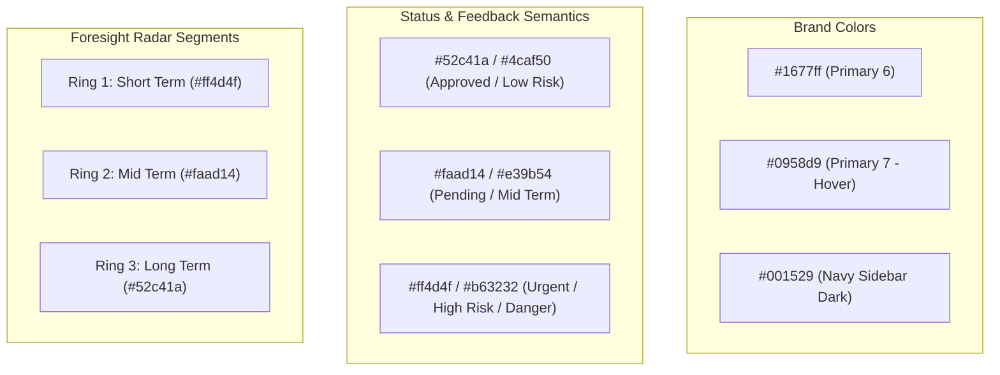

# Current Design System Audit — Foresight Radar

> **Role:** Design Systems Engineer & Senior Product Designer  
> **Repository:** `roozylabs27/foresight-radar`  
> **Audit Date:** October 2026  
> **Frameworks:** Laravel 10 (Inertia.js SSR/SPA bridge), React 18, Vite 5, Ant Design 5 (`antd` v5.13.2)

---

## 1. Executive Summary

Foresight Radar utilizes **Ant Design v5** (`antd` v5.13.2) as its primary UI component library, paired with React 18 and Inertia.js. While Ant Design v5 introduces a powerful CSS-in-JS token-based theme engine (`theme.useToken`, `ConfigProvider`), the current codebase exhibits significant architectural fragmentation:
1. **Decentralized Theme Providers:** `ConfigProvider` is instantiated separately in [`AuthenticatedLayout.jsx`](file:///c:/laragon/www/foresight-radar/resources/js/Layouts/AuthenticatedLayout.jsx#L195-L204) and [`Login.jsx`](file:///c:/laragon/www/foresight-radar/resources/js/Pages/Auth/Login.jsx#L87-L95), rather than globally at the Inertia root in [`app.jsx`](file:///c:/laragon/www/foresight-radar/resources/js/app.jsx).
2. **Duplicated & Hardcoded CSS Overrides:** [`additional.css`](file:///c:/laragon/www/foresight-radar/resources/css/additional.css) injects arbitrary global CSS classes (`.custom-green-button`, `.custom-red-button`, `.green-background`, `.radar-card`) that bypass the Ant Design Design Token pipeline and create conflicting visual styles.
3. **Lack of Design System Governance:** Colors, spacing, button variants, and typography levels are frequently hardcoded via inline `style={{ ... }}` objects across page components rather than derived from design tokens.

---

## 2. Token Architecture & Theme Providers

### 2.1 ConfigProvider Declarations

The application configures Ant Design themes in two isolated locations:

#### Location A: Authenticated Shell ([`AuthenticatedLayout.jsx#L195-L204`](file:///c:/laragon/www/foresight-radar/resources/js/Layouts/AuthenticatedLayout.jsx#L195-L204))
```jsx
<ConfigProvider
    theme={{
        token: {
            colorPrimary: "#1677ff",
            borderRadius: 8,
            fontFamily:
                "-apple-system, BlinkMacSystemFont, 'Segoe UI', Roboto, 'Helvetica Neue', Arial, sans-serif",
        },
    }}
>
```

#### Location B: Authentication Views ([`Login.jsx#L87-L95`](file:///c:/laragon/www/foresight-radar/resources/js/Pages/Auth/Login.jsx#L87-L95))
```jsx
<ConfigProvider
    theme={{
        token: {
            colorPrimary: "#1677ff",
            borderRadius: 8,
            fontFamily:
                "'Figtree', -apple-system, BlinkMacSystemFont, 'Segoe UI', Roboto, sans-serif",
        },
    }}
>
```

### 2.2 Token Analysis & Deficiencies

| Token Dimension | Configured Token | Default Antd v5 Token | Issue / Conflict |
| :--- | :--- | :--- | :--- |
| **`colorPrimary`** | `#1677ff` | `#1677ff` | Standard blue. However, custom CSS introduces non-tokenized greens (`#4caf50`) and reds (`#b63232`). |
| **`borderRadius`** | `8px` | `6px` | Set to 8px, but several custom CSS classes define `border-radius: 12px` or `4px` inline. |
| **`fontFamily`** | Inconsistent: System stack in Shell vs Figtree in Login | System UI font stack | Font family diverges between unauthenticated and authenticated sessions. Figtree is imported via Bunny Fonts in `app.blade.php` but omitted in AuthenticatedLayout. |
| **`colorSuccess`** | *(Unset / Default)* | `#52c41a` | `.custom-green-button` overrides success with `#4caf50`. |
| **`colorError`** | *(Unset / Default)* | `#ff4d4f` | `.custom-red-button` overrides error with `#b63232`. |
| **`colorWarning`** | *(Unset / Default)* | `#faad14` | Hover states in `additional.css` use `#e39b54`. |
| **Dark Mode** | Not configured | Supported via `theme.darkAlgorithm` | No dark mode token support or dark background overrides exist. |

---

## 3. CSS Cascade & Stylesheet Hierarchy

The stylesheet cascade is configured as follows in [`app.jsx`](file:///c:/laragon/www/foresight-radar/resources/js/app.jsx#L1-L3):
1. `resources/css/app.css`
2. `resources/css/additional.css` (imported via components)
3. Ant Design CSS-in-JS Emotion runtime style injection.

### 3.1 [`resources/css/app.css`](file:///c:/laragon/www/foresight-radar/resources/css/app.css)
- Contains basic HTML/body box-sizing resets (`margin: 0; padding: 0; width: 100%; min-height: 100%`).
- Contains dead/boilerplate classes from template generation:
  ```css
  .demo-logo-vertical {
      height: 32px;
      margin: 16px;
      background-color: #64748b;
      border-radius: 0.25rem;
  }
  ```
  *(Confirmed unreferenced in codebase).*

### 3.2 [`resources/css/additional.css`](file:///c:/laragon/www/foresight-radar/resources/css/additional.css)
Contains 169 lines of manual utility overrides with `!important` declarations that break design token reactivity:
- **Button Overrides:**
  ```css
  .custom-green-button {
      background-color: #4caf50;
      border-color: #4caf50;
      color: white;
  }
  .custom-red-button {
      background-color: #b63232;
      border-color: #b63232;
      color: white;
  }
  ```
- **Table Cell Highlighting:**
  ```css
  .green-background { background-color: #f6ffed !important; }
  .yellow-background { background-color: #fffbe6 !important; }
  .red-background { background-color: #fff1f0 !important; }
  ```
- **Custom Legend & Filter Components:**
  `.radar-card`, `.radar-table-row`, `.radar-no-badge`, `.radar-ring-legend`, `.radar-filter-bar`, and `.radar-fullscreen`.

---

## 4. Typography Scale & Hierarchy

The application relies on Ant Design's `<Typography.Title>` and `<Typography.Text>` components, but implements inconsistent hierarchy:

```
H1 (Unused in application)
H2 (30px) - Auth page feature hero headings
H3 (24px) - Unused
H4 (20px) - Page top banners (Dashboard, Driving Force, Time Horizon, Radar)
H5 (16px) - Section table headers ("Daftar Sinyal Perubahan", "Approval Items List")
Text (14px) - Body typography, form inputs, table cells
Text (12px) - Secondary descriptions, metadata, footer copyright
Microcopy (11px) - Subtitle badges ("STRATEGIC INTEL", "360° STRATEGIC HORIZON")
```

### Hierarchy Issues Identified:
1. **Banner Subtitle Inconsistency:** Page titles in the header bar use `level={4}` (`20px`), but some pages render titles inside the body content while others render them inside the top header slot.
2. **Hardcoded Inline Font Sizes:** Over 28 instances of `style={{ fontSize: 11 }}` or `style={{ fontSize: 15, fontWeight: 700 }}` in navigation components ([`AuthenticatedLayout.jsx#L257-L274`](file:///c:/laragon/www/foresight-radar/resources/js/Layouts/AuthenticatedLayout.jsx#L257-L274)).
3. **Typography vs Raw HTML Elements:** Mixed usage of `<Title level={5}>` alongside raw `<h3>` and `<span>` tags.

---

## 5. Color Palette & Semantic Mapping



### Palette Discrepancies:
- **Success / Green:** 3 different green hex values exist concurrently:
  - Antd Token: `#52c41a`
  - `.custom-green-button`: `#4caf50`
  - `.green-background`: `#f6ffed`
- **Error / Red:** 3 different red hex values exist concurrently:
  - Antd Token: `#ff4d4f`
  - `.custom-red-button`: `#b63232`
  - `.red-background`: `#fff1f0`
- **Warning / Orange:** 2 divergent warning palettes:
  - Antd Token: `#faad14`
  - `.custom-tag:hover`: `#e39b54`

---

## 6. Layout, Spacing & Breakpoints

### 6.1 Layout Shell Structure
- **Root Layout:** `<Layout style={{ minHeight: "100vh" }}>`
- **Sidebar (Sider):**
  - Width: `240px` (Expanded) / `64px` (Collapsed).
  - Breakpoint: `breakpoint="lg"` (`992px`).
  - Position: Sticky (`position: "sticky", top: 0, height: "100vh"`).
- **Header:** Sticky (`height: 64px, padding: "0 20px", position: "sticky", top: 0, zIndex: 10`).
- **Main Content Area:** `<Content style={{ padding: "24px 24px 0 24px" }}>` across all dashboard pages.

### 6.2 Responsive Breakpoint Definition
The application uses Ant Design's default 6-column grid breakpoints:
- `xs`: `< 576px`
- `sm`: `≥ 576px`
- `md`: `≥ 768px`
- `lg`: `≥ 992px`
- `xl`: `≥ 1200px`
- `xxl`: `≥ 1600px`

### 6.3 Layout Flaws Under Empirical Testing
1. **Mobile Sidebar Pinching:** On viewports `< 576px`, the Sider collapses to `64px` rather than hiding off-screen into an Ant Design `<Drawer>`. On an iPhone (375px), this reduces the usable canvas to only **311px**, breaking wide tables and charts.
2. **Filter Bar Overflow:** The filter bar (`.radar-filter-bar`) stacks awkwardly on viewports between `768px` and `992px` because date range pickers require minimum `240px` horizontal space.

---

## 7. Component Architecture & Reusability

### 7.1 Existing Reusable Component Inventory

| Component | Path | Responsibility | Architectural Quality |
| :--- | :--- | :--- | :--- |
| `ApplicationLogo` | `resources/js/Components/ApplicationLogo.jsx` | SVG brand icon | Clean, responsive SVG. |
| `Checkbox` | `resources/js/Components/Checkbox.jsx` | Native HTML checkbox | Redundant with `antd/Checkbox`. |
| `DangerButton` | `resources/js/Components/DangerButton.jsx` | Tailwind styled button | Redundant with `<Button danger>`. |
| `PrimaryButton` | `resources/js/Components/PrimaryButton.jsx` | Tailwind styled button | Redundant with `<Button type="primary">`. |
| `TextInput` | `resources/js/Components/TextInput.jsx` | Native HTML text input | Redundant with `antd/Input`. |
| `InputLabel` | `resources/js/Components/InputLabel.jsx` | Label tag wrapper | Redundant with `antd/Form.Item label`. |
| `InputError` | `resources/js/Components/InputError.jsx` | Error validation paragraph | Redundant with `antd/Form.Item help`. |
| `Dialog` | `resources/js/Components/Dialog.jsx` | Modal wrapper with Ant Design `<Modal>` | Useful abstraction, but duplicates Ant Design modal props. |
| `Radar` | `resources/js/Components/Radar.jsx` | Custom HTML5 Canvas / SVG 360° circular radar | Core domain asset; highly specialized visual algorithm. |
| `PrioritizingChart` | `resources/js/Components/PrioritizingChart.jsx` | Apache ECharts 2D scatter matrix | Good component encapsulation using `echarts-for-react`. |
| `OverallStatus` | `resources/js/Components/OverallStatus.jsx` | Tabular status summary | Page-specific; poorly separated. |

### 7.2 Component Gaps
1. **Missing `<PageHeader>`:** Every page manually creates an identical top banner with breadcrumbs, icon, title, and action buttons.
2. **Missing `<FilterToolbar>`:** The DateRangePicker + Dimension select combo is duplicated via copy-paste across 8 different pages.
3. **Missing `<DataTableWrapper>`:** Ant Design `<Table>` configurations (pagination, pageSize, loading states, empty states) are reimplemented on every table page with minor syntax variations.

---

## 8. Summary of Current Design System Maturity

| Dimension | Maturity Level (1-5) | Key Finding |
| :--- | :---: | :--- |
| **Tokenization** | Level 2 (Emerging) | Central `ConfigProvider` exists, but colors and sizes are frequently hardcoded. |
| **Visual Consistency** | Level 3 (Defined) | Clean Ant Design aesthetic, but inconsistent buttons and table cell styling. |
| **Component Reuse** | Level 2 (Emerging) | Repetitive filter bars and table boilerplates across analytical views. |
| **Responsive Ergonomics** | Level 2 (Emerging) | Desktop looks cohesive; mobile experiences severe layout pinching. |
| **Accessibility (WCAG)** | Level 2 (Emerging) | Missing form label associations and custom tag contrast issues. |
