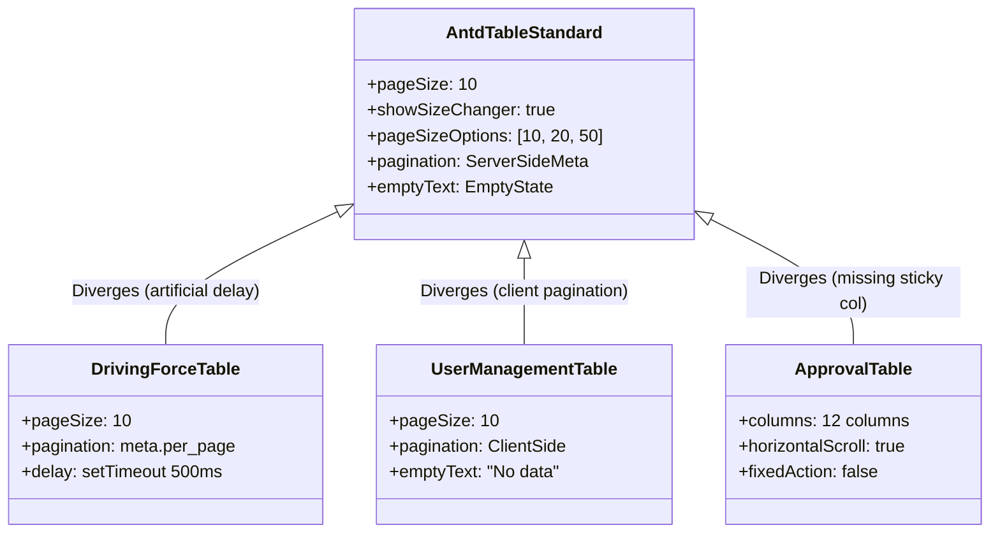
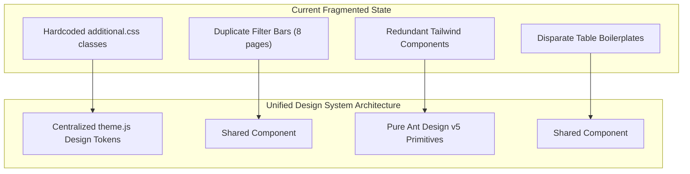

# Design System Consistency & Discrepancy Audit — Foresight Radar

> **Role:** Design Systems Engineer & Staff Frontend Engineer  
> **Repository:** `roozylabs27/foresight-radar`  
> **Audit Date:** October 2026  
> **Target Scope:** Cross-Component Consistency (Buttons, Tables, Filters, Modals, Badges, Notifications)

---

## 1. Executive Summary

A systematic comparative audit of components across all 15 routes revealed significant divergence from Ant Design design system standards. Code duplication, ad-hoc CSS overrides, and mixed architectural patterns have accumulated across successive sprints. 

This document cataloguers every identified inconsistency across six core design system categories and establishes concrete refactoring targets to unify the frontend architecture.

---

## 2. Inconsistency Analysis Matrix

### 2.1 Buttons & Interactive Triggers

| Pattern | Current Implementations | Inconsistency Description | Target Standardized Component |
| :--- | :--- | :--- | :--- |
| **Primary Action Buttons** | 1. `<Button type="primary">`<br/>2. `<Button style={{ background: "#1677ff" }}>`<br/>3. `resources/js/Components/PrimaryButton.jsx` | Mixed Ant Design and Tailwind classes; redundant wrapper components. | `<Button type="primary">` governed by theme tokens. |
| **Approval / Success Actions** | 1. `<Button className="custom-green-button">`<br/>2. `<Button style={{ backgroundColor: "#4caf50" }}>` | Uses custom CSS class with `#4caf50` overriding Ant Design's token `#52c41a`. Hover states fail to darken consistently. | `<Button type="primary" style={{ backgroundColor: token.colorSuccess }}>` or custom semantic variant. |
| **Rejection / Danger Actions** | 1. `<Button danger>`<br/>2. `<Button className="custom-red-button">`<br/>3. `resources/js/Components/DangerButton.jsx` | Three completely different approaches for destructive actions across pages. | `<Button danger>` using Ant Design's native danger variant. |
| **Action Dropdowns (Tables)** | 1. Ant Design `<Dropdown menu={{ items }}>`<br/>2. Individual inline button rows | In Driving Force, actions use `<Dropdown>` with `<MoreOutlined />`. In User Management and Approval, actions are rendered as raw inline buttons. | Unified `<RowActions>` dropdown component across all data tables. |

---

### 2.2 Table & Pagination Consistency



#### Key Table Inconsistencies:
1. **Artificial Network Delays:** In [`DrivingForce/Table.jsx#L114-L125`](file:///c:/laragon/www/foresight-radar/resources/js/Pages/DrivingForce/Table.jsx#L114-L125), table data loading wraps `setData` in an artificial `setTimeout(..., 500)`, while other table pages update state synchronously, leading to jarring differences in perceived performance.
2. **Server-Side vs Client-Side Pagination:**
   - Driving Force and Registered List implement server-side pagination with Laravel pagination meta (`current_page`, `last_page`, `total`).
   - User Management loads all records in memory and uses client-side Ant Design pagination.
3. **Empty States:** Mixed usage of Ant Design's `<Empty image={Empty.PRESENTED_IMAGE_SIMPLE} />` vs raw text strings ("No data", "No signals found for the selected period").

---

### 2.3 Filter Toolbar Duplication

The combination of **Date Range Picker + Dimension Dropdown** is reimplemented via copy-paste across **8 separate pages**:
1. [`Dashboard.jsx`](file:///c:/laragon/www/foresight-radar/resources/js/Pages/Dashboard.jsx)
2. [`DrivingForce/Table.jsx`](file:///c:/laragon/www/foresight-radar/resources/js/Pages/DrivingForce/Table.jsx)
3. [`TimeHorizon/Table.jsx`](file:///c:/laragon/www/foresight-radar/resources/js/Pages/TimeHorizon/Table.jsx)
4. [`RatingUrgency/Table.jsx`](file:///c:/laragon/www/foresight-radar/resources/js/Pages/RatingUrgency/Table.jsx)
5. [`StatusAction/Table.jsx`](file:///c:/laragon/www/foresight-radar/resources/js/Pages/StatusAction/Table.jsx)
6. [`Approval/Table.jsx`](file:///c:/laragon/www/foresight-radar/resources/js/Pages/Approval/Table.jsx)
7. [`Report/ForesightRadar.jsx`](file:///c:/laragon/www/foresight-radar/resources/js/Pages/Report/ForesightRadar.jsx)
8. [`UserManagement/User/Table.jsx`](file:///c:/laragon/www/foresight-radar/resources/js/Pages/UserManagement/User/Table.jsx) *(Copy-paste anomaly)*

#### Specific Divergences Across Filter Implementations:
- **State Property Names:** `defaultDate` in Driving Force vs `filterDate` in Time Horizon vs `date` in Foresight Radar.
- **Clearability:** Some pages allow clearing dates (`allowClear={true}` with `close-circle` icon), while other pages disable date clearing (`allowClear={false}`).
- **User Management Anomaly:** The User Management administrative page displays a full "Filter Analisis: Periode:" date picker that has zero impact on user queries.

---

### 2.4 Status Indicators & Visual Badges

| Domain Status | Representation on Page A | Representation on Page B | Inconsistency Impact |
| :--- | :--- | :--- | :--- |
| **Approved** | `<Tag color="green">Approved</Tag>` (`DrivingForce/Table.jsx`) | `.green-background` cell class (`TimeHorizon/Table.jsx`) | One uses clean Ant Design tags; the other tints the entire table cell with hardcoded CSS. |
| **Pending** | `<Tag color="orange">Pending</Tag>` | `<Badge status="warning" />` | Tags vs status dots with differing visual hierarchy. |
| **Decided Plan** | `∆` character (`Report/ForesightRadar.jsx`) | Table column indicator (`StatusAction/Table.jsx`) | Abstract ASCII symbol vs clear text. |
| **Monitoring** | `O` character (`Report/ForesightRadar.jsx`) | Table column indicator (`StatusAction/Table.jsx`) | Abstract ASCII symbol vs clear text. |
| **Priority Level** | Colored text: "High", "Medium", "Low" | Tag pills with divergent colors (`#ff4d4f`, `#faad14`, `#52c41a`) | Priority lacks consistent tokenized color pills across report and table views. |

---

### 2.5 Feedback & Confirmation Patterns

| Pattern | Implementation A | Implementation B | Recommended Standard |
| :--- | :--- | :--- | :--- |
| **Record Deletion** | `<Popconfirm title="Yakin ingin menghapus?">` (`DrivingForce/Table.jsx`) | Custom `Modal.confirm({ ... })` (`UserManagement/User/Table.jsx`) | Standardize on `<Popconfirm>` for inline table rows and `Modal.confirm` for destructive bulk actions. |
| **Success Feedback** | `message.success("Data berhasil disimpan")` | Redirection with flash session banner (`Inertia.visit`) | Standardize on Ant Design `message.success` for AJAX actions; top-level notification for navigation events. |
| **Error Feedback** | `message.error("Error: ...")` | Inline `<Alert type="error" />` component | Inline `<Alert>` for form-level validation errors; `message.error` for network/API failures. |

---

## 3. Duplication Audit & Code Health

### 3.1 Redundant Template Files

The project contains boilerplate files generated by Laravel Breeze/Inertia scaffolding that duplicate native Ant Design components:

```
resources/js/Components/
├── ApplicationLogo.jsx       (Keep: Custom SVG)
├── Checkbox.jsx              (REDUNDANT: Duplicates antd/Checkbox)
├── DangerButton.jsx          (REDUNDANT: Duplicates antd/Button danger)
├── Dialog.jsx                (REDUNDANT: Duplicates antd/Modal)
├── Footer.jsx                (REDUNDANT: Duplicates antd/Layout.Footer)
├── InputError.jsx            (REDUNDANT: Duplicates antd/Form.Item help)
├── InputLabel.jsx            (REDUNDANT: Duplicates antd/Form.Item label)
├── Navbar.jsx                (REDUNDANT: Dead code, unused in AuthenticatedLayout)
├── PrimaryButton.jsx         (REDUNDANT: Duplicates antd/Button type="primary")
├── Sidebar.jsx               (REDUNDANT: Dead code, unused in AuthenticatedLayout)
└── TextInput.jsx             (REDUNDANT: Duplicates antd/Input)
```

**Recommendation:** Deprecate and remove the 8 redundant Tailwind wrapper components to eliminate architectural confusion.

---

## 4. Standardization Action Plan



1. **Phase A: Token Unification:** Migrate all hex codes from `additional.css` into Ant Design tokens in a central `theme.js` configuration file.
2. **Phase B: Shared Component Extraction:** Extract `<FilterToolbar>`, `<DataTableWrapper>`, `<StatusBadge>`, and `<PageHeader>` into `resources/js/Components/Common/`.
3. **Phase C: Boilerplate Deletion:** Safely remove unused Laravel Breeze component wrappers.
