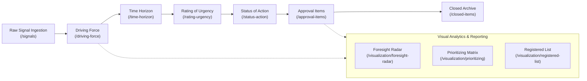

# Comprehensive Page Inventory — Foresight Radar

> **Role:** Senior Product Designer & UX Researcher  
> **Repository:** `roozylabs27/foresight-radar`  
> **Audit Date:** October 2026  
> **Total Evaluated Pages:** 15 distinct routes & viewports

---

## 1. Overview & Persona Profiles

Foresight Radar serves four distinct user personas across the strategic horizon scanning lifecycle:

| Persona | Role in Organization | Core Goal | Primary Views |
| :--- | :--- | :--- | :--- |
| **P1: Horizon Scanner (Junior Analyst)** | Scans external news, research papers, technology blogs, and regulatory announcements. | Ingest raw signals, extract quotes/data, and submit candidate items for team evaluation. | `/signals`, `/driving-force` |
| **P2: Strategic Analyst (Senior Foresight Analyst)** | Analyzes macro/mezzo trends, maps PESTLE dimensions, and conducts impact & uncertainty scoring. | Refine signals into Driving Forces, score Time Horizons, Rate Urgency, and propose Status Actions. | `/driving-force`, `/time-horizon`, `/rating-urgency`, `/status-action` |
| **P3: Executive Decision Maker (BOD / Director)** | Reviews high-level radar distributions, assesses organizational vulnerability, and allocates strategic resources. | Review prioritized items, approve or reject proposals, and consult the 360° radar canvas. | `/dashboard`, `/approval-items`, `/visualization/foresight-radar`, `/visualization/prioritizing` |
| **P4: Platform Administrator** | Manages organizational users, role-based access control, and master taxonomies. | Create/deactivate users, assign roles (BOD, Analyst, Admin), monitor system health. | `/user-management/user`, `/profile` |

---

## 2. Complete 15-Page Inventory Matrix

---

### Page 01: Authentication — Login
* **Route:** `/login` (`route("login")`)
* **Primary Persona:** All Users (P1, P2, P3, P4).
* **Main User Goal:** Securely authenticate into the platform using corporate email and password.
* **Most Important Information:** Work email input, password input, authentication feedback messages (error alerts).
* **Primary Action:** "Masuk ke Platform" (Submit button).
* **Secondary Actions:** "Lupa kata sandi?" link, "Ingat saya" checkbox, 3-slide value proposition carousel.
* **Shared Components:** Ant Design `<Form>`, `<Input>`, `<Button>`, `<Carousel>`, `<Alert>`.
* **Current Usability Risks:**
  1. Accessibility warning in browser console: `Incorrect use of <label for=FORM_ELEMENT> (count: 2)`.
  2. Hero carousel on left panel consumes 50% screen width on tablet/desktop but auto-scrolls without pause-on-hover controls.
* **Desktop vs Mobile:**
  - *Desktop (1440px):* Two-column split layout with branded dark illustration panel on left, clean login card on right.
  - *Mobile (375px):* Left marketing panel collapses; single-column form fills screen with adequate touch targets.

---

### Page 02: Authentication — Registration
* **Route:** `/register` (`route("register")`)
* **Primary Persona:** New Team Member / Analyst.
* **Main User Goal:** Register a new organizational account.
* **Most Important Information:** Name, Work Email, Password, Password Confirmation.
* **Primary Action:** "Daftar Akun" (Submit button).
* **Secondary Actions:** "Sudah punya akun? Masuk di sini" link.
* **Shared Components:** Ant Design `<Form>`, `<Input>`, `<Button>`, `<Card>`.
* **Current Usability Risks:**
  1. Open registration by default without domain whitelist validation (`@company.com`).
  2. Password complexity requirements (minimum length, symbols) are not visually communicated upfront; only surfaced upon failed submit.
* **Desktop vs Mobile:**
  - *Desktop:* Centered card layout.
  - *Mobile:* Full-width form stack; buttons are comfortably tap-friendly.

---

### Page 03: Executive Dashboard
* **Route:** `/dashboard` (`route("dashboard.")`)
* **Primary Persona:** P3 Executive Decision Maker & P2 Strategic Analyst.
* **Main User Goal:** Obtain an immediate high-level summary of active driving forces, urgent items, and radar ring distribution.
* **Most Important Information:** Analytical Filter Bar (Date range & Dimension), Tabular overview segmented into Prioritizing, Registered List, and Foresight Radar preview tabs.
* **Primary Action:** Filter by date range or specific dimension.
* **Secondary Actions:** Switch tabs (`Prioritizing`, `Registered List`, `Foresight Radar`), drill down to dedicated visualization views.
* **Shared Components:** `<AuthenticatedLayout>`, `<DatePicker.RangePicker>`, `<Select>`, `<Tabs>`, `<Table>`, `<PrioritizingChart>`.
* **Current Usability Risks:**
  1. **Tab Redundancy:** The three tabs in the dashboard simply embed previews of the three standalone visualization pages (`/visualization/*`), causing confused information hierarchy.
  2. **Lack of High-Level Metric Cards (KPIs):** No summary counter widgets (e.g., "Total Active SSignals: 19", "Pending Approval: 4", "High Urgency: 7") exist at the top of the dashboard.
* **Desktop vs Mobile:**
  - *Desktop:* Clean multi-tab card layout.
  - *Mobile:* Tabs overflow horizontally without scroll indicators; date picker overflows container width.

---

### Page 04: Signal Ingestion Workspace
* **Route:** `/signals` (`route("signals.index")`)
* **Primary Persona:** P1 Horizon Scanner & P2 Strategic Analyst.
* **Main User Goal:** Ingest raw external signals (articles, PDFs, URLs) and triage candidate signals before graduating them into driving forces.
* **Most Important Information:** Candidate Review Queue table, Signal Title & Evidence quote, Taxonomy & Dimension, Assessment & Confidence scores, Review Status tag.
* **Primary Action:** "Ingest New" (opens ingestion tab/drawer) and "Approve/Graduate" candidate signal.
* **Secondary Actions:** Search query textbox, Review Status dropdown filter, Dimension filter, "Reject/Archive" signal.
* **Shared Components:** `<AuthenticatedLayout>`, `<Breadcrumb>`, `<Tabs>`, `<Table>`, `<Select>`, `<Input.Search>`, `<Button>`, `<Tag>`, `<Badge>`.
* **Current Usability Risks:**
  1. Ingestion form is separated into a secondary tab rather than a streamlined modal or drawer, breaking scanning momentum.
  2. Table columns lack responsive collapse; on viewports < 1200px, evidence excerpts cause aggressive cell line wraps.
* **Desktop vs Mobile:**
  - *Desktop:* Wide multi-column layout with status badges.
  - *Mobile:* Severe horizontal scrolling; action buttons require horizontal scroll to reach.

---

### Page 05: Driving Force Repository
* **Route:** `/driving-force` (`route("driving-force.")`)
* **Primary Persona:** P2 Strategic Analyst.
* **Main User Goal:** Manage formalized driving forces, create new items, view signal provenance, and track lifecycle stage.
* **Most Important Information:** Keyword, Dimension, Description, Personal in Charge (PIC), Signals provenance link, Pipeline Stage tag ("Approved", "Pending").
* **Primary Action:** "Tambah Sinyal" (Opens multi-field modal form).
* **Secondary Actions:** Search keyword input, Dimension filter, Date range filter, Action popover (Edit, Delete, View Signals Provenance drawer).
* **Shared Components:** `<AuthenticatedLayout>`, `<DatePicker.RangePicker>`, `<Select>`, `<Input.Search>`, `<Button>`, `<Table>`, `<Tag>`, `<Modal>`, `<Drawer>`, `<Popconfirm>`.
* **Current Usability Risks:**
  1. **Terminology Confusion:** The button says "Tambah Sinyal" (Add Signal), but the page is "Driving Force" and the modal title is "Create Signal Changes", mixing up Signals with Driving Forces.
  2. **Modal Form Cognitive Load:** Creating a Driving Force requires picking Dimension, Keyword, Description, and PIC in an unassisted form without guidance on what constitutes a valid Driving Force.
* **Desktop vs Mobile:**
  - *Desktop:* Well-spaced table with ellipsis overflow tooltips.
  - *Mobile:* Collapsed 64px Sider squeezes the 7-column table into 311px, requiring deep horizontal scrolling.

---

### Page 06: Time Horizon Assessment
* **Route:** `/time-horizon` (`route("time-horizon.")`)
* **Primary Persona:** P2 Strategic Analyst.
* **Main User Goal:** Assess and assign strategic time horizons (Short Term <1yr, Mid Term 1-3yrs, Long Term >3yrs) for each driving force.
* **Most Important Information:** Keyword, Short Term checkbox/radio, Mid Term checkbox/radio, Long Term checkbox/radio, Assigned Horizon status.
* **Primary Action:** Select horizon column for each item and save assessment.
* **Secondary Actions:** Filter by date or dimension.
* **Shared Components:** `<AuthenticatedLayout>`, `<FilterToolbar>`, `<Table>`, `<Radio.Group>`.
* **Current Usability Risks:**
  1. **Lack of Inline Feedback:** When a user selects a horizon, it is not immediately clear whether changes auto-save or require a batch "Submit Assessments" action.
  2. **Header Visual Density:** The multi-tier table header ("TIME HORIZON ▶ OVERALL") uses uppercase micro-text that lacks visual breathing room.
* **Desktop vs Mobile:**
  - *Desktop:* Clean 5-column matrix layout.
  - *Mobile:* Column headers clip; radio buttons require precise tapping in tight table cells.

---

### Page 07: Rating of Urgency
* **Route:** `/rating-urgency` (`route("rating-urgency.")`)
* **Primary Persona:** P2 Strategic Analyst.
* **Main User Goal:** Evaluate each driving force across two strategic dimensions: **Uncertainty** (1-10) and **Impact** (1-10) to determine urgency.
* **Most Important Information:** Driving Force Keyword, Dimension, Uncertainty score (1-10), Impact score (1-10), Calculated Urgency Priority (High / Medium / Low).
* **Primary Action:** Score Uncertainty and Impact via numeric steppers or dropdowns.
* **Secondary Actions:** Filter by period or dimension.
* **Shared Components:** `<AuthenticatedLayout>`, `<FilterToolbar>`, `<Table>`, `<InputNumber>`, `<Tag>`.
* **Current Usability Risks:**
  1. **Unclear Scoring Methodology:** No tooltip or guidance modal explains what "1" vs "10" represents (e.g., 1 = Negligible, 10 = Existential Threat).
  2. **Calculation Opacity:** The formula determining how Uncertainty and Impact combine into "High", "Medium", or "Low" priority is completely hidden from the analyst.
* **Desktop vs Mobile:**
  - *Desktop:* 2-level grouped table header ("RATING -> Uncertainty / Impact").
  - *Mobile:* Number inputs are difficult to adjust via mobile touch keyboards.

---

### Page 08: Status of Action
* **Route:** `/status-action` (`route("status-action.")`)
* **Primary Persona:** P2 Strategic Analyst & P3 Executive BOD.
* **Main User Goal:** Determine strategic corporate response: **Monitoring** (passive observation) vs **Decided Plan** (active resource allocation/initiative).
* **Most Important Information:** Driving Force Keyword, Monitoring indicator, Decided Plan indicator, Strategic Action rationale.
* **Primary Action:** Assign Action status and input operational rationale.
* **Secondary Actions:** Period and dimension filtering.
* **Shared Components:** `<AuthenticatedLayout>`, `<FilterToolbar>`, `<Table>`, `<Radio>`, `<Modal>`.
* **Current Usability Risks:**
  1. Rationale input is buried in a secondary dialog rather than being directly editable inline.
  2. Visual indicators use non-standard symbols (`∆` and `O`) that are unfamiliar to international foresight practitioners without a persistent legend.
* **Desktop vs Mobile:**
  - *Desktop:* Structured table with action indicators.
  - *Mobile:* Rationale modal overflows screen width.

---

### Page 09: Approval Items Gate
* **Route:** `/approval-items` (`route("approval-items.")`)
* **Primary Persona:** P3 Executive Decision Maker (BOD / Executive Director).
* **Main User Goal:** Review completed driving force assessments (Time Horizon + Urgency + Status Action) and officially approve or reject them.
* **Most Important Information:** Comprehensive 12-column record: Date, Dimension, Keyword, Description, PIC, Horizon, Priority, Uncertainty, Impact, Status, Status Action, Reason.
* **Primary Action:** "Approve" (Green button) and "Reject" (Red button) per item.
* **Secondary Actions:** Batch approve selected rows, search keyword, filter by period.
* **Shared Components:** `<AuthenticatedLayout>`, `<Table>`, `.custom-green-button`, `.custom-red-button`, `<Popconfirm>`.
* **Current Usability Risks:**
  1. **Information Overload:** 12 columns in a single table make executive scanning exhausting; horizontal scrolling is mandatory even on a 1920x1080 display.
  2. **No Summary Diff:** When an item is modified, the BOD member cannot see what changed from the previous assessment iteration.
* **Desktop vs Mobile:**
  - *Desktop:* Wide dense table with 12 columns.
  - *Mobile:* Severe usability failure; horizontal scroll exceeds 1800px on a 375px screen.

---

### Page 10: Closed Items Archive
* **Route:** `/closed-items` (`route("closed-items.")`)
* **Primary Persona:** P2 Strategic Analyst & P3 Executive Decision Maker.
* **Main User Goal:** Access the historical archive of finalized and closed strategic foresight items for past horizon auditing.
* **Most Important Information:** Full historical item record with final decision rationale and archived date.
* **Primary Action:** Filter and search archived records.
* **Secondary Actions:** Export archived dataset.
* **Shared Components:** `<AuthenticatedLayout>`, `<Table>`, `<FilterToolbar>`, `<Input.Search>`.
* **Current Usability Risks:**
  - Read-only table shares identical visual design with active workflow tables, lacking a distinct "Archived" watermark or visual cue.
* **Desktop vs Mobile:**
  - Same wide-table constraints as Approval Items.

---

### Page 11: Prioritizing Matrix
* **Route:** `/visualization/prioritizing` (`route("visualization.prioritizing.")`)
* **Primary Persona:** P3 Executive Decision Maker & P2 Strategic Analyst.
* **Main User Goal:** Visually explore driving forces plotted on a 2D matrix (Urgency vs Impact) to identify critical strategic clusters.
* **Most Important Information:** Apache ECharts scatter plot, 4 quadrants, hover tooltips showing Driving Force details.
* **Primary Action:** Hover over scatter points to inspect driving force metadata.
* **Secondary Actions:** Filter by dimension, date period.
* **Shared Components:** `<AuthenticatedLayout>`, `<FilterToolbar>`, `<PrioritizingChart>` (`echarts-for-react`).
* **Current Usability Risks:**
  1. **Tooltip Overlap:** In dense clusters of driving forces, scatter points overlap, making individual item tooltips difficult to trigger.
  2. **Lack of Interactive Cross-Filtering:** Clicking a scatter dot does not filter the tabular list below or navigate to the item's detail page.
* **Desktop vs Mobile:**
  - *Desktop:* Large 600px height responsive ECharts canvas.
  - *Mobile:* Chart scales down, but scatter point tap radius is too small for mobile touch targets (finger tap targets < 44px).

---

### Page 12: Registered List & Reporting
* **Route:** `/visualization/registered-list` (`route("visualization.registered-list.")`)
* **Primary Persona:** P2 Strategic Analyst & P3 Executive Decision Maker.
* **Main User Goal:** View a consolidated corporate register of all foresight items and export the audited ledger to Microsoft Excel.
* **Most Important Information:** Comprehensive multi-dimensional table, Segmented view toggles ("Overall" vs "Detail Info"), Excel Export button.
* **Primary Action:** "Export to Excel" (Client-side SheetJS / server streaming).
* **Secondary Actions:** Toggle between "Overall" and "Detail Info" views; filter by Horizon, Priority, Status.
* **Shared Components:** `<AuthenticatedLayout>`, `<Radio.Group>`, `<Button>`, `<Table>`, `<Select>`, `<DatePicker.RangePicker>`.
* **Current Usability Risks:**
  1. "Export to Excel" button displays a loading spinner during export without a percent progress indicator for large datasets.
  2. The multi-level table header requires 3 rows of headers, reducing vertical data space on smaller screens.
* **Desktop vs Mobile:**
  - *Desktop:* Clean structured executive report view.
  - *Mobile:* Radio buttons wrap awkwardly above table; export button takes 100% width.

---

### Page 13: 360° Foresight Radar
* **Route:** `/visualization/foresight-radar` (`route("visualization.foresight-radar.")`)
* **Primary Persona:** P3 Executive Decision Maker & Corporate Strategy Leadership.
* **Main User Goal:** Visualizing organizational horizons in a 360-degree circular radar chart divided into taxonomy wedges and concentric time-horizon rings.
* **Most Important Information:**
  - Circular radar canvas with 3 concentric rings: Short Term (inner/urgent), Mid Term (middle), Long Term (outer).
  - Categorical dimension wedges (Economy, Technology, Ecology, Regulation, etc.).
  - Side-by-side tabular signal list with priority pills and info drawer modals.
* **Primary Action:** "Layar Penuh" (Toggle Fullscreen presentation mode for BOD meetings).
* **Secondary Actions:** Filter by period/dimension, click signal row to highlight radar point, click "info-circle" for deep modal info.
* **Shared Components:** `<AuthenticatedLayout>`, `<Radar>` (HTML5 Canvas/SVG), `.radar-filter-bar`, `.radar-card`, `.radar-table-row`.
* **Current Usability Risks:**
  1. **Canvas Resizing Glitch:** Switching to fullscreen mode occasionally requires a window resize event to redraw the canvas coordinate map correctly.
  2. **Mobile Pinched Viewport:** On mobile viewports, the dual-column layout (Table + Radar) stacks vertically, but the Canvas retains a fixed minimum width, causing off-screen canvas clipping.
* **Desktop vs Mobile:**
  - *Desktop:* Outstanding presentation-grade visual experience with synchronized row hover highlighting.
  - *Mobile:* Severe canvas clipping; legend wraps across 4 rows.

---

### Page 14: User Management
* **Route:** `/user-management/user` (`route("user-management.user.")`)
* **Primary Persona:** P4 Platform Administrator.
* **Main User Goal:** Administer system users, invite analysts, assign roles (BOD, Super Admin, Developer), and manage account status.
* **Most Important Information:** User Name, Email, Role/Division, Created Date, Action buttons (Edit, Delete, Permissions).
* **Primary Action:** "Tambah Pengguna" (Add User button).
* **Secondary Actions:** Search users input, Edit user role, Delete user popconfirm.
* **Shared Components:** `<AuthenticatedLayout>`, `<Table>`, `<Button>`, `<Modal>`, `<Select>`.
* **Current Usability Risks:**
  1. **Copy-Paste Filter Remnant:** Renders a "Filter Analisis: Periode: [Start Date] - [End Date]" bar identical to the foresight analytical pages, which has zero relevance to user accounts.
  2. **Role Assignment Clarity:** Assigning Spatie permissions vs roles is opaque in the modal form.
* **Desktop vs Mobile:**
  - *Desktop:* Standard administrative data table.
  - *Mobile:* Action buttons stack vertically inside table cells.

---

### Page 15: User Profile & Security Settings
* **Route:** `/profile` (`route("profile.edit")`)
* **Primary Persona:** All Users.
* **Main User Goal:** Update personal display name, email, change password, and manage account lifecycle.
* **Most Important Information:** User avatar, current role badge, personal details form, update password form, account deletion warning.
* **Primary Action:** "Simpan Perubahan" (Save Profile) and "Simpan Kata Sandi" (Save Password).
* **Secondary Actions:** "Hapus Akun Ini" (Delete Account) danger button.
* **Shared Components:** `<AuthenticatedLayout>`, `<Form>`, `<Input.Password>`, `<Button>`, `<Avatar>`, `<Badge>`, `<Card>`.
* **Current Usability Risks:**
  1. "Hapus Akun" danger zone lacks a secondary confirmation modal requiring user password re-entry.
* **Desktop vs Mobile:**
  - Both viewports render cleanly with vertical stacked cards.
