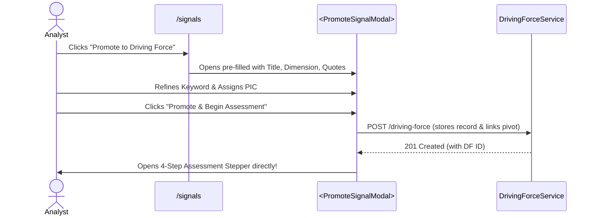
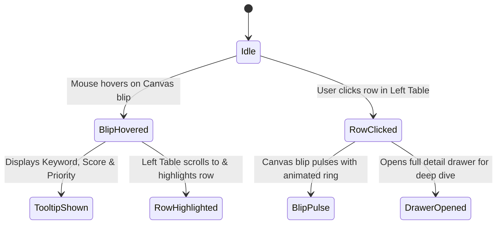

# Frontend Architecture & UI/UX Redesign Recommendations — Foresight Radar

> **Role:** Staff Frontend Engineer, Design Systems Architect & Senior Product Designer  
> **Repository:** `roozylabs27/foresight-radar`  
> **Audit Date:** October 2026  
> **Target Scope:** Component Abstractions, Centralized Theming, Workflow Modernization, and Responsive Ergonomics

---

## 1. Executive Summary

Based on empirical evidence gathered during the UI/UX discovery audit, this document presents actionable architectural specifications to elevate Foresight Radar to enterprise production standards. Rather than proposing a disruptive total redesign, these recommendations introduce **clean component abstractions, centralized token governance, and streamlined workflow steppers** that preserve all existing backend business logic while dramatically improving analyst productivity and visual polish.

---

## 2. Centralized Design System & Token Architecture

### 2.1 Proposed Theme Configuration (`resources/js/Theme/theme.js`)

Centralize all tokens into a single authoritative design system definition:

```javascript
// resources/js/Theme/theme.js
import { theme } from "antd";

export const appTheme = {
    token: {
        colorPrimary: "#1677ff",
        colorSuccess: "#52c41a",
        colorWarning: "#faad14",
        colorError: "#ff4d4f",
        colorInfo: "#1677ff",
        borderRadius: 8,
        wireframe: false,
        fontFamily:
            "'Figtree', -apple-system, BlinkMacSystemFont, 'Segoe UI', Roboto, 'Helvetica Neue', Arial, sans-serif",
        fontSize: 14,
        colorTextHeading: "#001529",
        colorText: "#262626",
        colorTextSecondary: "#595959", // Meets WCAG 2.1 AA 4.5:1 ratio
    },
    components: {
        Layout: {
            headerBg: "#ffffff",
            headerHeight: 64,
            headerPadding: "0 24px",
            siderBg: "#ffffff",
            bodyBg: "#f8fafc",
            footerBg: "transparent",
            footerPadding: "16px 24px",
        },
        Button: {
            borderRadius: 6,
            controlHeight: 38,
            fontWeight: 500,
        },
        Table: {
            headerBg: "#fafafa",
            headerColor: "#262626",
            headerSplitColor: "#f0f0f0",
            rowHoverBg: "#f6f8fb",
            borderRadiusLG: 8,
        },
        Card: {
            borderRadiusLG: 12,
            boxShadowTertiary:
                "0 1px 3px 0 rgba(0, 0, 0, 0.05), 0 1px 2px 0 rgba(0, 0, 0, 0.03)",
        },
        Tag: {
            borderRadiusSM: 4,
            defaultBg: "#f5f5f5",
        },
    },
};
```

### 2.2 Global Provider Mounting (`resources/js/app.jsx`)

Mount `ConfigProvider` globally at the Inertia root so that all page components, modals, and notifications inherit the theme uniformly:

```jsx
// resources/js/app.jsx
import { ConfigProvider, App as AntdApp } from 'antd';
import { appTheme } from './Theme/theme';

createInertiaApp({
    title: (title) => `${title} - ${appName}`,
    resolve: (name) => resolvePageComponent(`./Pages/${name}.jsx`, import.meta.glob('./Pages/**/*.jsx')),
    setup({ el, App, props }) {
        const root = createRoot(el);
        root.render(
            <ConfigProvider theme={appTheme}>
                <AntdApp>
                    <App {...props} />
                </AntdApp>
            </ConfigProvider>
        );
    },
});
```

---

## 3. Core Component Abstractions

To eliminate boilerplate across the 15 routes, four core domain components must be created in `resources/js/Components/Common/`:

### 3.1 `<PageHeader>` Component
Unifies top banners, breadcrumbs, icons, titles, and action triggers.

```jsx
// resources/js/Components/Common/PageHeader.jsx
import React from "react";
import { Flex, Typography, Breadcrumb, Space } from "antd";

const { Title, Text } = Typography;

export default function PageHeader({ icon, title, subtitle, breadcrumbs, actions }) {
    return (
        <div style={{ marginBottom: 16 }}>
            {breadcrumbs && (
                <Breadcrumb items={breadcrumbs} style={{ marginBottom: 8, fontSize: 13 }} />
            )}
            <Flex justify="space-between" align="center" wrap="wrap" gap="small">
                <Flex align="center" gap="middle">
                    {icon && (
                        <div style={{
                            width: 40,
                            height: 40,
                            borderRadius: 8,
                            background: "#e6f4ff",
                            color: "#1677ff",
                            display: "flex",
                            alignItems: "center",
                            justifyContent: "center",
                            fontSize: 20
                        }}>
                            {icon}
                        </div>
                    )}
                    <div>
                        <Title level={4} style={{ margin: 0, lineHeight: 1.2 }}>{title}</Title>
                        {subtitle && <Text type="secondary" style={{ fontSize: 13 }}>{subtitle}</Text>}
                    </div>
                </Flex>
                {actions && <Space>{actions}</Space>}
            </Flex>
        </div>
    );
}
```

---

### 3.2 `<FilterToolbar>` Component
Consolidates the duplicated 8-page Date Range + Dimension dropdown filter:

```jsx
// resources/js/Components/Common/FilterToolbar.jsx
import React from "react";
import { Card, DatePicker, Select, Input, Row, Col, Space, Typography } from "antd";
import { FilterOutlined, CalendarOutlined, AppstoreOutlined } from "@ant-design/icons";

const { RangePicker } = DatePicker;
const { Text } = Typography;

export default function FilterToolbar({
    dateRange,
    onDateChange,
    dimensions,
    selectedDimension,
    onDimensionChange,
    searchQuery,
    onSearchChange,
    extraFilters,
    loading
}) {
    return (
        <Card size="small" style={{ marginBottom: 16, borderRadius: 8 }}>
            <Row gutter={[12, 12]} align="middle">
                <Col xs={24} sm={12} md={8} lg={6}>
                    <Space direction="vertical" size={2} style={{ width: "100%" }}>
                        <Text type="secondary" style={{ fontSize: 12 }}>
                            <CalendarOutlined style={{ marginRight: 4 }} /> Periode Analisis:
                        </Text>
                        <RangePicker
                            value={dateRange}
                            onChange={onDateChange}
                            style={{ width: "100%" }}
                            disabled={loading}
                        />
                    </Space>
                </Col>

                {dimensions && (
                    <Col xs={24} sm={12} md={6} lg={5}>
                        <Space direction="vertical" size={2} style={{ width: "100%" }}>
                            <Text type="secondary" style={{ fontSize: 12 }}>
                                <AppstoreOutlined style={{ marginRight: 4 }} /> Dimensi:
                            </Text>
                            <Select
                                value={selectedDimension}
                                onChange={onDimensionChange}
                                options={[{ value: null, label: "Semua Dimensi" }, ...dimensions]}
                                style={{ width: "100%" }}
                                placeholder="Pilih Dimensi"
                                disabled={loading}
                            />
                        </Space>
                    </Col>
                )}

                {onSearchChange && (
                    <Col xs={24} sm={12} md={6} lg={6}>
                        <Space direction="vertical" size={2} style={{ width: "100%" }}>
                            <Text type="secondary" style={{ fontSize: 12 }}>Pencarian:</Text>
                            <Input.Search
                                placeholder="Cari kata kunci..."
                                value={searchQuery}
                                onChange={(e) => onSearchChange(e.target.value)}
                                allowClear
                                disabled={loading}
                            />
                        </Space>
                    </Col>
                )}

                {extraFilters && (
                    <Col xs={24} lg={7} style={{ textAlign: "right" }}>
                        {extraFilters}
                    </Col>
                )}
            </Row>
        </Card>
    );
}
```

---

### 3.3 `<StatusBadge>` Semantic Component
Standardizes status pills, eliminating cryptic symbols (`∆`, `O`) and ad-hoc background colors:

```jsx
// resources/js/Components/Common/StatusBadge.jsx
import React from "react";
import { Tag, Tooltip } from "antd";
import { CheckCircleOutlined, EyeOutlined, ClockCircleOutlined, FireOutlined } from "@ant-design/icons";

export function StatusBadge({ type, value }) {
    switch (type) {
        case "priority":
            const priorityConfig = {
                high: { color: "red", label: "High Priority" },
                medium: { color: "gold", label: "Medium Priority" },
                low: { color: "green", label: "Low Priority" },
            };
            const p = priorityConfig[value?.toLowerCase()] || { color: "default", label: value };
            return <Tag color={p.color}>{p.label}</Tag>;

        case "horizon":
            const horizonConfig = {
                short: { color: "red", label: "Short Term (0 - 1 yr)" },
                mid: { color: "gold", label: "Mid Term (1 - 3 yrs)" },
                long: { color: "green", label: "Long Term (> 3 yrs)" },
            };
            const h = horizonConfig[value?.toLowerCase()] || { color: "default", label: value };
            return <Tag color={h.color}>{h.label}</Tag>;

        case "status_action":
            if (value === "DECIDED_PLAN" || value === "∆") {
                return (
                    <Tooltip title="Decided Plan: Rencana aksi strategis yang telah disetujui">
                        <Tag color="blue" icon={<CheckCircleOutlined />}>Decided Plan</Tag>
                    </Tooltip>
                );
            }
            return (
                <Tooltip title="Monitoring: Pemantauan berkala tanpa alokasi sumber daya langsung">
                    <Tag color="orange" icon={<EyeOutlined />}>Monitoring</Tag>
                </Tooltip>
            );

        case "lifecycle":
            const lifecycleColors = {
                APPROVED: "success",
                PENDING: "processing",
                REJECTED: "error",
                CLOSED: "default",
            };
            return <Tag color={lifecycleColors[value] || "default"}>{value}</Tag>;

        default:
            return <Tag>{value}</Tag>;
    }
}
```

---

## 4. Key Strategic Workflow Redesigns

### 4.1 One-Click Signal-to-Driving-Force Graduation Modal



* **Enhancement:** Bridges the gap identified in `UX-001`. Eliminates re-typing and guarantees that every formalized Driving Force maintains traceable digital provenance to its source publication.

---

### 4.2 Integrated 4-Step Assessment Drawer

Instead of forcing the analyst to visit 4 separate pages (`/driving-force` &rarr; `/time-horizon` &rarr; `/rating-urgency` &rarr; `/status-action`), provide an Ant Design `<Drawer width={720}>` featuring `<Steps>`:

```
[ Step 1: Info ] ===> [ Step 2: Horizon ] ===> [ Step 3: Urgency ] ===> [ Step 4: Action ]
  - Dimension           - Short Term (<1yr)      - Uncertainty (1-10)     - Monitoring
  - Keyword             - Mid Term (1-3yrs)      - Impact (1-10)          - Decided Plan
  - Description         - Long Term (>3yrs)      - Dynamic Priority       - Operational Rationale
```

* **Outcome:** The analyst completes the entire scoring pipeline for an item in a single focused session under 2 minutes.

---

### 4.3 Executive Approval Table Overhaul

Transform the unmanageable 12-column table (`UX-008`) into an executive-first layout:
1. **Primary Visible Columns:** `[Dimension | Keyword | Horizon Badge | Priority Badge | Status Action Badge | Decision Actions]`.
2. **Sticky Right Column:** "Approve" (Green) and "Reject" (Red) buttons are pinned to the right edge with permanent visibility.
3. **Expandable Row Panel (`expandedRowRender`):**
   - Left side: Full item description and source quotes.
   - Middle side: Uncertainty & Impact rubric breakdown.
   - Right side: Proposed Strategic Action rationale.

---

### 4.4 Bidirectional Interactive 360° Radar



* **Enhancement:** Solves `UX-009`. Enables fluid, high-engagement presentations during executive board of directors sessions.

---

## 5. Cross-Device Responsive Architecture

### 5.1 Mobile Navigation Drawer Pattern
On viewports &le; `768px`:
- Sider collapses to `0px` width (`collapsedWidth={0}`).
- Main content occupies 100% viewport width without horizontal compression.
- Tapping the hamburger button opens a smooth Ant Design overlay `<Drawer placement="left" closable>` displaying the navigation menu.

### 5.2 Mobile Responsive Table Fallback
On screens &le; `576px`:
- Standard Ant Design tables automatically reflow into a clean list of interactive cards using CSS grid or conditional component rendering (`<Table>` on desktop, `<List>` with `<Card>` on mobile).
- Action buttons expand to 100% width with minimum 44px tap targets.
